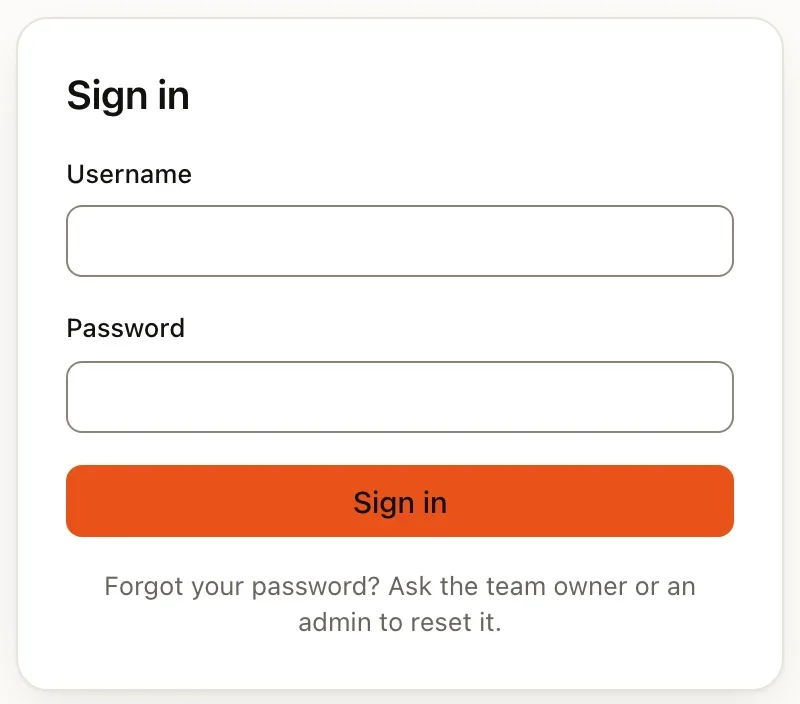
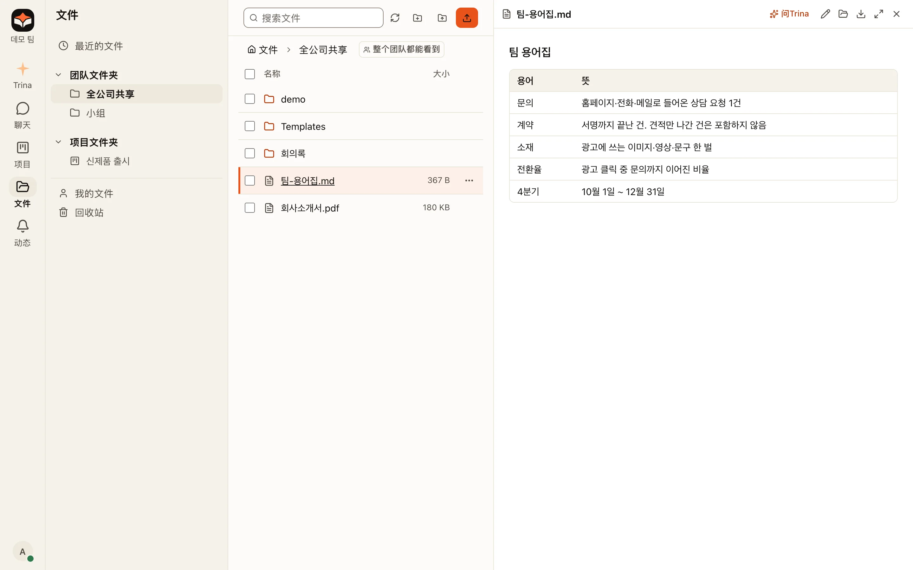

演示会启动一个带有六个入门技能的虚构团队。AI 是关闭的，所以你不需要 AI 账号。

:::warning
演示不是正式安装。它没有操作系统级隔离。只使用虚构数据。
:::

## 开始之前

| 你需要 | 版本 |
|---|---|
| macOS 或 Linux | Windows 用户在浏览器中打开准备好的服务器 |
| Git | 任何较新版本 |
| Bun | 1.3.12（CI 固定的版本） |
| Go | 1.27 或更新 |
| 本地编译工具 | macOS 上的 Xcode 命令行工具 |
| 一个空闲端口 | 19760 |

## 启动演示

:::steps
#### 克隆并安装
```sh
git clone https://github.com/trina-app/trina-ax.git
cd trina-ax
bun install --frozen-lockfile
```

#### 启动演示
```sh
bun run demo
```
让这个终端保持运行。它会编译，在 http://127.0.0.1:19760 上启动，并填入虚构团队。

#### 登录
打开 http://127.0.0.1:19760，用 `alice` 和 `teamax-demo-1` 登录。其他账号是 `bob`、`admin1` 和所有者 `dion`。密码是有意公开的。



#### 检查文件夹权限
打开 **文件 → 全公司共享（Company-wide） → 팀-용어집.md**。然后在无痕窗口中以 `bob` 登录。Bob 能看到财务小组，但看不到市场小组。


:::

:::tip
使用 `127.0.0.1`，不要用 `localhost`。它们是不同的 cookie 来源，所以会反复要求登录。
:::

## 更进一步

演示是最快的开始方式。想要更多时，从下面选一个。

:::tabs
@tab 端口和语言
选择另一个端口、一个新的数据文件夹和韩语界面：

```sh
bun run demo --port 19761 --data "$HOME/.trina-evaluation-new" --locale ko
```

数据文件夹必须还不存在。端口被占用或文件夹已存在时会被拒绝。

@tab 试用 AI
演示无法调用 AI。如果想要一个使用你自己的 Claude Code 或 Codex 登录的开发服务器，请先停止演示，然后运行：

```sh
TEAM_AX_DEV_DIR="$HOME/.trina-ai-evaluation-new" TEAM_AX_DEV_PORT=19761 bun run dev --no-relay
# In a second terminal, before you create a team:
TEAM_AX_DEV_DIR="$HOME/.trina-ai-evaluation-new" bun run demo:seed --base http://127.0.0.1:19761
```

:::warning
在开发模式下，引擎以你的操作系统用户身份运行，没有正式环境的隔离。只连接你可以这样使用的账号。
:::

@tab 在你的 tailnet 上共享
要让你 Tailscale 网络上的同事点开预览看看，请运行一个关闭 AI、并额外允许一个来源的开发服务器。

:::steps
#### 写一个关闭 AI 的配置
把它保存为 `preview.json`，放在一个新的、路径较短的文件夹中，例如 `~/.trina-preview`。它和演示写入的配置相同。
```json
{"mode":"dev","listen":{"host":"127.0.0.1","port":19780},
 "engine":{"authMode":"local-login","claudeBin":"/nonexistent/trina-demo-no-ai","codexBin":""},
 "relay":{"url":null,"officialAvailable":false},"update":{"feedUrl":null,"auto":false}}
```

#### 用你的 tailnet 来源启动服务器
把 `<your-tailnet-host>` 换成这台机器的 Tailscale 名称。
```sh
MYCEL_CONFIG="$HOME/.trina-preview/preview.json" MYCEL_HOST=127.0.0.1 \
TEAM_AX_DEV_DIR="$HOME/.trina-preview" TEAM_AX_DEV_PORT=19780 \
MYCEL_PUBLIC_ORIGINS="https://<your-tailnet-host>:8443,http://127.0.0.1:19780" \
bun scripts/dev.ts --no-relay
```

#### 填入虚构团队
```sh
TEAM_AX_DEV_DIR="$HOME/.trina-preview" bun run demo:seed --base http://127.0.0.1:19780
```

#### 只在 tailnet 上提供
```sh
tailscale serve --bg --https=8443 http://127.0.0.1:19780
```
使用 `tailscale serve`，绝不要用 `tailscale funnel`：funnel 会把它公开到互联网上。

#### 修改演示密码
演示密码是公开的。在分享地址之前，为每个账号修改密码。
:::

停止方法：在服务器终端中按 Ctrl-C，然后运行 `tailscale serve --https=8443 off`。
:::

## 下一步

:::cards cols=2
- icon=book-open | [核心概念](key-concepts.md) | 这些文档其余部分使用的词。
- icon=terminal | [本地开发（英文）](../../develop/local-development.md) | 编译、测试和修改代码。
:::
