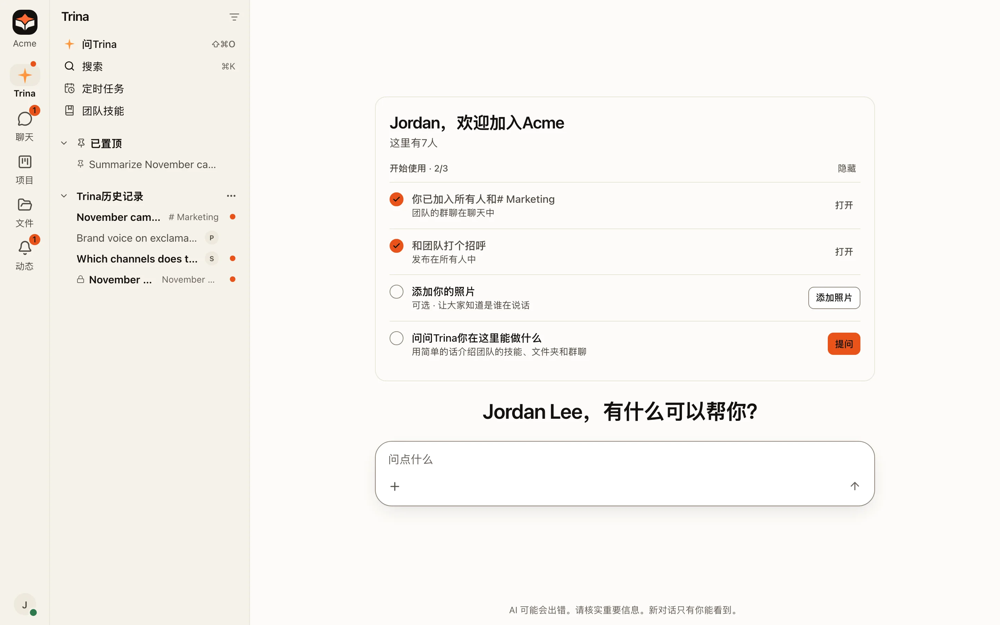

:::note
只想试一试？运行[本地演示](get-started/quickstart.md)。它不需要 AI 账号。
:::

Trina AX 是一个公司 AI 工作空间。你在服务器上设置一次 Claude Code，所有人都通过浏览器使用它。

| | 含义 |
|---|---|
| **一台服务器** | Claude Code 和 Codex 运行在你们的服务器上，而不是每台笔记本电脑上。 |
| **你们的文件** | AI 使用团队文件夹工作：`shared/`、`groups/`、`projects/` 和个人文件夹。 |
| **团队技能** | 一个 `SKILL.md` 文件把团队的工作方法变成可重复使用的指令。 |
| **权限** | AI 打开的每个文件，服务器都会以提问者的身份检查。 |

---

## 新开发者的推荐路线

:::steps
#### 运行演示
在你的电脑上启动一个虚构团队，大约需要 10 分钟。[前往快速入门](get-started/quickstart.md)。

#### 了解常用词
团队、小组、文件夹、技能、引擎和 MCP，一页看完。[阅读核心概念](get-started/key-concepts.md)。

#### 看看各部分如何配合
服务器、网页应用、引擎和权限检查。[阅读架构说明](../develop/architecture.md)（英文）。

#### 做出第一次修改
搭建开发服务器，运行检查，然后提交 pull request。[阅读本地开发指南](../develop/local-development.md)（英文）。

#### 交给团队使用
选择托管、Linux 服务器或办公室的 Mac。[比较各种部署方式](../operate/install.md)（英文）。
:::

---

## 用 Trina AX 开发

:::cards cols=3
- icon=code | [开发者指南（英文）](../develop/architecture.md) | 架构、仓库结构、测试和约定。
- icon=bot | [面向 AI 智能体（英文）](../agents/overview.md) | 编程智能体的规则，以及 AI 在 Trina AX 中如何工作。
- icon=braces | [HTTP API（英文）](../reference/http-api.md) | 按领域分组的所有接口，以及谁可以调用。
:::

## 主要功能

:::cards cols=2
- icon=folder-lock | [文件和权限](use/files-and-permissions.md) | 每个人和他们的 AI 只能看到自己可以打开的文件夹。
- icon=book-open | [团队技能](use/team-skills.md) | 可重复使用的指令，像文件一样管理。
- icon=plug | [MCP 连接](use/mcp.md) | 让 AI 使用 Notion、Linear 等服务。
- icon=clock | [定时任务](use/scheduled-tasks.md) | 只需交代一次，AI 就会重复完成工作。
:::

## 支持

:::cards cols=2
- icon=life-buoy | [支持（英文）](../resources/support.md) | 在哪里提问、报告问题或发送安全报告。
- icon=wrench | [故障排除（英文）](../operate/troubleshooting.md) | 按症状列出的常见问题解决方法。
:::
