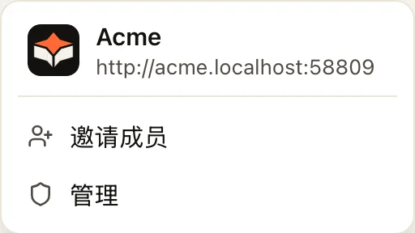
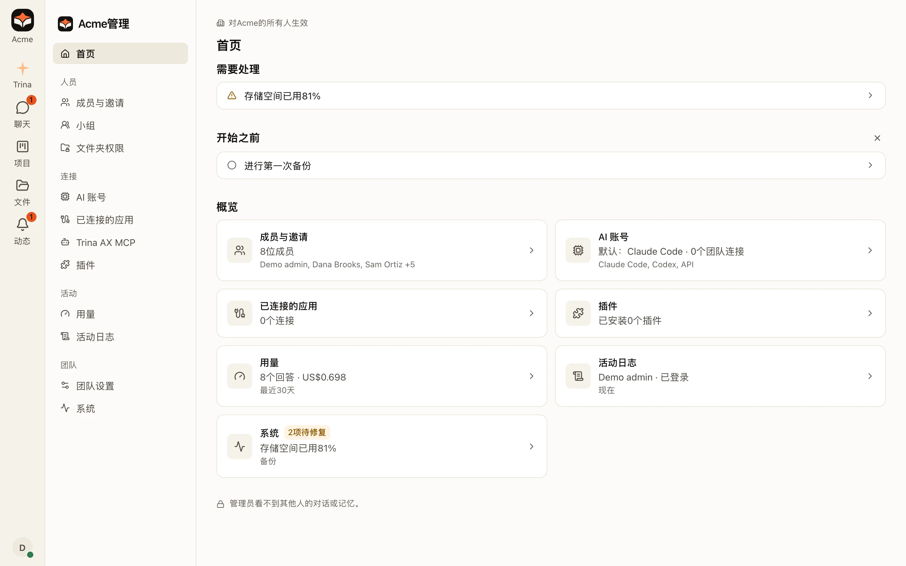
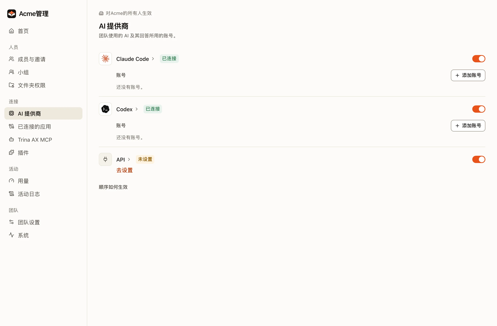
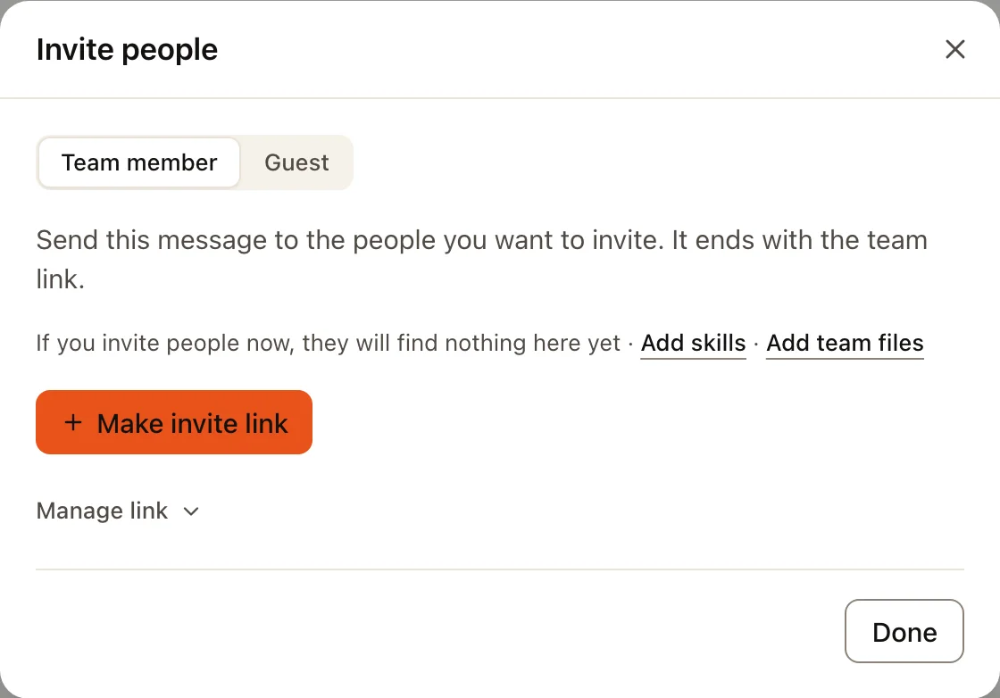
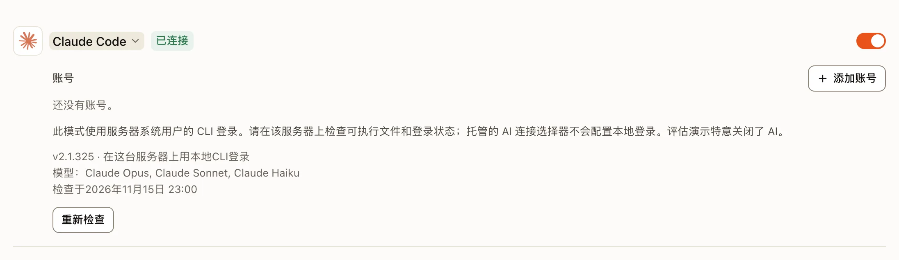
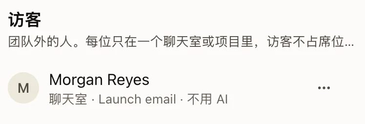
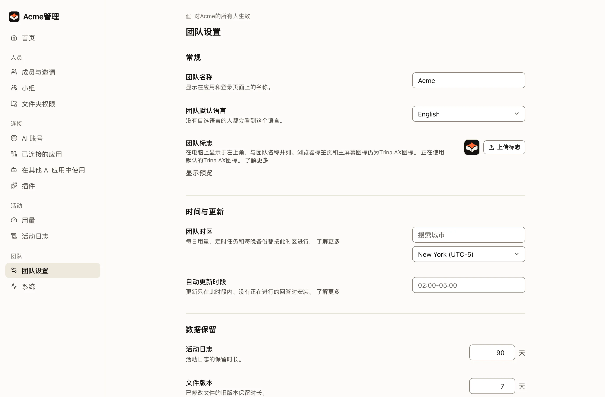
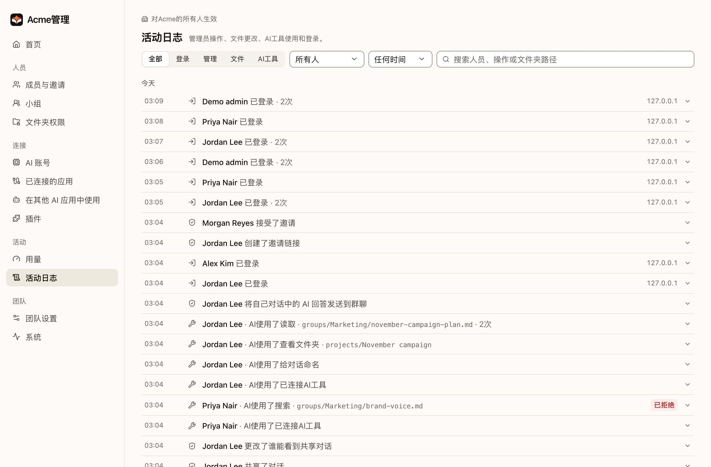
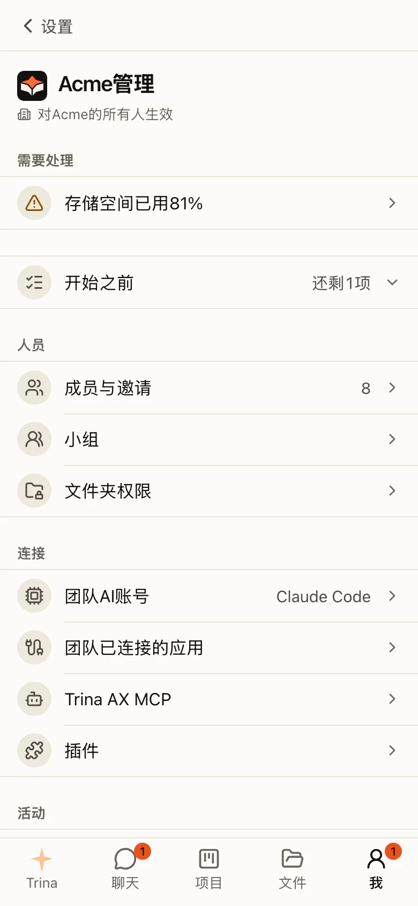

**管理**供所有者和管理员使用。其中每个页面都作用于整个团队：菜单标题是你团队的名称和标志（“Acme管理”），每个页面的标题上方都写着“对Acme的所有人生效”。你自己的设置仍在**设置**中，页面名称相同：管理 › 已连接的应用是团队的连接，你自己的连接在**设置 › 连接器**中。

在电脑上打开管理：

1. 选择左侧栏顶部你团队的标志。团队菜单会打开：团队地址、**邀请团队成员**、**管理**和**切换团队**。（成员只看到团队地址和**切换团队**。）
2. 选择**管理**。打开后首先显示**首页**，最先列出需要处理的事项。

用 ⌘K（Windows 上为 Ctrl+K）输入“管理”也能找到它。在手机上，打开**我**标签页，然后选择**管理**。

对所有者来说，首页还会列出尚未完成的初始设置步骤：检查 AI 连接、设置文件夹权限、邀请你的团队、准备第一个团队技能、进行第一次备份。完成的步骤会从列表中消失。

## 管理菜单

| 分组 | 页面 |
|---|---|
| **人员** | 成员与邀请、小组、文件夹权限 |
| **连接** | AI 提供商、已连接的应用（Google 应用、[Slack](slack.md) 以及 Notion 等其他服务）、Trina AX MCP、插件 |
| **活动** | 用量、活动日志 |
| **团队** | 团队设置、系统 |

**成员与邀请**中也列出访客：来自团队外部、最多在一个私密频道或群聊，以及一个项目中的人。[了解访客](guests.md)。

:::note
早期版本中，AI 账号有自己单独的 **AI 连接**（AI connections）页面，旁边是 **AI 引擎**（AI engines）页面。现在两者合并为一个
**AI 提供商**页面（曾叫 **AI 账号**），旧地址也会打开它。团队的 AI 设置（默认设置、谁来选择引擎、成员自己的账号、用量限制）在**团队设置**中。**Slack** 以前也有自己的菜单项；现在它是
**已连接的应用**中的一行，旧地址会在那里打开它。
:::

如果公司使用 Google Workspace，Google 应用可以通过公司自己的 Google 应用登录，五个应用只需设置一次：[使用公司自己的 Google 应用](google-own-app.md)。

## 第一周

:::steps
#### 设置权限
把文件夹分配给小组，并用两个测试账号检查访问权限。[了解权限](files-and-permissions.md)。

#### 连接 AI
在 **AI 提供商**中，所有者或管理员在 Claude Code 或 Codex 一行中选择**添加账号**，连接一个已获授权的
Claude 或 OpenAI 账号。每一行都会显示该引擎是否已就绪。

#### 邀请团队
先从一个小的试点小组开始，然后确认角色和文件夹访问权限。

1. 选择你团队的标志，然后选择 **邀请团队成员**。
2. 保留 **团队成员**（**访客** 用于团队外部的人），然后选择 **创建邀请链接**。
3. 选择 **复制消息**，把它粘贴到 Slack、Teams 或电子邮件中。消息末尾是链接。打开链接的人会创建自己的账号并进入团队。

**成员与邀请** 中还列出团队的[访客](#访客)。
成员列表下方的 **邀请链接** 只显示仍然有效的链接：团队邀请链接和还没有人用过的邀请链接。用过或过期的链接，以及所在私密频道、群聊或项目已不存在的访客链接，不再列出；谁加入了，可以在成员列表和活动日志中看到。

#### 添加第一个技能
复制一个入门技能，并对照原始资料检查它的结果。[了解技能](team-skills.md)。

#### 进行第一次备份
先备份，然后和 IT 人员一起练习一次恢复。[了解备份](../../operate/backups.md)（英文）。
:::

## 管理员不能做的事

- 阅读其他人的对话。活动日志显示 AI 读取了哪些文件，但不显示对话内容。
- 查看 `users/<id>/` 中的个人文件夹或个人技能。
- 使用团队的 MCP 连接，除非有规则点名他们。

:::warning
运营服务器、其操作系统或其存储的人，可以读取存储的文件和对话。在托管方案中，这包括 Trina 的运营人员。
:::

## AI 提供商

**管理 › AI 提供商**是连接分组中的第一项，每个引擎（Claude Code、Codex、API）一行，显示其
标志、状态和开关。出现问题时，名称下方会有一行简短说明告诉你如何解决。
Claude Code 和 Codex 下方是团队用来回答的账号，按尝试的顺序排列，每个都显示标志、
方案和状态；所有者和管理员还可以看到**添加账号**。先用最上面可用的账号；某个账号被拒绝或达到上限时，
会换用下一个。要调整顺序，所有者和管理员可以拖动账号左侧的手柄（⠿），电脑和手机上都可以。使用键盘时：
按 Tab 移到手柄，按空格拿起，用方向键移动，再按空格放下，按 Esc 取消。

点击引擎名称可以打开详情：登录方式、所有模型、上次检查时间、**重新检查**，
所有者和管理员还能看到 API 引擎的表单。点击账号名称可以看到谁在使用、本月用量以及上次
使用时间。账号的 **⋯** 菜单中有重新检查、上移 / 下移、重命名、更换、关闭和删除。

## 访客

**管理 › 成员与邀请** 的最后是 **访客**：来自团队之外的人，每人最多在一个私密频道或群聊，以及一个项目中，不占席位。每一行会说明访客在哪里、用哪种 AI。它的 **⋯** 菜单中有 **更改 AI**（不用 AI、用自己的账号登录，或带每月额度的团队 AI 账号）、**设为团队成员** 和 **移除访客**。成员可以自己从私密频道、群聊或项目中邀请访客（[访客](chats-and-projects.md#访客)）。所有者和管理员也可以在这里选择 **邀请成员** › **访客**，再选出那一个私密频道、群聊或项目（[访客：从管理页面邀请](guests.md#从管理页面邀请)）。团队没有访客时，不显示 **访客** 部分；可以在角色列表中选择 **访客** 查看。在管理 **首页** 上，**访客** 卡片会打开只列出访客的成员与邀请。

## 已连接的应用

**管理 › 已连接的应用** 在 **已连接** 下列出团队的连接，在 **发现** 下列出可以添加的服务。每一行都会显示应用的状态（例如
**开**、**正在连接** 或 **需要处理**）；点击整行会打开应用的页面，页面上显示的状态相同。连接一个会打开浏览器窗口的应用时
（Google 应用、某个服务的登录、**添加到 Slack**），随时都可以退出：等待期间有 **重试** 和 **取消**，如果窗口已经关闭，等待会在
五分钟后自动结束。Slack 有单独的指南：[Slack](slack.md)。

## 团队的 AI 设置

**管理 › 团队设置**的最后是团队的 AI 设置：

| 分组 | 包含内容 |
|---|---|
| **AI 默认设置** | 默认引擎和模型，以及可以同时运行多少个回答。 |
| **谁来选择引擎** | 成员是否可以选择其他引擎，以及在 Claude 达到上限时是否切换到 Codex。 |
| **成员自己的账号** | 成员是否可以添加自己的账号、订阅是否可以共享，以及成员添加的账号。 |
| **用量限制** | 每天或每月的 token 或金额上限，可针对个人、小组或整个团队。 |

只有在某个分组中更改了内容后，该分组才会出现取消和保存；每个分组单独保存。

:::note
从 0.4.0 开始。在 0.3.0 及更早版本中，这些内容和引擎都在同一个 **AI 引擎**（AI engines）页面上。
:::

## 活动日志

**管理 › 活动日志**按天分组列出登录、管理操作、文件更改和 AI 工具使用。滚动时筛选条件始终停留在顶部。它从不显示对话内容。

## 系统

**管理 › 系统**以简单的分区显示团队的存储空间、版本和更新、服务器的运行状况、团队如何连接到服务器、已连接的文件夹、备份和导出。存储空间会把大家在聊天中发送的文件单独列成一行 **聊天中的文件**：整个团队只有一个数字，从不按人或按聊天拆分。已删除的对话和聊天的文件算进 **团队文件**（“团队文件包含已删除对话和聊天的文件 120 MB，30 天后清除”）：它们会保留 30 天，以便恢复。磁盘用到 80% 时，以及再到 95% 时，所有者和管理员的 **动态** 里会留下一条通知（各自每天最多一次），点开就是这张卡片。在聊天中发送的文件放不下时，成员和访客会看到空间不足、请联系管理员的提示，以及 **查看你发送的文件**；所有者和管理员会看到 **查看哪些内容占用了空间**。在各项下方点 **请大家清理**，会给聊天中的文件占用空间最多的人发通知，请他们删除不再需要的文件（每天一次；你不会看到是谁）。运行状况会先列出需要处理的事项，例如缺少引擎、检查失败或自动更新被关闭；通过的检查会折叠成一行，并提供**显示详情**。不是所有者的管理员可以看到方案、存储空间，以及在办公室 Mac 上的自动更新。为避免小硬盘被占满，备份会跳过工具可以重新生成的文件夹，14 天没人用的缓存会被清理；你自己的文件不会被动。有更新在等待正在运行的任务结束时，系统页会告诉你；会提供 **等待后更新** 和 **仍然立即更新**。

运行状况下有一个按钮**重启…**：确认密码后，它会重启**仅AI**（回答出不来或AI卡住时，大约10秒）或**整个Trina AX**（画面卡住或很慢时，所有人的连接会断开大约30秒）。**回答结束后重启**会等待进行中的回答结束，最多10分钟，只显示数量，从不显示是谁的回答；等待期间，这一行提供**立即重启**和**不重启**。只有所有者还可以选择**立即重启**；不是所有者的管理员在运行状况下只看到这一行。更新、备份进行中或已准备好恢复时无法重启，每小时最多5次。每次重启都会记录在活动记录中。如果服务器多次停止响应、不再自动重启，这一行会告诉你。

在已经没有人能打开的聊天中发送的文件（所有人都退出了群聊，或其小组已被删除），会在聊天关闭 30 天后从磁盘上删除。消息会保留，但没有人能读取。
