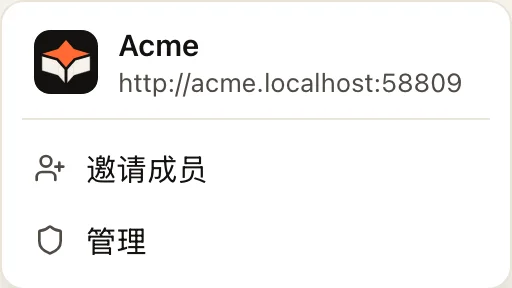
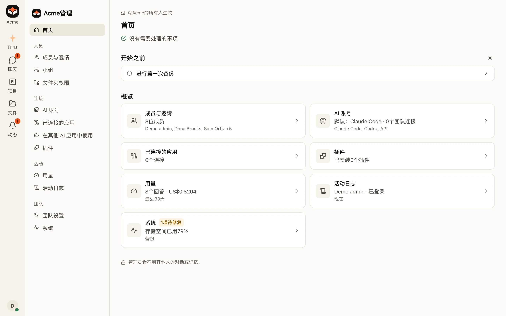
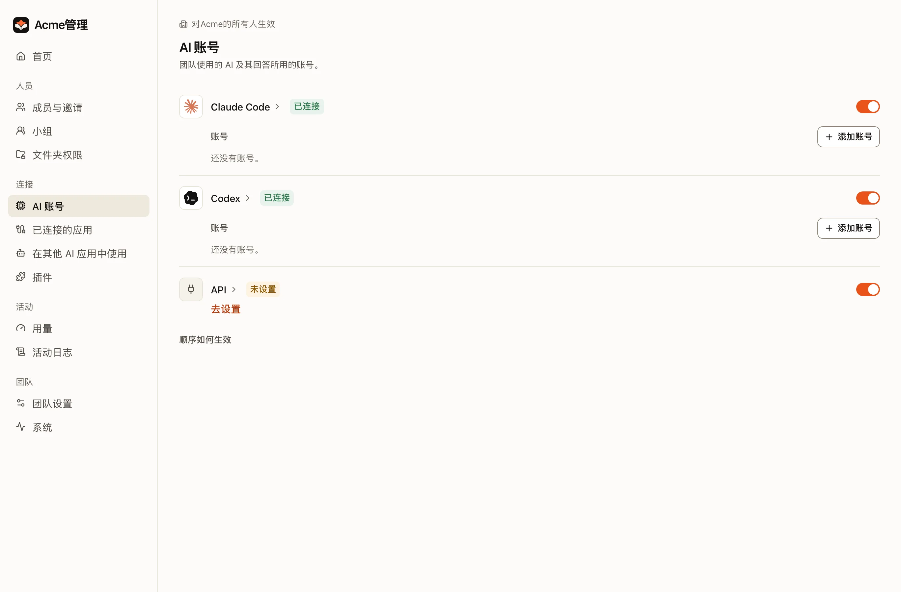
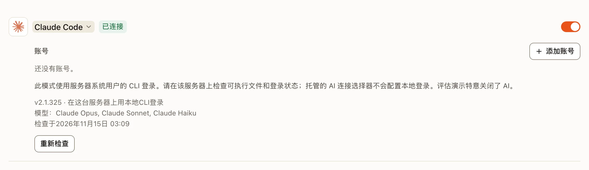
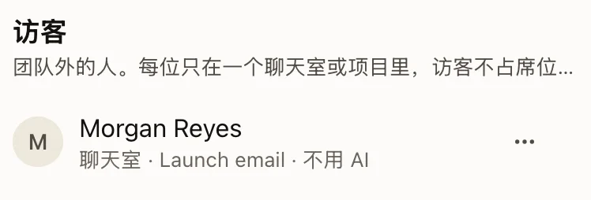
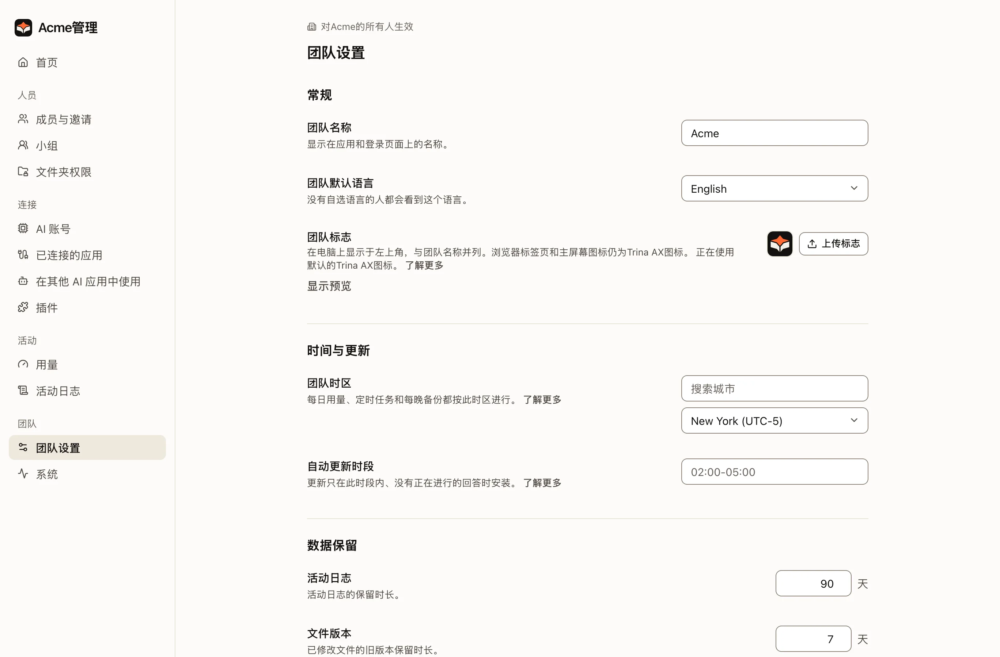
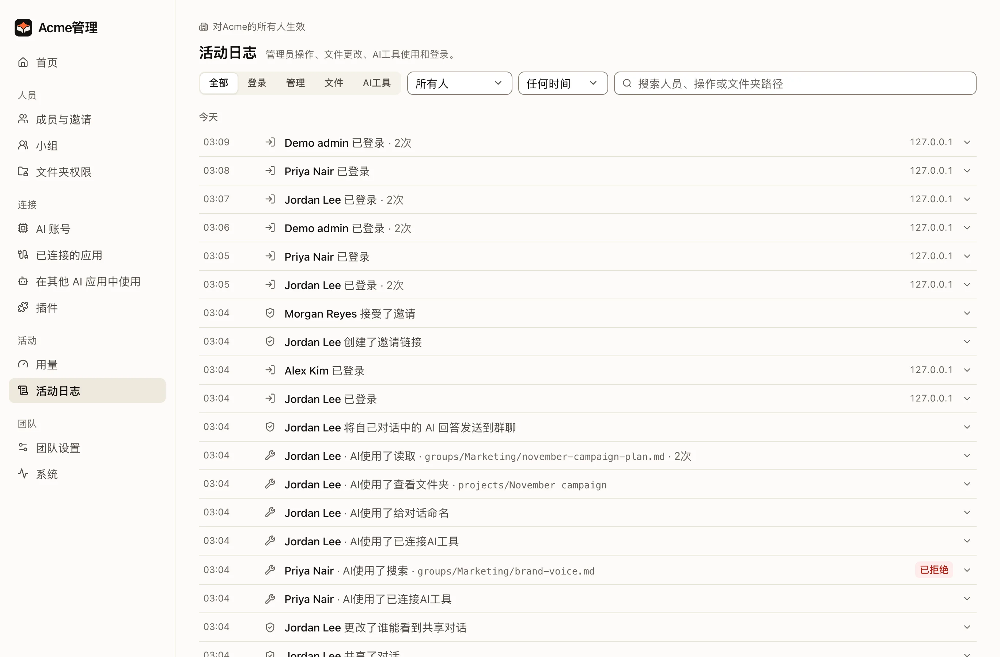
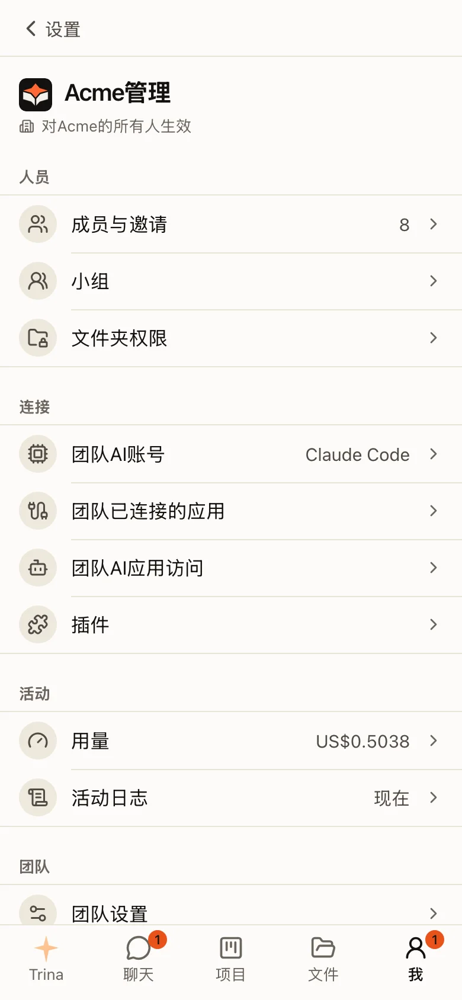

**管理**供所有者和管理员使用。在电脑上，它位于左侧栏顶部团队标志下方的团队菜单中，也可以用 ⌘K 找到；在手机上，它在**我**标签页里。其中每个页面都作用于整个团队：菜单标题是你团队的名称和标志（“Acme管理”），每个页面的标题上方都写着“对Acme的所有人生效”。各页面的名称与设置中的相同。管理 › 已连接的应用是团队的连接；你自己的连接在**设置 › 连接器**中。打开后首先显示**首页**，最先列出需要处理的事项。
对所有者来说，首页还会列出尚未完成的初始设置步骤：检查 AI 连接、设置文件夹权限、邀请你的团队、准备第一个团队技能、进行第一次备份。完成的步骤会从列表中消失。

## 管理菜单

| 分组 | 页面 |
|---|---|
| **人员** | 成员与邀请、小组、文件夹权限 |
| **连接** | AI 账号、已连接的应用（Google 应用、Notion 等其他服务，以及仅限所有者的 [Slack](slack.md)）、在其他 AI 应用中使用、插件 |
| **活动** | 用量、活动日志 |
| **团队** | 团队设置、系统 |

:::note
早期版本中，AI 账号有自己单独的 **AI 连接**（AI connections）页面，旁边是 **AI 引擎**（AI engines）页面。现在两者合并为一个
**AI 账号**页面，旧地址也会打开它。团队的 AI 设置（默认设置、谁来选择引擎、成员自己的账号、用量限制）在**团队设置**中。**Slack** 以前也有自己的菜单项；现在它是
**已连接的应用**中的一行，旧地址会在那里打开它。
:::

如果公司使用 Google Workspace，Google 应用可以通过公司自己的 Google 应用登录，五个应用只需设置一次：[使用公司自己的 Google 应用](google-own-app.md)。

## 第一周

:::steps
#### 设置权限
把文件夹分配给小组，并用两个测试账号检查访问权限。[了解权限](files-and-permissions.md)。

#### 连接 AI
在 **AI 账号**中，所有者或管理员在 Claude Code 或 Codex 一行中选择**添加账号**，连接一个已获授权的
Claude 或 OpenAI 账号。每一行都会显示该引擎是否已就绪。

#### 邀请团队
先从一个小的试点小组开始，然后确认角色和文件夹访问权限。

#### 添加第一个技能
复制一个入门技能，并对照原始资料检查它的结果。[了解技能](team-skills.md)。

#### 进行第一次备份
先备份，然后和 IT 人员一起练习一次恢复。[了解备份](../../operate/backups.md)（英文）。
:::

## 管理员不能做的事

- 阅读其他人的对话。活动日志显示 AI 读取了哪些文件，但不显示对话内容。
- 查看 `users/<id>/` 中的个人文件夹或个人技能。
- 使用团队的 MCP 连接，除非有规则点名他们。

:::warning
运营服务器、其操作系统或其存储的人，可以读取存储的文件和对话。在托管方案中，这包括 Trina 的运营人员。
:::

## AI 账号

**管理 › AI 账号**是连接分组中的第一项，每个引擎（Claude Code、Codex、API）一行，显示其
标志、状态和开关。出现问题时，名称下方会有一行简短说明告诉你如何解决。
Claude Code 和 Codex 下方是团队用来回答的账号，按尝试的顺序排列，每个都显示标志、
方案和状态；所有者和管理员还可以看到**添加账号**。列表下方的**顺序如何生效**会说明这个顺序。

点击引擎名称可以打开详情：登录方式、所有模型、上次检查时间、**重新检查**，
所有者和管理员还能看到 API 引擎的表单。点击账号名称可以看到谁在使用、本月用量以及上次
使用时间。账号的 **⋯** 菜单中有重新检查、上移 / 下移、重命名、更换、关闭和删除。

## 访客

**管理 › 成员与邀请** 的最后是 **访客**：来自团队之外的人，每人只在一个群聊或一个项目中，不占席位。每一行会说明访客在哪里、用哪种 AI。它的 **⋯** 菜单中有 **更改 AI**（不用 AI、用自己的账号登录，或带每月额度的团队 AI 账号）、**设为团队成员** 和 **移除访客**。成员可以自己从群聊或项目中邀请访客（[访客](chats-and-projects.md#访客)）。

## 团队的 AI 设置

**管理 › 团队设置**的最后是团队的 AI 设置：

| 分组 | 包含内容 |
|---|---|
| **AI 默认设置** | 默认引擎和模型，以及可以同时运行多少个回答。 |
| **谁来选择引擎** | 成员是否可以选择其他引擎，以及在 Claude 达到上限时是否切换到 Codex。 |
| **成员自己的账号** | 成员是否可以添加自己的账号、订阅是否可以共享，以及成员添加的账号。 |
| **用量限制** | 每天或每月的 token 或金额上限，可针对个人、小组或整个团队。 |

只有在某个分组中更改了内容后，该分组才会出现取消和保存；每个分组单独保存。

:::note
从 0.4.0 开始。在 0.3.0 及更早版本中，这些内容和引擎都在同一个 **AI 引擎**（AI engines）页面上。
:::

## 活动日志

**管理 › 活动日志**按天分组列出登录、管理操作、文件更改和 AI 工具使用。滚动时筛选条件始终停留在顶部。它从不显示对话内容。

## 系统

**管理 › 系统**以简单的分区显示团队的存储空间、版本和更新、服务器的运行状况、团队如何连接到服务器、已连接的文件夹、备份和导出。运行状况会先列出需要处理的事项，例如缺少引擎、检查失败或自动更新被关闭；通过的检查会折叠成一行，并提供**显示详情**。不是所有者的管理员可以看到方案、存储空间，以及在办公室 Mac 上的自动更新。

