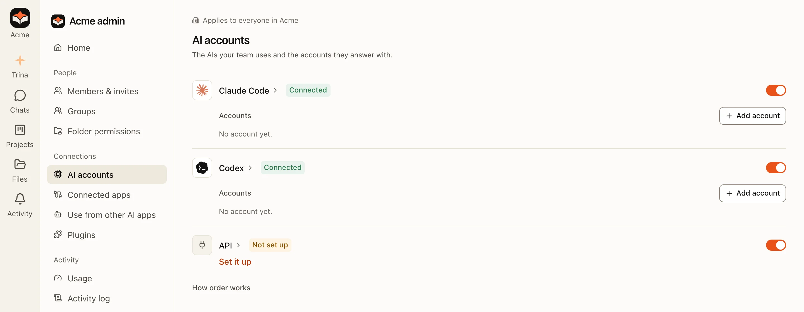
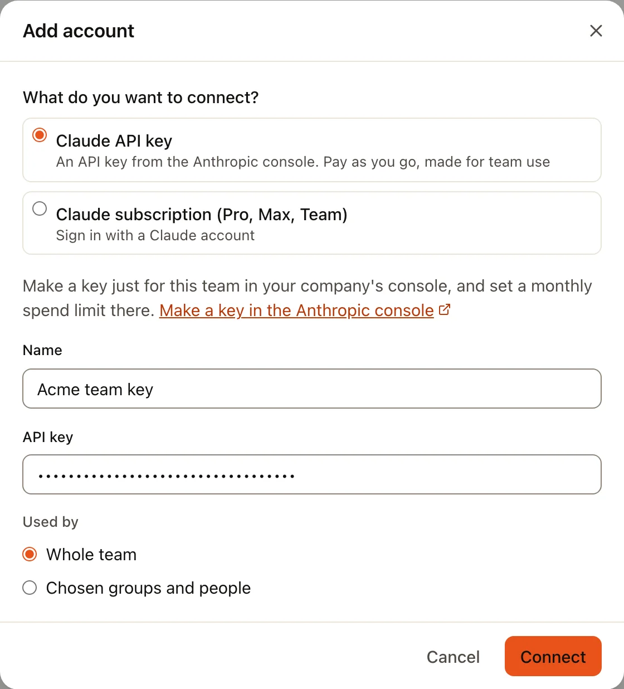
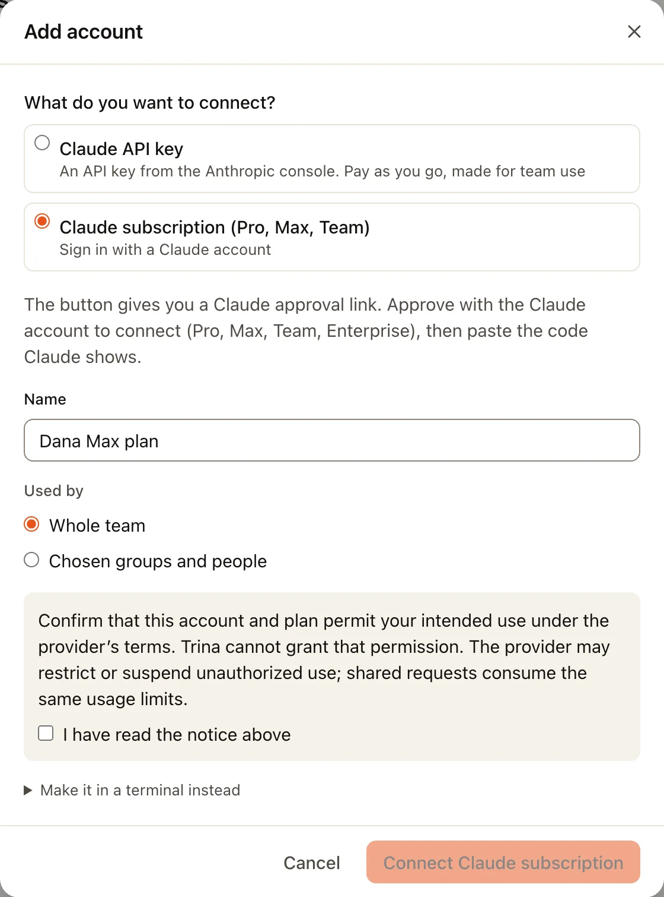
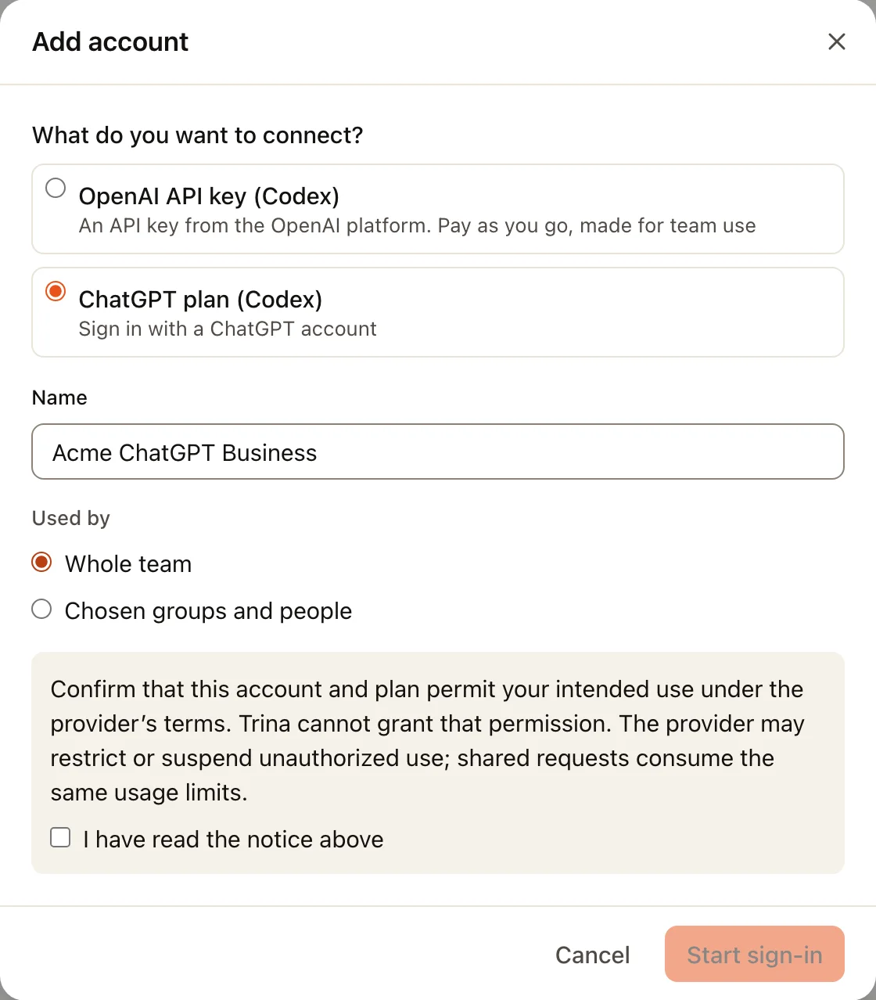
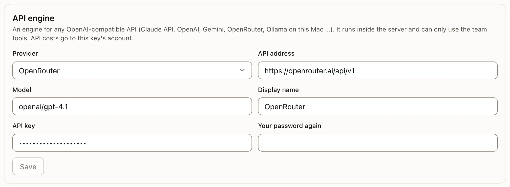
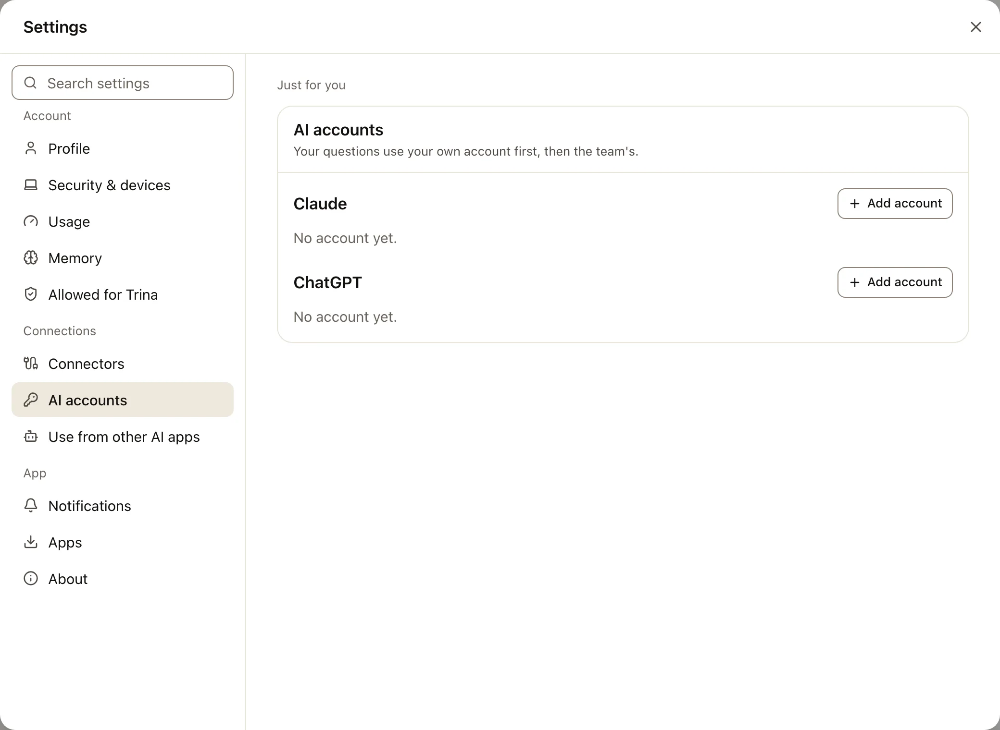

Trina AX 使用团队连接的 AI 账号来回答问题：Claude 或 ChatGPT 账号，或者 API 密钥。Trina AX 不包含 AI 的使用费用。
Anthropic、OpenAI 或其他 AI 公司会按照它们自己的条款，向你连接的账号或密钥收费。

团队的账号由所有者或管理员在**管理 › AI 账号**中连接。如果团队允许，每个人也可以在**设置 › AI 账号**中添加自己的账号：
自己的提问会优先使用它。

## 选哪一种

| Trina AX 中的选项 | 你需要什么 | 由谁收费 | 适合 |
|---|---|---|---|
| **Claude API密钥** | Claude Console 中的 API 密钥 | Anthropic，按用量 | 团队，可以在 Anthropic 设置每月上限 |
| **Claude订阅（Pro、Max、Team）** | 有付费套餐的 Claude 账号 | Anthropic，按你的套餐 | 一个人自己的账号 |
| **OpenAI API密钥（Codex）** | OpenAI 平台上的 API 密钥 | OpenAI，按用量 | 使用 OpenAI 的团队 |
| **ChatGPT套餐（Codex）** | 有付费套餐的 ChatGPT 账号 | OpenAI，按你的套餐 | 一个人自己的账号 |
| **API 引擎** | 任何兼容 OpenAI 的服务的地址、模型和密钥 | 那项服务 | OpenRouter、Gemini，或在你自己电脑上运行的模型 |

:::warning
订阅（Claude 或 ChatGPT）是给账号主人自己用的。在为其他人连接之前，请确认提供方的条款允许这样做：对话框会请你确认
**我已阅读上述说明**。对团队来说，API 密钥更稳妥。
:::

## 添加 Claude API 密钥

:::tip
**你需要准备的**

- **API密钥**：一长串以 `sk-` 开头的代码。在 [Claude Console](https://platform.claude.com/settings/keys) 中创建。
- **名称**：团队认得出的任意名称，例如“Acme 团队密钥”。
:::

:::steps
#### 在 Anthropic 创建密钥
用公司的账号登录 [Claude Console](https://platform.claude.com/settings/keys)。打开 **API keys**，选择 **Create Key**。
起个名字，例如“Trina AX”，然后复制密钥：Anthropic 只显示一次。顺便在 **Limits** 下为你的组织设置每月花费上限。详情见
Anthropic 的 [API 密钥指南](https://docs.claude.com/en/api/admin-api/apikeys/get-api-key)（英文）。

#### 打开“添加账号”
在 Trina AX 中打开**管理 › AI 账号**。在 **Claude Code** 这一行选择**添加账号**，再选择 **Claude API密钥**。
对话框中也有到 Claude Console 的链接：**在Anthropic控制台创建密钥**。

#### 粘贴并连接
填写**名称**，把密钥粘贴到 **API密钥**中。在**使用者**下，保留**整个团队**或选择**选定的小组和人员**。选择**连接**。
Trina AX 会向 Anthropic 核对密钥，账号会显示**正常**。

:::

## 添加 Claude 订阅

:::tip
**你需要准备的**

- 一个有 Pro、Max、Team 或 Enterprise 套餐的 **Claude 账号**，并已在浏览器中登录。
- 不需要从控制台复制任何东西：你批准后 Claude 会显示一个**代码**，把它粘贴回来即可。
:::

:::steps
#### 打开“添加账号”
在**管理 › AI 账号**（或者为自己添加时在**设置 › AI 账号**）中，选择 Claude 下的**添加账号**，再选择
**Claude订阅（Pro、Max、Team）**。填写**名称**，选择谁使用它，阅读说明并勾选**我已阅读上述说明**。

#### 在 Claude 上批准
选择**连接Claude订阅**。几秒钟后会出现**打开Claude进行批准**（或者**复制链接**，用来在已登录 Claude 的浏览器中打开）。
Claude 自己的页面会打开：确认它显示的是你想要的账号，然后批准。

#### 粘贴代码
Claude 接着会显示一个代码。把它完整复制（中间有一个 `#`）到**粘贴批准后Claude显示的代码**中。Trina AX 会显示
**已连接 · Claude订阅**。
:::

你的 Claude 密码不会到达 Trina AX：你是在 Claude 自己的页面上登录的，Trina AX 只保存 Claude 发放的访问权限。

说明下方的**改为在终端中生成**是另一种方式，适合装了 Claude Code 的人：在终端中运行 `claude setup-token`，在打开的浏览器中批准，
然后把它打印出的整段令牌（终端会告诉你是哪一行）粘贴到 **Token** 中。它的有效期是一年。

## 添加 OpenAI API 密钥

:::tip
**你需要准备的**

- **API密钥**：以 `sk-` 开头。在 [OpenAI 平台](https://platform.openai.com/api-keys)上创建。
:::

:::steps
#### 在 OpenAI 创建密钥
登录 [OpenAI 平台](https://platform.openai.com/api-keys)，打开 **API keys**，选择 **Create new secret key**。选择它所属的
项目，然后复制密钥：OpenAI 只显示一次。在 **Limits** 下为那个项目设置预算。

#### 在 Trina AX 中粘贴
在**管理 › AI 账号**中，在 **Codex** 这一行选择**添加账号**，再选择 **OpenAI API密钥（Codex）**。填写**名称**，把密钥粘贴到
**API密钥**中，选择谁使用它，然后选择**连接**。
:::

## 添加 ChatGPT 套餐

:::tip
**你需要准备的**

- 一个有付费套餐的 **ChatGPT 账号**。不需要从控制台复制任何东西：Trina AX 会给你一个地址和一个代码，到 OpenAI 那边输入。
:::

:::steps
#### 开始登录
在**管理 › AI 账号**中，在 **Codex** 这一行选择**添加账号**，再选择 **ChatGPT套餐（Codex）**。填写**名称**，选择谁使用它，
勾选**我已阅读上述说明**，然后选择**开始登录**。

#### 在 OpenAI 输入代码
Trina AX 会显示**打开这个地址**和**输入这个代码（15分钟内）**。打开地址，用那个 ChatGPT 账号登录，输入代码并批准。

#### 完成
Trina AX 会显示**已连接 · ChatGPT**和套餐名称。如果登录的不是你想要的账号，请在 chatgpt.com 退出登录，然后选择**重新开始**。
:::

## API 引擎

API 引擎可以连接任何提供兼容 OpenAI 的 API 的服务。它仍标为**实验性**：回答、工具和费用可能与 Claude Code 和 Codex 不同。

:::tip
**你需要准备的**

- **提供商**：选一个，Trina AX 会自动填好它的 **API 地址**和一个**模型**。
- **模型**：模型在那个提供商那里的准确名称。
- **API 密钥**：从提供商的密钥页面获取。
- **再次输入你的密码**：你自己的 Trina AX 密码，用来确认。
:::

| 提供商 | API 地址 | 在哪里创建密钥 |
|---|---|---|
| OpenAI | `https://api.openai.com/v1` | [platform.openai.com/api-keys](https://platform.openai.com/api-keys) |
| Claude API (Anthropic) | `https://api.anthropic.com/v1` | [platform.claude.com/settings/keys](https://platform.claude.com/settings/keys) |
| Google Gemini | `https://generativelanguage.googleapis.com/v1beta/openai` | [aistudio.google.com/apikey](https://aistudio.google.com/apikey) |
| OpenRouter | `https://openrouter.ai/api/v1` | [openrouter.ai/settings/keys](https://openrouter.ai/settings/keys) |
| Ollama（这台 Mac） | `http://127.0.0.1:11434/v1` | 不需要密钥：模型运行在服务器所在的同一台电脑上 |

:::steps
#### 打开 API 这一行
在**管理 › AI 账号**中，选择 **API** 下的**去设置**。

#### 填写表单
选择**提供商**，检查**模型**，填写**显示名称**，粘贴 **API 密钥**，并填写**再次输入你的密码**。选择**保存**。

:::

## 你自己的账号

管理员打开**允许成员添加自己的AI连接**（在**管理 › 团队设置**的**成员自己的账号**中）后，每个人都会看到**设置 › AI 账号**：
“你的提问会先使用你自己的账号，然后使用团队的账号。”在 **Claude** 或 **ChatGPT** 下选择**添加账号**，按照上面相同的步骤操作。
只有你自己的提问会使用它；管理员无法使用它，也看不到它的密钥。

## 语音输入

语音输入通过 OpenRouter 把语音转成文字。在你自己的服务器上，由管理员在**管理 › 团队设置**的**语音输入**下添加
**OpenRouter API密钥**。在 [openrouter.ai/keys](https://openrouter.ai/keys) 创建密钥。

## 常见问题

| 你看到的 | 该怎么做 |
|---|---|
| **不是这种类型的API密钥。** | 密钥属于另一种类型（把 OpenAI 密钥填到了 Claude 的输入框，或者反过来），或者复制时带了空格。请重新复制。 |
| **请粘贴完整的代码（中间有一个#）。** | Claude 的代码缺了一部分。请用 Claude 的复制按钮重新复制。 |
| **该代码无效。请重新开始、批准，并粘贴新代码。** | 代码已经用过或已过期。请再次选择**连接Claude订阅**。 |
| **已超时。**（ChatGPT） | 代码 15 分钟内有效。请选择**重新开始**。 |
| **只能通过安全连接（https）添加连接。** | 请用 Trina AX 的 `https://` 地址打开它。 |
| 账号显示**被拒绝**或**需要重新连接** | 密钥被撤销，或登录已结束。打开账号的 **⋯** 菜单，选择**更换token或密钥**或**重新连接**。 |
| 账号显示**每月上限已用完** | 已达到它在 **⋯** › **每月上限**中设置的上限。请提高上限，或等到下个月。 |

关于账号的使用顺序、上限和引擎的更多内容：[管理](admin.md#ai-账号)和[用量和限制](usage-and-limits.md)。
