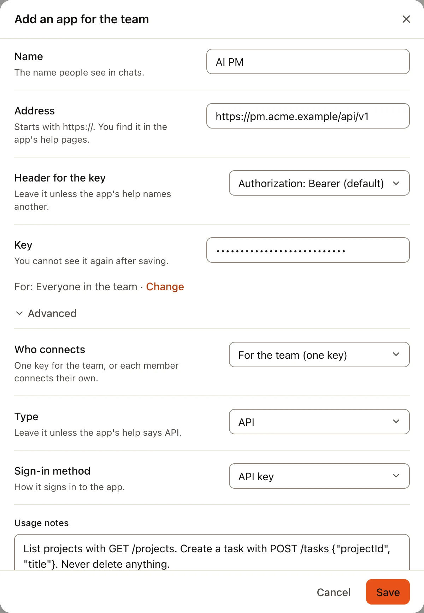
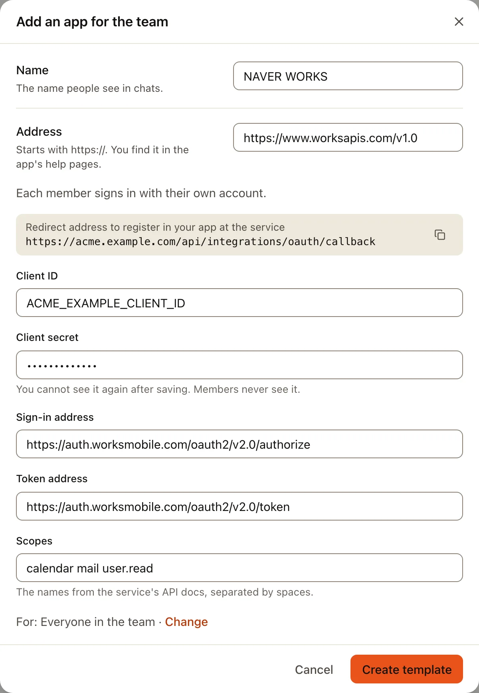

你的公司可能有自己的系统：项目管理工具、订单系统、内部工具。只要它有 Web API，AI 就可以使用它。所有者或管理员在
**管理 › 已连接的应用**中添加一次，填写它的地址、一个密钥，以及几行使用说明。之后 AI 只能访问这个地址下面的地址。

有些服务（例如 NAVER WORKS）不发放密钥：大家需要登录，而登录要通过公司在那个服务上创建的登录应用。这部分在
[本页的后半部分](#用你自己的应用登录)。

下面这些值需要找熟悉那个系统的人（它的管理员或开发者）获取。这里的操作都不需要写代码。

## 用密钥连接 API

:::tip
**你需要准备的**

- **地址**：API 的基础地址，例如 `https://pm.acme.example/api/v1`。可以问系统管理员，或在它的 API 文档中查找（“base URL”）。
- **密钥**：那个系统的 API 密钥或令牌。请专门为 Trina AX 创建一个，权限不要超过 AI 需要的范围。
- **密钥使用的请求头**：大多数 API 使用 `Authorization: Bearer <key>`。如果 API 文档写的是别的请求头，例如 `X-API-Key`，
  请记下它的准确名称。
- **使用说明**：几行文字，说明 AI 应该访问哪些地址。系统的 API 文档里有这些内容。
:::

:::steps
#### 打开对话框
在**管理 › 已连接的应用**中，选择“发现”下的**通过地址添加**。打开**高级**，把**类型**设为 **API**，**登录方式**设为
**API密钥**。

#### 填写各项
- **名称**：大家在对话中看到的名称，例如“AI PM”。
- **地址**：基础地址。AI 只能访问它下面的路径。
- **密钥使用的请求头**：保留 **Authorization: Bearer（默认）**，或选择**其他请求头**，并按文档中的写法准确填写**请求头名称**。
- **密钥**：粘贴密钥。
- **使用说明**：主要的路径、它们需要的值，以及 AI 不能做的事。最多 4,000 个字符。



#### 选择谁可以使用，然后保存
**适用于：团队中的所有人 · 更改**用来选择小组或个人。**写入、删除和发送**一开始请保留为**每次都询问**。选择**保存**：Trina AX
会检查地址和密钥，这一行会显示**已连接**。
:::

好的使用说明是这样的：

```
List projects with GET /projects.
Create a task with POST /tasks and a JSON body {"projectId", "title", "dueDate"}.
Dates are YYYY-MM-DD. Never call DELETE.
```

AI 每次使用这个 API 时都会读这段说明，所以请写得简短、准确。

## 用你自己的应用登录

有些服务允许大家登录（OAuth），但只能通过在该服务上登记的应用登录：例如 NAVER WORKS，以及 Google 自己的 MCP 服务器。你在服务的
开发者控制台中创建一次这个应用，然后把它的值粘贴到 Trina AX 中。通常你会把它添加为**模板**，这样每位成员都用自己的账号登录。

:::tip
**你需要从服务的开发者控制台获取的**

- 你在那里创建的应用的 **Client ID** 和 **Client secret**。
- **登录地址**和 **Token地址**（用于 API；MCP 服务器会自己找到它们）。
- **权限范围**：AI 需要的权限，用空格分开。

**你需要交给服务的**

- Trina AX 显示的**重定向地址**：`https://<your team address>/api/integrations/oauth/callback`。
:::

:::steps
#### 先在 Trina AX 中打开对话框
在**管理 › 已连接的应用**中，选择**通过地址添加**，打开**高级**，把**由谁连接**设为**每位成员各自**，**类型**设为
**API**（或 **MCP服务器**），**登录方式**设为**登录（OAuth）**。如果是 MCP 服务器，还要打开**用我自己的应用登录**。这时对话框会显示
**要在该服务的应用中登记的重定向地址**，旁边有复制按钮。复制它。

#### 在服务上创建应用
在服务的开发者控制台中创建一个应用（可能叫“OAuth app”“client”或“integration”）。把重定向地址粘贴到它的 redirect URL 中，
选择权限范围，然后复制它的 **Client ID** 和 **Client secret**。

#### 填写其余各项并保存
回到 Trina AX，填写**名称**、**地址**、**Client ID**、**Client secret**、**登录地址**和 **Token地址**（用于 API）以及
**权限范围**。选择**创建模板**。之后成员会在**设置 › 连接器**中看到它，并用自己的账号登录。


:::

### NAVER WORKS

| 在 Trina AX 中 | 值 |
|---|---|
| **类型** | **API** |
| **地址** | `https://www.worksapis.com/v1.0` |
| **登录地址** | `https://auth.worksmobile.com/oauth2/v2.0/authorize` |
| **Token地址** | `https://auth.worksmobile.com/oauth2/v2.0/token` |
| **Client ID**、**Client secret** | 来自你在 NAVER WORKS Developer Console 中的应用 |
| **权限范围** | AI 需要的权限，例如 `calendar mail file user.read` |
| **使用说明** | AI 应该访问的 API 地址，来自 NAVER WORKS 的 API 文档 |

在 NAVER WORKS Developer Console 中打开你的应用（或在 API 2.0 下添加一个），把它的 **Redirect URL** 设为 Trina AX 显示的地址，
勾选相同的 **OAuth Scopes**，然后复制 **Client ID** 和 **Client Secret**。NAVER WORKS 在它的
[OAuth 指南](https://developers.worksmobile.com/kr/docs/auth-oauth)中说明了登录方式。

### Google 的 MCP 服务器

Google 也为 Gmail、日历、Drive 等提供 MCP 服务器（`https://gmailmcp.googleapis.com/mcp/v1` 等），属于 Google 的预览计划。
它们需要你自己的 Google 登录应用，创建方法和[使用公司自己的 Google 应用](google-own-app.md#在-google-cloud-中)一样，只是重定向地址
换成上面的地址。日常使用的话，内置的 [Google 应用](google-apps.md)不需要你自己的应用。

## 常见问题

| 你看到的 | 该怎么做 |
|---|---|
| **该服务不接受此应用的Client ID或Secret。** | Client ID 或 secret 复制错了，或者 secret 在服务那边更新过。请编辑连接，在**高级**中重新输入 secret，然后重新登录。 |
| 服务提示重定向地址不对（`redirect_uri_mismatch`、“invalid redirect”） | 服务控制台中的 redirect URL 和 Trina AX 显示的不一样。请用复制按钮重新复制；检查 `https`、团队地址，以及末尾没有斜杠。 |
| **已保存的Client secret不会沿用到新地址。请重新输入。** | 你修改了地址或登录地址。为了安全，不会沿用原来的 secret：请重新粘贴。 |
| 调用返回 401 或 403 | 密钥已过期、缺少某项权限，或复制时带了空格。请新建一个密钥，或在服务那边添加缺少的权限范围后重新登录。 |
| AI 访问了错误的路径 | 把**使用说明**写得更准确：列出每个路径及其方法。 |

面向开发者的完整说明：[集成](../../../INTEGRATIONS.md#your-own-app-client-id)（英文）。
