对话就是和 AI 的一次交谈。新对话只属于你，直到你[共享它](#共享对话)；团队项目中的对话会与项目成员共享，除非你选择 **仅自己**。管理员能看到 AI 读了哪些文件，但永远看不到对话内容。

## 开始对话

:::steps
#### 打开新对话
在 Trina 列表顶部选择 **问Trina**（左侧栏上的 **Trina**），按 ⇧⌘O（Windows 上按 Ctrl+Shift+O），或者在首页的输入框中输入。在手机上，**Trina** 标签页会打开首页：在底部的输入框中输入。第一次使用时，输入框下方的 **团队中已准备好** 会列出你的团队已经设置好的内容：团队的技能（**示例** 展示一个结果，**试试看** 打开这个技能），直到你运行过一个技能为止；还有团队文件（**提问** 会把关于这些文件的问题放进输入框，但不会发送）。如果还没有设置任何内容，**从这里开始** 会提供一个可以发送的问题。

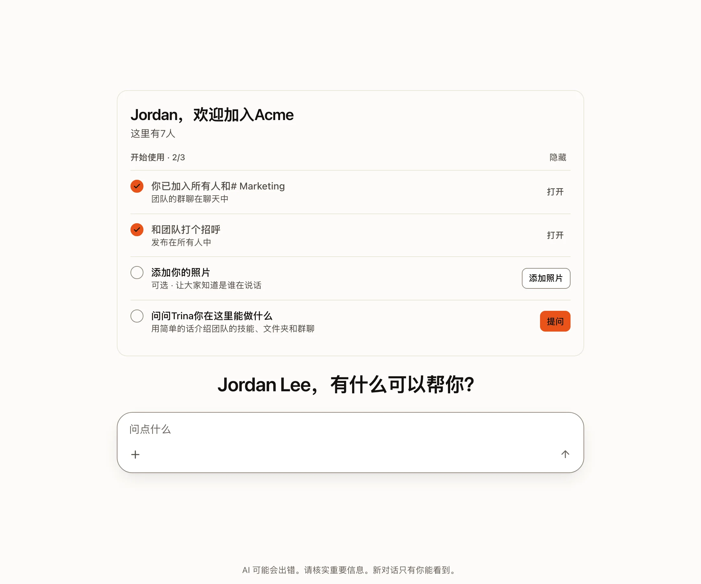

#### 用平常的话提问
例如：“总结一下 shared/sales 里上周的销售笔记。”输入 `/` 可以选择一个团队技能。

消息输入框上面是你的文字，下面一行是按钮，都在框内：左边的 **+** 用来添加文件（来自你的电脑或团队文件），右边是 AI 选择（管理员允许的人才有）、麦克风（开启时）和发送（**↑**）。按 Enter 发送。

#### 查看工作过程
打开回答下方的 **N个步骤**，可以看到 AI 用过的每个工具和读过的每个文件。
:::

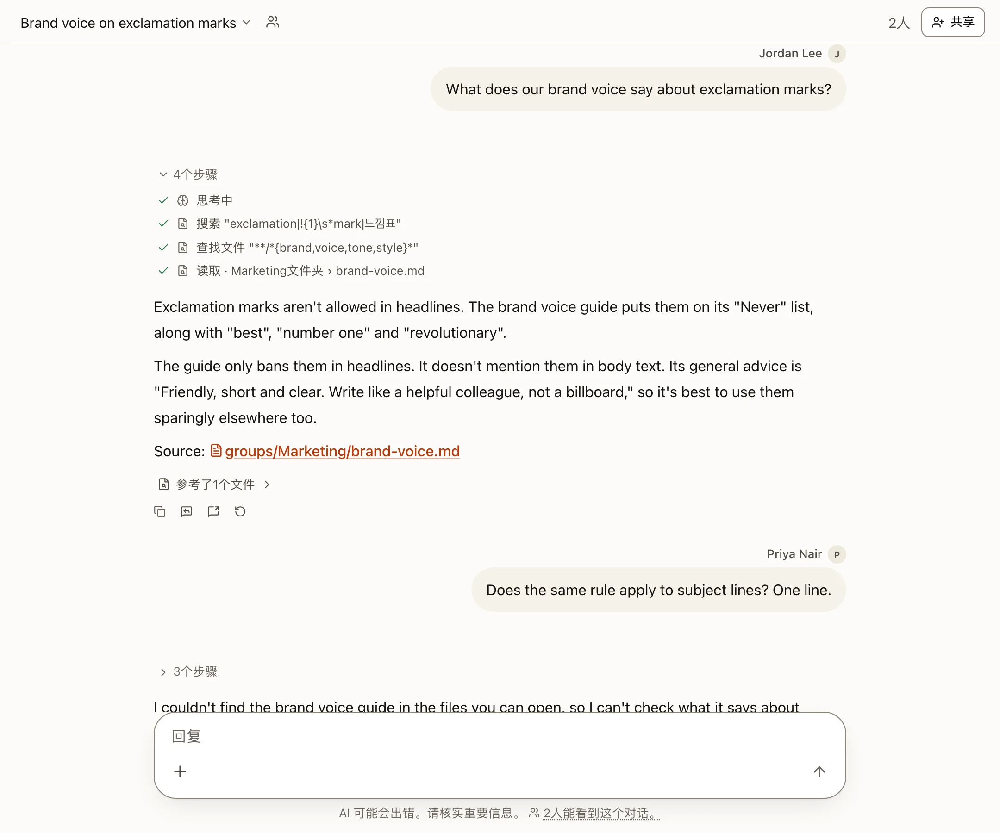

## 回答是怎样产生的

| 方面 | 会发生什么 |
|---|---|
| **引擎** | 成员使用团队的默认设置。管理员允许的人可以在对话中选择引擎和模型。 |
| **文件** | AI 使用 Trina 的文件工具。每次调用都会按你自己的权限进行检查。 |
| **问题** | 当 AI 需要你做选择或确认时，它会显示一张卡片。它不能自己回答这张卡片。 |
| **助手** | 遇到大的请求时，AI 可以把工作拆成子任务，最多同时进行 4 个。每个助手都以你的身份工作。 |
| **长度** | 一个回答默认最多可以使用工具 500 次（管理员可在 10 到 2,000 之间选择；定时任务、来自 Slack 的提问和访客最多 150 次）。达到上限时，**继续** 会接着做下去。 |
| **网页** | AI 可以打开网页。服务器会检查每个地址，遇到有风险的地址会先问你。 |
| **帮助** | 问 Trina AX 怎么用、怎么设置、出了问题怎么办，AI 会在这份文档里查找后回答，并在最后附上页面链接。文档按版本放在你的服务器上。 |

:::note
选中的上下文会发送给你连接的 AI 提供商。自行托管并不等于离线处理。[阅读数据流向](../../operate/security.md)（英文）。
:::

## 你的 Trina 列表

在电脑上，左侧栏上的 **Trina** 会在页面旁边打开你的 Trina 对话列表。顶部是 **问Trina**、**搜索**、**定时任务** 和 **团队技能**。它们下面从上到下依次是：

| 部分 | 里面有什么 |
|---|---|
| **正在等你** | 只在有对话等待你回答时显示，点击即可打开 |
| **已置顶** | 你置顶的对话 |
| **Trina历史记录** | 你的其他所有对话，最新的在前。属于某个项目的对话，会在这一行末尾显示项目名称 |

小标记说明谁能看到对话：团队项目中只有你能看到的对话，标题前有一把锁；共享对话带人员图标。其他人写过消息的共享对话，会在这一行末尾改为显示他们的头像（最多 3 个，手机上 2 个）；把鼠标移到头像上可以看到名字。历史记录、项目页面和搜索中也是如此。

当左侧栏上的 **Trina** 显示 **?** 时，点击它也会打开正在等待的对话。你删除的对话在 **已删除的历史记录** 中，位于 **Trina历史记录** 旁边的 **⋯** 菜单里。列表顶部的筛选按钮可以只显示部分对话，例如正在回答或正在等你的对话。你的项目有自己的位置：左侧栏上的 **项目**。

在手机上，**Trina** 标签页会打开首页。顶部的 **☰** 会打开你的历史记录：**搜索**、**定时任务**、**团队技能**，然后是 **Trina历史记录**（先是你置顶的对话，再按日期排列，最新的在前），最下面是 **设置状态** 和 **已删除的历史记录**。

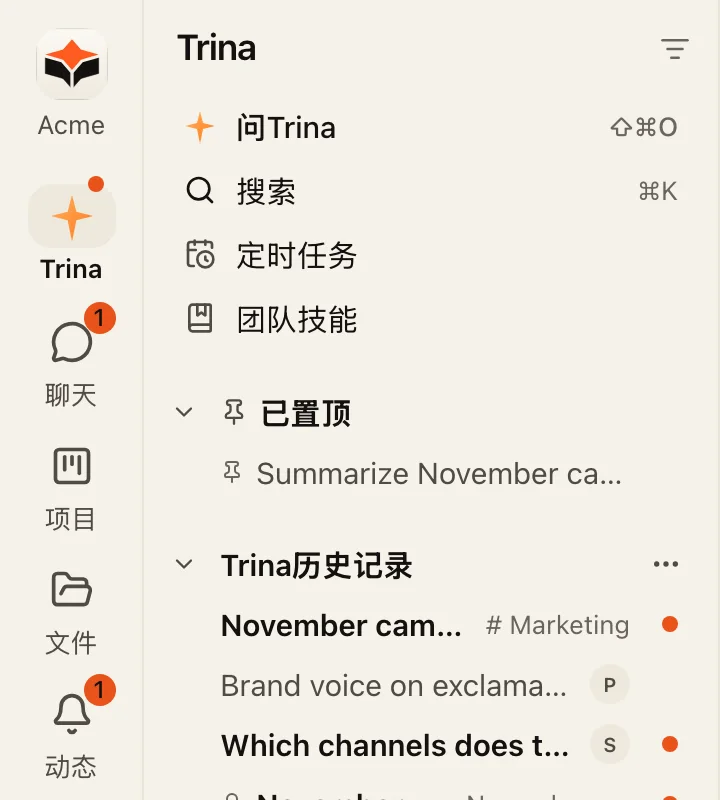

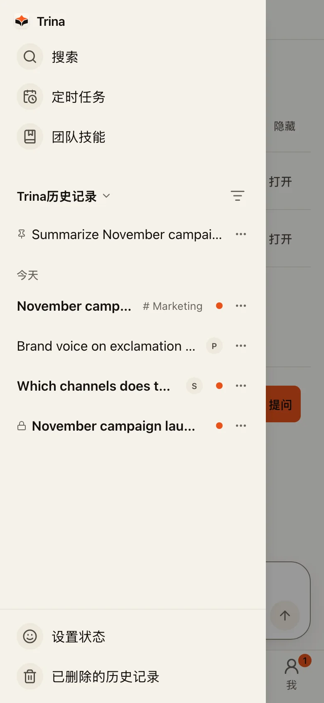

### 分区

Trina 对话没有文件夹。想把同一项工作的对话放在一起，就把它们放进一个[项目](#项目)。

在 **聊天** 列表中，你可以把频道和私信归入自己的 **分区**，就像 Slack 侧边栏里的分区。分区只用来整理你自己的列表：
它不存放文件，别人看不到它，也绝不会改变聊天里有谁。

1. 点击左侧栏上的 **聊天**。
2. 把鼠标移到 **频道** 上，点这一行末尾的 **+**。会打开一个小菜单，里面有 **创建频道** 和 **新建分区**。
3. 选择 **新建分区**，输入名称（例如“客户”），然后点 **创建**。
4. 会打开你的聊天列表。勾选想放进去的聊天，然后点 **添加2个会话**（数字随你勾选的数量变化）；也可以点 **跳过**，
   以后再添加。

新分区会出现在你的聊天列表中，位于 **频道** 上方，里面是你选的聊天。

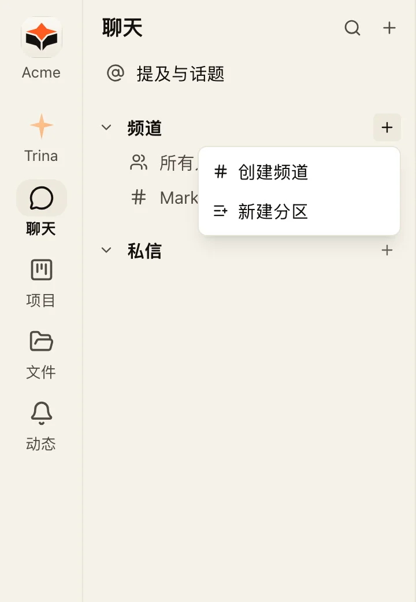

- **移动一个聊天：** 在它那一行选择 **···** › **移到分区**，然后选一个分区（或 **新建分区…**）。在电脑上也可以把这一行拖到
  某个分区上。**从分区中移出** 会把它放回原来的位置：**频道**、**项目**（项目的聊天室）或 **私信** 下面。
- **修改分区：** 分区的 **···** 里有 **添加会话**、**重命名分区**、**上移**、**下移** 和 **删除分区**。删除分区只会去掉
  这个标题：其中的聊天会回到 **频道** 和 **私信** 下面。

## 同时进行多个对话

Trina 对话列表中的每个对话，最多在这一行的右端显示一个标记：

| 标记 | 含义 |
|---|---|
| 琥珀色的 **?** | AI 在等你：一张问题或确认卡片，或者一个失败了或因达到上限而暂停的回答。卡片的 **?** 会一直保留，直到你回答它。 |
| 灰色圆环 | AI 正在回答，或者回答正在排队。 |
| 圆点，标题加粗 | 一个你还没打开的新回答。 |

打开一个对话会清除它的圆点，以及失败或暂停的回答的 **?**，在所有设备上都会清除。折叠起来的部分会显示其中对话最重要的那个标记。当 AI 在某个群聊中等你回答时，这个群聊会用 **?** 代替数字。

当浏览器标签页在后台时，它的标题会显示需要你处理的对话和群聊的数量，例如“(2) Trina”。桌面应用会在 Mac 的程序坞上显示同样的数字；当一张卡片出现，或者一个运行超过一分钟的回答在你看别处时结束，它还会发出通知，点击通知即可打开那个对话。定时任务只会显示标记；从 Slack 提出的问题会在 Slack 中回答，所以它的对话不会出现圆点。当有对话需要你时，左侧栏上的 **Trina**（在手机上是 **Trina** 标签页）会显示 **?** 或圆点；当 AI 在某个群聊中等你回答时，**聊天** 会显示 **?**；在手机上，应用中还会出现一条带 **打开** 的简短消息。

## 共享对话

你可以像共享 Google 云端硬盘中的文件一样，把自己的任何对话共享给人员和小组。他们能看到整个对话，包括他们被添加之前的内容，也能自己在里面向 AI 提问。

:::steps
#### 打开共享
在对话的标题菜单中，或者在列表中这一行的 **···** 里，选择 **共享**。

#### 添加人员和小组
在 **添加人员和小组** 中输入名字。你自己在列表中显示为 **发起了此对话**。**✕** 会把某人再移出去（保存之前，**撤销** 可以把他放回来）。

#### 保存
按 **共享**（已经共享过的对话是 **保存**）。有未保存的更改时离开，会先问你。
:::

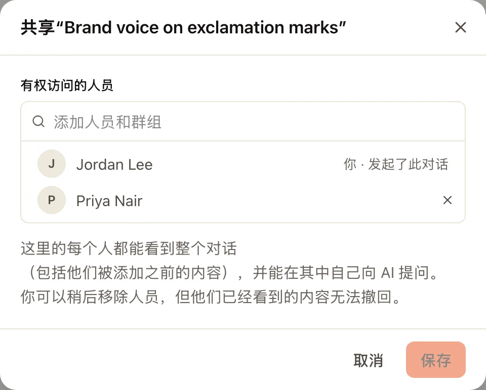

- **添加人的时候**，应用会检查他们将开始看到什么，只有确实有风险时才会立即显示一条警告，例如“2个回答可能用到了你的个人记忆”或“3个回答用到了Priya打不开的文件”。**查看回答** 会列出这些回答。没有风险时不显示警告；无法检查的旧回答只显示一行灰色小字。按一次 **共享** 就会共享这个对话；**取消** 保持原样。
- **文件。** 你在共享之前从电脑附加的文件，会对你添加的人可见，对话框会说明有几个。附加之后又改过的文件仍然只属于你：不计入数量，其他人也看不到它。在共享对话中，里面的任何人都可以从电脑附加文件（每个文件最大 50 MB）：文件和对话保存在一起，只有能看到这个对话的人才能打开它并向 Trina 询问。删除对话会一并删除这些文件。
- **谁能看到回答。** 共享对话中的回答绝不会对里面的人隐藏，包括之后被添加的人。每个回答都以提问者的身份、按他能打开的内容运行。AI 要读取其中某些人打不开的内容之前，会先问你。
- **其他人看到什么。** 对话会出现在他们的 Trina 列表中，**动态** 会显示“Jordan Lee与你共享了一个对话。”。按名字添加的人还会在手机和浏览器上收到通知（**设置 › 通知 › 与我共享的对话** 可以关闭）。他们可以用自己的权限继续这个对话，也可以在菜单中选择 **从我的列表中隐藏**；再次打开它就会回来。
- **更改谁能看到。** 只有发起对话的人可以更改谁能看到它：再次选择 **共享**，或者输入框下方的 **更改谁能看到**。被你移出的人会立即失去这个对话和其中的文件，并看到“此对话已不再与你共享。”，之后再打开它的链接也一样；他们在里面正在输入的内容会保留在那个页面上，可以 **复制**。你按名字移出的人如果也在你共享给的某个小组里，会通过这个小组继续看到它，对话框会说明这一点。把所有人都移出后，它又只属于你。
- **请求访问。** 团队成员打开一个自己看不到的对话的链接时，会看到 **请求访问** 和一个备注框；页面不会显示这个对话的任何内容，包括标题和里面有谁。按下后，按钮会变成 **已请求**。请求会带着 **共享** 和 **拒绝** 按钮出现在你的 **动态** 中，并在手机和浏览器上通知你（**设置 › 通知 › 共享**；与打开文件的请求合计每天最多 10 条）。**共享** 会经过与共享对话框相同的检查，然后按名字添加对方；**拒绝** 只会告诉对方请求未获批准，对方可以再次请求。项目的链接也一样：请求会发给能更改成员的人，**添加** 会让这个人成为成员。团队项目中共享对话的链接，会变成加入该项目的请求。无法请求时（例如个人项目中这类从不共享的对话，或已没有人能答复），页面只说明无法请求，不显示按钮，也不说明原因。访客不能请求，已经能打开的人会直接进入。
- **个人的东西不会带进来。** 在共享对话中，AI 不会使用你的记忆、你的浏览器、你的邮件或你的日程。要使用它们，请在对话菜单中选择 **在只有你能看到的对话中继续**。
- 个人项目中的对话仍然只属于你：**共享** 会先提出把它移出项目。团队项目中的对话会与项目成员共享（见[项目](#项目)）。

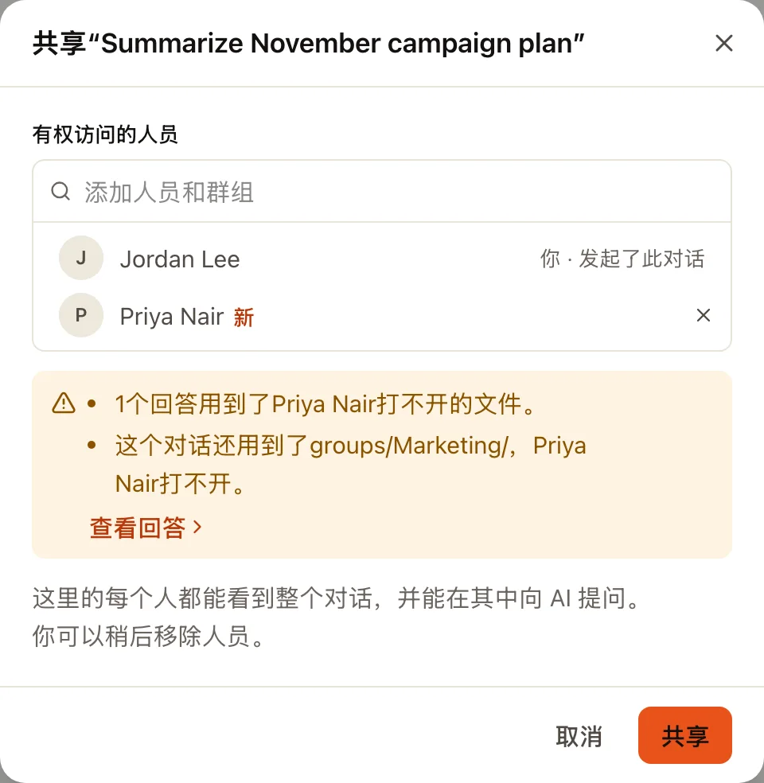

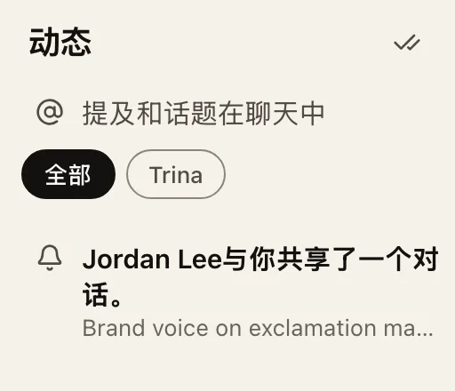

## 置顶对话

在你的 Trina 对话列表中，对话的 **···**（或者在这一行上点击右键，在手机上则是长按）里有 **置顶**。
置顶的对话会排在 Trina 列表的最前面，最近置顶的在最前，标题前有一个小图钉，在电脑和手机上都是如此。项目页面也会把你置顶的对话排在最前面。**取消置顶** 会把对话放回原处。置顶只对你自己有效，在共享的项目对话中也是如此；对话被删除或你不再能看到它时，置顶也会消失。你最多可以置顶 50 个对话。

**聊天** 中的频道和私信（一对一聊天和群聊）也用同样的方式置顶，通过一行的 **···** 或群聊自己的 **···**：置顶的聊天排在最前面，名称后有一个小图钉，在所有聊天列表中都是如此，在电脑上和手机的 **聊天** 标签页中都一样。
只有你能看到自己的置顶。你离开或隐藏一个群聊时，它的置顶也会消失。你最多可以置顶 50 个聊天。

**聊天** 列表会显示所有聊天：你的置顶、你的分区，然后是 **频道**（先是 所有人频道，再按名称排列；私密频道带有锁）和 **私信**（一对一聊天和没有名称的群聊放在一起，最新的在前，并显示成员的头像）。你隐藏的聊天在 **已隐藏的聊天（N）** 里。

**频道** 旁边的 **+** 会打开一个小菜单。**创建频道**：选择成员并起一个名称，就成为只有这些人能看到的私密频道。
**新建分区** 会创建一个你自己的分区，见上文“分区”一节。**私信** 旁边的 **+** 是 **新消息**：选一个人是私信，选多个人是以他们的名字显示的群聊（如果已经有完全相同成员的群聊，会直接打开它）。要把群聊转为私密频道，请选择 **···** › **转为私密频道** 并起一个名称。

与已离开团队的人的私聊会显示“<姓名>已离开团队”，并且没有输入框，历史记录仍然可以查看。

## 团队聊天

左侧栏上的 **聊天**（在手机上是 **聊天** 标签页）是人与人交流的地方：**频道**（团队全员一个，每个小组一个，以及你加入的私密频道）和 **私信**（一对一聊天和群聊）。提到你的消息和你关注的话题里的新回复，会和其他通知一起出现在 **动态** 里。

要单独给某个人发消息，点击消息旁边的头像或名字（消息里的 @提及，或聊天成员列表中的一行也可以）。会打开一张小卡片，上面有对方的名字和职位：点 **发消息** 就会打开你和对方的一对一聊天。在手机上，卡片从屏幕底部打开。你自己的卡片上是 **编辑个人资料**。应用和已离开团队的人没有卡片；访客只能给自己群聊或项目里的人发消息。

要请团队外部的人加入，在私密频道、群聊或项目中添加人时选择 **邀请访客**。[了解访客](guests.md)。

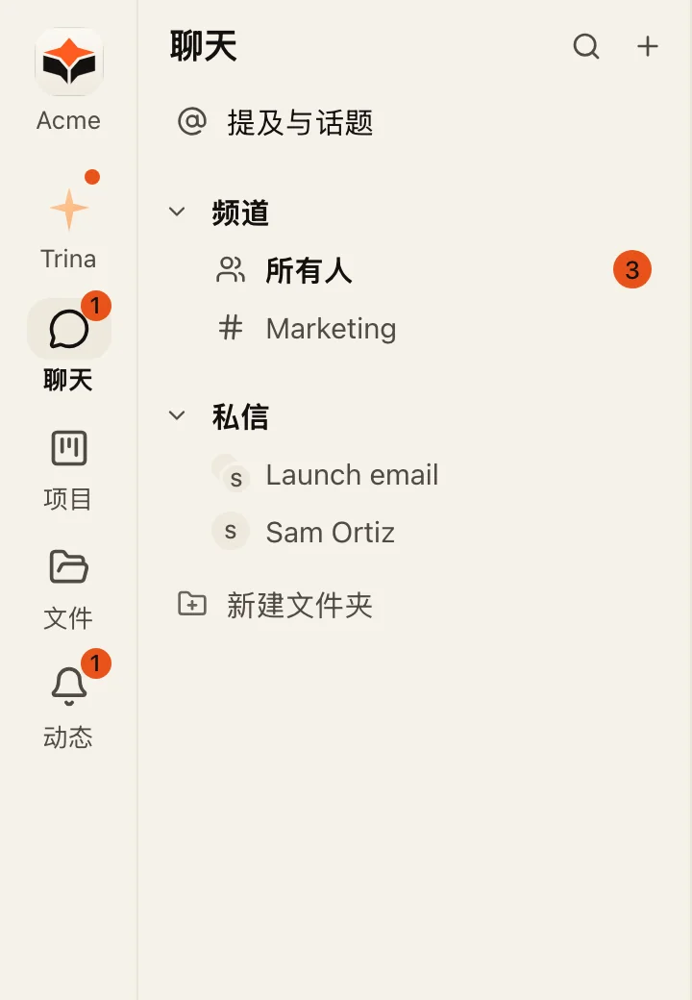

#### 在群聊旁边问 Trina

群聊顶部的 **✦** 按钮会在旁边打开一个和 Trina 的侧边对话。只有你能看到这个对话，AI 只用你有权打开的内容来回答。当某个回答值得分享时，回答下方的 **发送到群聊** 会把它作为你的消息发到群聊中（如果你问的是某一条消息，则是 **发送到话题**）。如果群聊里有些人打不开回答所用的文件，应用会先告诉你，等你同意后再发送。

话题打开时点 **✦**，侧边对话会在话题旁边打开，两者都留在屏幕上（窗口较小时，群聊会让出位置）。这时侧边对话的输入框会显示 **正在查看这个话题**：你的提问针对这个话题，回答也可以直接发到话题里。想问整个聊天的内容，就点这一行的 **✕**。

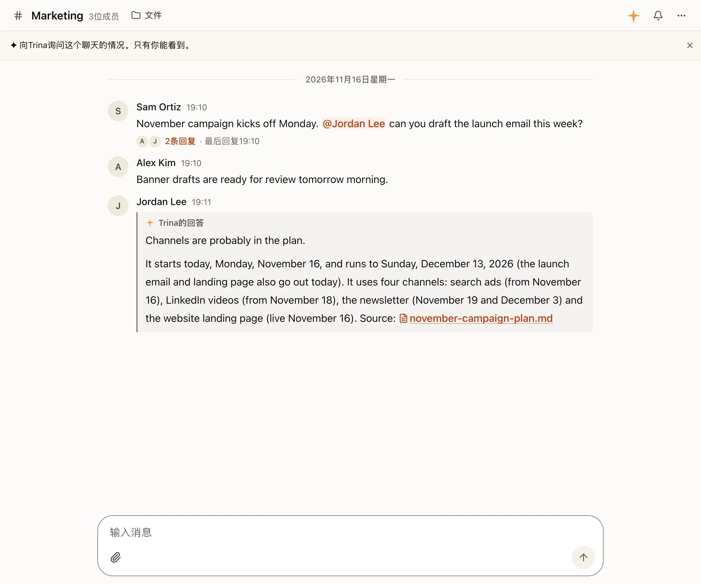

#### 在话题中回复

在一条消息上选择 **在话题中回复**，会把旁支讨论放在这条消息下面，让群聊保持清爽易读。群聊会显示一个话题有多少条回复；**同时发送到群聊** 会把回复也发到群聊中。

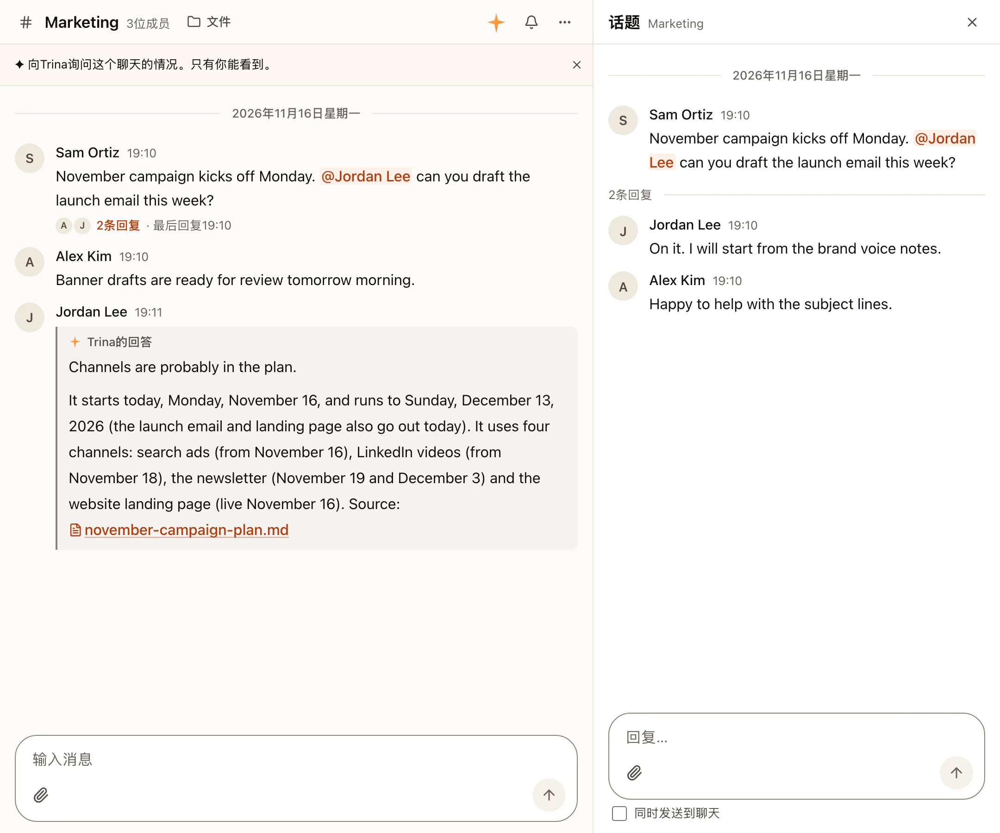

#### 链接到一条消息

在消息的 **⋯** 菜单中选择 **复制链接**（手机上长按消息）即可复制它的地址。把它粘贴到任何频道、群聊、私信或话题中：链接会显示为对话的名称，消息会以卡片形式显示在下面，包括作者、时间、内容和文件。点击卡片即可打开这条消息。

只有能看到那条消息的人才会看到卡片。其他人只会看到普通链接，打开时会提示找不到对话。如果对话中有人看不到那条消息，发送前输入框会提示：**只显示链接**（默认）只发送链接；**显示消息** 会向他们展示这条消息的副本，并标注由你分享。原消息被删除后，副本也会消失。要从自己的消息上移除卡片，把鼠标移到卡片上点击 **✕**（或在消息菜单中选择 **移除预览**）。

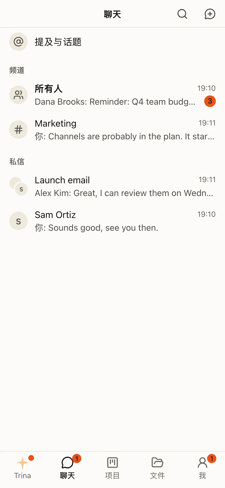

### 聊天出现在哪里

聊天列表在电脑和手机上的顺序相同：**已置顶**，然后是你自己的分组，然后是 **频道**、**项目** 和 **私信**。

- **项目** 里按名称列出每个团队项目自己的聊天室，带文件夹图标。有人发言后它才会出现，在那之前从项目里打开。这里没有 **+**：项目在项目页面创建，或从聊天创建（见 [把聊天转为项目](#把聊天转为项目)）。
- 一个聊天只出现在一个地方。你置顶的、或拖进自己分组的项目聊天室会离开 **项目**。把它拖到 **项目** 标题上即可放回。
- 项目移到回收站后，它的聊天室会离开列表。恢复项目后会回来。

### 部门的聊天室和部门文件夹

每个部门（**管理 › 小组** 中的小组）都有自己的频道。部门有你能打开的文件夹时，频道顶部会显示带部门名称的文件夹按钮，点击即可在文件页面中打开该文件夹。

- **在频道发送的文件会保存到部门文件夹的“对话附件”文件夹**，部门的文件都在一个地方。文件旁会显示它去了哪里，例如“销售 › 对话附件”。
- 当部门以外的人也能打开这个文件夹、频道里有人打不开“对话附件”、或你对文件夹只能查看时，文件只留在这个聊天中，并标为 **仅在此聊天中**。这时频道还会有 **文件**，列出这些文件。
- **删除消息只会删除消息。** 部门文件夹中的文件仍然保留，确认时会说明在哪里；如需删除，请在文件页面中删除。
- 管理员可以打开所有团队文件夹，所以即使不在这个部门，也能在文件页面中打开这些文件。他们看不到聊天内容。
- 之后加入部门的人可以打开“对话附件”中之前的所有文件，但看不到之前的消息，和项目一样。
- 部门文件夹在某个项目里面时，在频道发送的文件只留在这个聊天中。
- 在这项变化之前发送的文件留在频道中，在它的 **文件** 列表里。

### 访客

团队之外的人，例如代理公司或客户，可以作为访客加入私密频道、群聊或项目，最多在一个私密频道或群聊，以及一个项目中。在私密频道或群聊中，点开顶部的名称查看成员，选择 **添加成员**，再选 **邀请访客**；在项目中，在 **成员** 里选择 **添加成员**。写下链接是给谁的、是否让他们用 AI，然后 **创建链接**。链接只能用一次：请你自己发给对方。

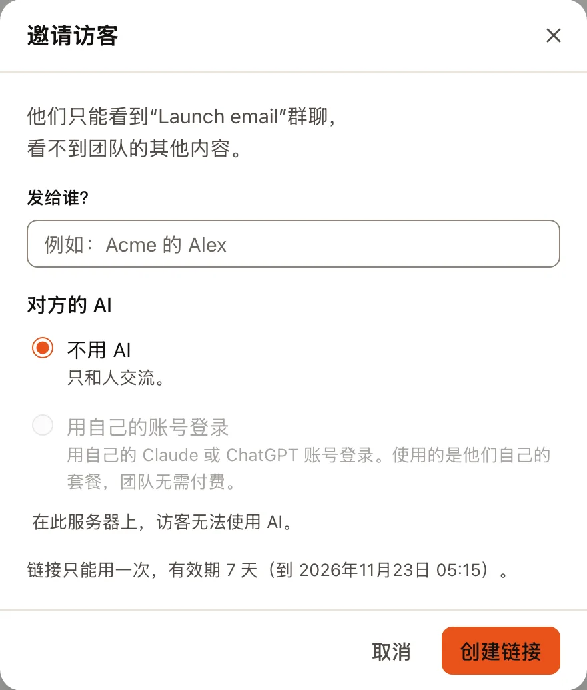

- 访客只能看到那一个地方：没有文件，看不到其他群聊、项目或团队区域。
- 他们的 AI 默认关闭，除非你选择 **用自己的账号登录**，或者管理员给他们一个带每月额度的 **团队 AI** 账号。
- 他们的名字旁边会显示 **访客** 标签，顶部会写着 **包括 1 位访客**。
- 管理员可以在 **管理 › 成员与邀请 › 访客** 中看到所有访客（[管理](admin.md#访客)）。

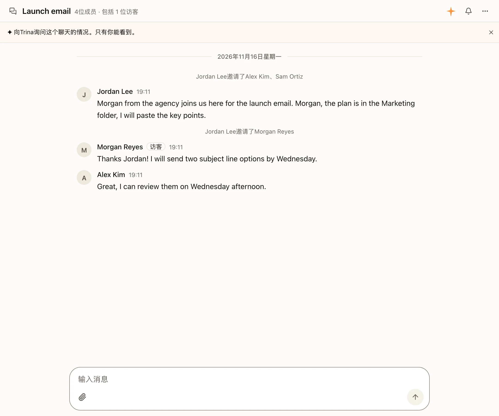

## 项目

项目把一项工作的对话、文件和指示放在一起，供你自己或你添加的人使用。适合总是回到同一批文件的工作：一次发布、一个客户、一个季度的报告。

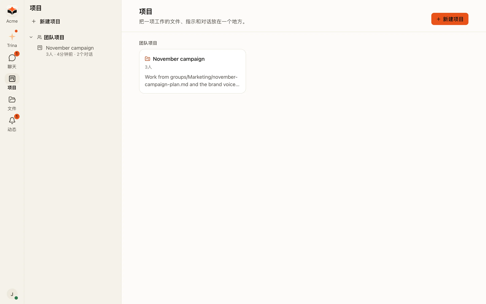

:::steps
#### 创建项目
打开左侧栏上的 **项目**（在手机上是 **项目** 标签页），选择 **新建项目**。给它起个名字。
新项目是 **仅自己**：在你添加其他人之前，只有你能看到它。

#### 编写指示
说明这项工作是什么，以及 AI 应该怎样帮忙。第一段会显示在项目标题下方。

#### 在项目中对话
从项目页面开始对话，或者用对话标题菜单中的 **移到项目** 把对话移进来。之后 AI 就能使用项目的文件和指示。

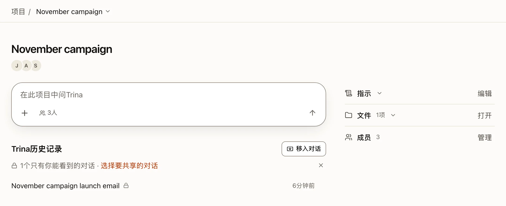
:::

- 你的项目在 **项目** 下，位于左侧栏和手机的 **项目** 标签页：**团队项目**（其他人也能看到）和 **我的项目**（只有你能看到）。点击项目名称会打开它的页面。从项目中打开的对话会回到这个项目；项目的对话也会出现在你 Trina 列表的 **Trina历史记录** 中。团队文件夹和它的回收站在 **文件** 下。
- 项目有成员。在项目页面上，**成员** 显示成员是谁，**添加成员** 可以把只属于你的项目分享出去。保存之前，它会告诉你：他们可以查看和编辑项目的文件和指示，你之前的对话仍然只属于你，而且项目无法再改回只有你自己。在有些团队中，只有所有者和管理员可以分享项目。
- 项目也可以有一位或多位访客：来自团队外部、只能看到这个项目的人。项目成员可以看到访客在这里的对话。[了解访客](guests.md)。
- 只有项目成员能看到其中的内容。所有者和管理员可以更改项目成员，但除非他们自己是成员，否则看不到项目的对话、文件和指示。
- **要重命名项目**，点击项目页面顶部的名称，输入新名称后按 Enter（按 Esc 取消）。也可以在 **项目** 列表中项目的
  **···**（或右键点击）里，或在页面顶部名称的菜单里选择 **重命名**。在手机上，点按顶部栏里的项目名称。只有项目的创建者、
  所有者和管理员可以重命名，其他人看到的只是普通文字。重命名项目不会改变它的文件夹名称。
- 一个文件夹对应一个项目。文件夹成为项目后，只有管理员能移动、重命名或删除它。
- 团队项目菜单中的 **移到回收站** 会把项目连同它的文件一起放进回收站。成员仍然能看到它的卡片，上面标着 **在回收站中**：项目页面会说明是谁、在什么时候把它移进回收站的，以及管理员或它的创建者可以恢复它。在恢复之前，没有人能打开它的文件、对话或指示。管理员或它的创建者可以在项目页面上恢复它，也可以在 **文件 › 回收站** 中恢复，在那里它是以项目名称命名的一行。**永久删除** 只有管理员能用。
- 不完全由你自己编写的指示，会被视为外部内容。AI 读过这些指示后，在记住任何内容之前都会先问你。
- **团队项目中的对话会与成员共享。** 项目消息输入框中 **+** 后面的小标签会显示谁能看到你正在开始的对话（例如 **👥 3 人**）。点一下可以只留给自己（**🔒 仅自己**）；下一个新对话又会默认共享。只有你能看到的对话带锁。每个问题都会显示发送者的头像和名字。每个回答都以提问者的身份、按他的权限运行。当 AI 要读取其中某些人打不开的内容时，会先问你（**读取并共享** / **不读取**）。
- **你带进来或移进来的对话仍然只属于你。** 项目页面会显示有几个（“1个只有你能看到的对话”），**选择要共享的对话**（或对话 **⋯** 菜单中的 **共享**）可以共享它们。共享后无法撤销。**移入对话** 可以把其他对话移进来。
- **项目对话中的文件。** 在共享的项目对话中，你从电脑附加的文件（**+**、粘贴或拖放）会保存在项目文件夹的 **对话附件** 子文件夹中（用团队的语言命名），项目的成员可以打开它，文件下方会有一行文字说明这一点。你需要对项目文件夹有写入权限（没有的话，**+** 只提供团队文件）；在发送前点 **✕** 会把文件移到回收站。

### 只给自己看的项目对话

在团队项目中新开的对话会共享给项目里的所有人，就像你在共享的 Google Drive 文件夹里新建的文档一样。想问一个只有你能看到的问题：

1. 打开项目页面。
2. 看消息输入框里 **+** 的右边：小标签显示谁会看到这个对话，例如 **👥 3 人**。
3. 点这个小标签，它会变成 **🔒 仅自己**。
4. 输入问题并发送。

这个对话在项目列表和你的 Trina 历史记录中带锁：只有你能看到。项目里的下一个新对话又会默认共享，所以每次都要看一下小标签。
以后想共享它，在对话的 **⋯** 菜单中选择 **共享**（或对话右上角的 **共享**）。共享后，到目前为止的全部对话
内容项目成员也都能看到，并且无法撤销。

### 项目聊天室

每个团队项目都有自己的聊天室。项目里的人就是聊天室里的人，聊天室的文件就是项目的文件：只有一份成员名单，文件也只放在一个地方。

- 在项目页面点 **聊天室**（手机上是项目名称下方的一行）即可打开。第一次打开时，会以项目名称创建聊天室。**项目** 列表中项目行上的小聊天图标（有未读时带一个点），以及项目 AI 对话顶部的 **聊天室**，也能打开它。
- 聊天室顶部带项目名称的文件夹按钮会打开项目页面（文件和 AI 对话）。有人发言后，聊天室会带着文件夹图标出现在聊天列表的 **项目** 中。
- **成员随项目变化。** 把人加入项目，他也会进入聊天室，并能看到全部历史记录；把人移出项目，他也会离开聊天室。添加之前，成员窗口会说明这一点。要更改成员，点顶部的聊天室名称，然后选 **管理成员**（仅限可以更改项目成员的人）。**静音** 让聊天室安静；**退出项目** 会同时退出项目和聊天室。
- **在聊天室发送的文件会保存到项目的“对话附件”文件夹**，项目成员可以在文件页面找到。只能查看项目的人可以发消息，但不能添加文件。
- **删除消息只会删除消息。** 文件仍保留在项目的“对话附件”中；如需删除，请在文件页面中删除。
- 聊天室侧边的 Trina 对话会把新文档保存在项目文件夹中，项目的 AI 对话也能读取聊天室。两者面对的是同一群人，所以不会询问谁能看到。
- 聊天室的 **✦** 侧边对话只有你能看到。为空时会说明这一点，并链接到项目页面，项目的人在那里一起问 Trina。
- 当项目的人正好和某个部门的人完全相同时，聊天室开头和聊天室信息会显示“成员与#销售相同。Atlas的事在这里聊。”，并带有通往部门频道的链接。

### 把聊天转为项目

变成正式工作的私人频道或群聊，可以连同历史记录一起转为项目。

1. 打开聊天的 **⋯**（顶部、列表中的那一行，或在手机上长按那一行），选择 **转为项目**。只有可以创建团队项目的人才能看到；在只有管理员能创建项目的团队中，成员看不到。
2. 检查名称。一开始是聊天的名称（没有名称的群聊则是成员的名字）。如果已有同名项目，新文件夹会加上“-2”，对话框会说明。
3. 阅读将发生的变化，然后选择 **创建项目**：
   - 聊天中的每个人都会成为项目的成员。
   - 聊天中发送的文件会移到项目的 **对话附件** 文件夹。并非聊天中每个人都能看到的文件（例如在某人加入之前发送的）会留在聊天中，对话框会说明有几个。
   - 之后加入项目的人从那时起看到消息，也能打开移过去的文件。

聊天保持打开，现在是项目的聊天室：顶部有项目的文件夹按钮，并有一行说明是谁把它转为项目。移动文件期间，顶部显示 **正在移动文件…**；结束后再有一行说明移了几个、留下几个。留下的文件标为 **仅在此聊天中**，聊天室会保留一个列出这些文件的 **文件** 列表。

你的置顶、分组、通知和阅读位置都不变。如果对话框打开期间有人加入或离开，会显示 **人员有变化** 和新的人数。如果其中有已经属于另一个项目的访客，就无法转换：需要管理员先把他设为团队成员。

在私信中，**⋯** 里改为 **与某人新建项目**。它会为你们两人新建一个项目和它的聊天室，私信保持不变。

## 查找任何内容

按 ⌘K（Windows 上按 Ctrl+K），或者选择 **问Trina** 下方的 **搜索**，可以查找对话、聊天中的消息、项目、文件、技能、定时任务和 MCP 连接。[阅读关于搜索和设置的说明](settings-and-search.md)。

**你发送的文件。** 在搜索中输入“你发送的文件”，或从通知打开，即可看到你在聊天中发送的文件，从大到小排列，并显示它们占用的空间。删除一个文件，会把与它一起发送的消息也删除，聊天中的所有人都将看不到。

## 已删除的对话

删除对话会把它移到 **已删除的历史记录**，就像 iPhone 上的“最近删除”相簿：默认在 7 天内可以恢复。管理员可以设置为 1 到 365 天。

要恢复一个对话：

1. 点击左侧栏上的 **Trina**。在手机上，打开 **Trina** 标签页，点顶部的 **☰**。
2. 点 **Trina历史记录** 标题末尾的 **⋯**，选择 **已删除的历史记录**。在手机上，**已删除的历史记录** 在菜单的最下面。
3. 找到这个对话（每一行都写着它是什么时候删除的），点 **恢复**。

这一行会从列表中消失，对话回到你的 Trina 历史记录中。

- 共享对话会进入创建者的 **已删除的历史记录**。当项目的创建者或管理员删除了别人的共享对话时，这个对话也会出现在他们自己的 **已删除的历史记录** 中，只要他们还能恢复它。
- 永久删除一个项目时，它的共享对话会移到各自创建者的 **已删除的历史记录** 中。这样的对话被恢复后，只属于它的创建者，不再属于任何项目。
