对话就是和 AI 的一次交谈。在你[共享某个对话](#共享对话)之前，只有你能看到自己的对话；团队项目中的对话，项目成员都能看到。管理员能看到 AI 读了哪些文件，但永远看不到对话内容。

## 开始对话

:::steps
#### 打开新对话
在 Trina 列表顶部选择 **问Trina**（左侧栏上的 **Trina**），按 ⇧⌘O（Windows 上按 Ctrl+Shift+O），或者在首页的输入框中输入。在手机上，**Trina** 标签页会打开首页：在底部的输入框中输入。第一次使用时，输入框下方的 **团队中已准备好** 会列出你的团队已经设置好的内容：团队的技能（**示例** 展示一个结果，**试试看** 打开这个技能），直到你运行过一个技能为止；还有团队文件（**提问** 会把关于这些文件的问题放进输入框，但不会发送）。如果还没有设置任何内容，**从这里开始** 会提供一个可以发送的问题。

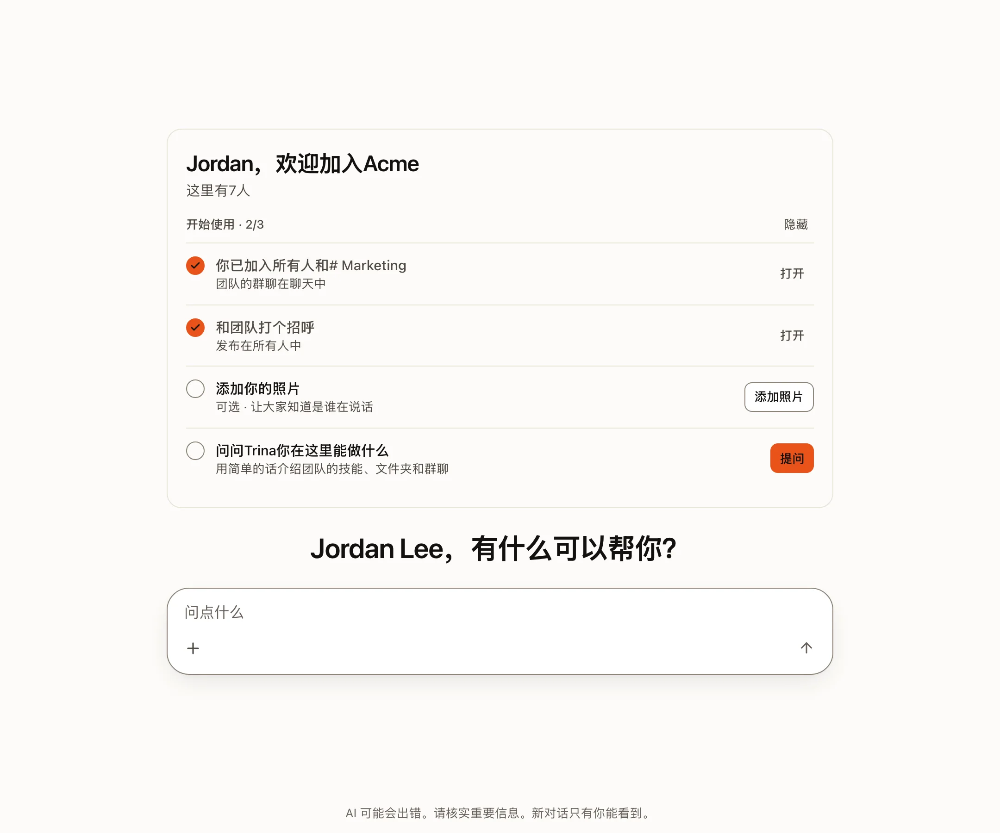

#### 用平常的话提问
例如：“总结一下 shared/sales 里上周的销售笔记。”输入 `/` 可以选择一个团队技能。

#### 查看工作过程
打开回答下方的 **N个步骤**，可以看到 AI 用过的每个工具和读过的每个文件。
:::

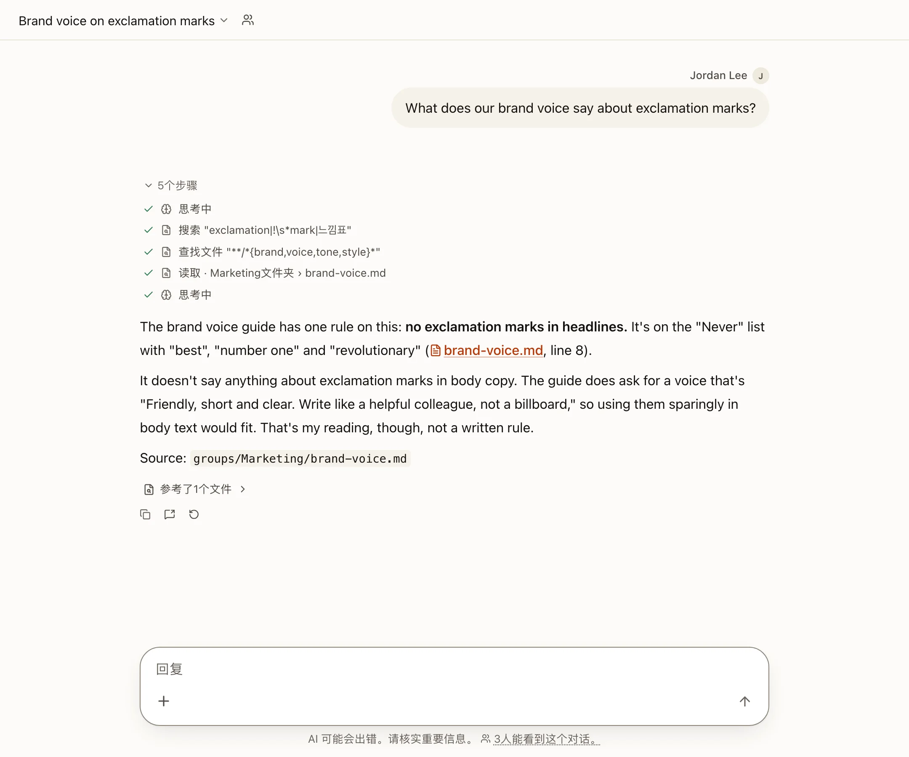

## 回答是怎样产生的

| 方面 | 会发生什么 |
|---|---|
| **引擎** | 成员使用团队的默认设置。管理员允许的人可以在对话中选择引擎和模型。 |
| **文件** | AI 使用 Trina 的文件工具。每次调用都会按你自己的权限进行检查。 |
| **问题** | 当 AI 需要你做选择或确认时，它会显示一张卡片。它不能自己回答这张卡片。 |
| **助手** | 遇到大的请求时，AI 可以把工作拆成子任务，最多同时进行 4 个。每个助手都以你的身份工作。 |
| **长度** | 一个回答默认最多可以使用工具 150 次（管理员可在 10 到 500 之间选择）。达到上限时，**继续** 会接着做下去。 |
| **网页** | AI 可以打开网页。服务器会检查每个地址，遇到有风险的地址会先问你。 |

:::note
选中的上下文会发送给你连接的 AI 提供商。自行托管并不等于离线处理。[阅读数据流向](../../operate/security.md)（英文）。
:::

## 你的 Trina 列表

在电脑上，左侧栏上的 **Trina** 会在页面旁边打开你的 Trina 对话列表。顶部是 **问Trina**、**搜索**、**定时任务** 和 **团队技能**。它们下面从上到下依次是：

| 部分 | 里面有什么 |
|---|---|
| **正在等你** | 只在有对话等待你回答时显示，点击即可打开 |
| **已置顶** | 你置顶的对话 |
| **Trina历史记录** | 你的其他所有对话，最新的在前。属于某个项目的对话，会在这一行末尾显示项目名称 |

标题前的小标记说明谁能看到这个对话：锁表示团队项目中只有你能看到的对话，人员图标（或其他参与者的头像）表示你共享的对话。

当左侧栏上的 **Trina** 显示 **?** 时，点击它也会打开正在等待的对话。你删除的对话在 **已删除的历史记录** 中，位于 **Trina历史记录** 旁边的 **⋯** 菜单里。列表顶部的筛选按钮可以只显示部分对话，例如正在回答或正在等你的对话。你的项目有自己的位置：左侧栏上的 **项目**。

在手机上，**Trina** 标签页会打开首页。顶部的 **☰** 会打开你的历史记录：**搜索**、**定时任务**、**团队技能**，然后是 **Trina历史记录**（先是你置顶的对话，再按日期排列，最新的在前），最下面是 **设置状态** 和 **已删除的历史记录**。

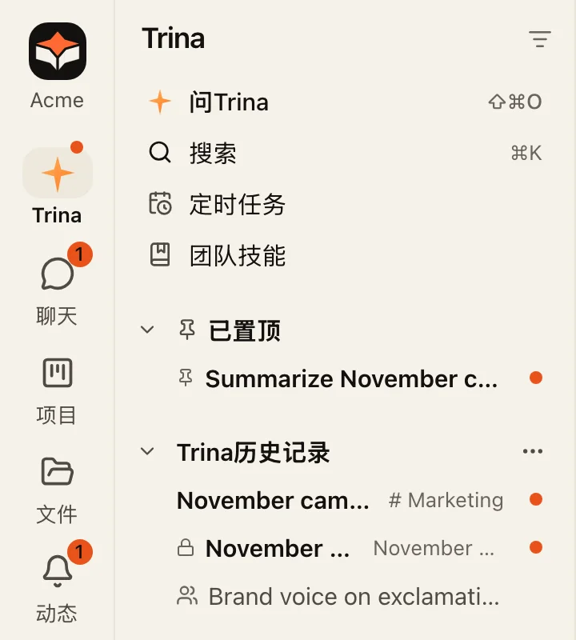

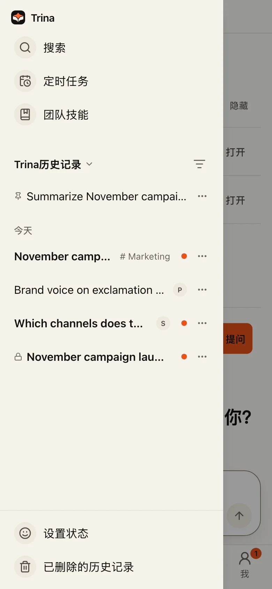

### 文件夹

Trina 对话没有文件夹。想把同一项工作的对话放在一起，就把它们放进一个[项目](#项目)。

**聊天** 列表中有用于群聊和私信的 **聊天文件夹**。文件夹只用来整理你的列表，没有别的作用：它不存放文件，也绝不会改变谁能看到某个聊天。用 **新建文件夹** 创建一个，然后使用聊天的 **···** › **移到文件夹**。文件夹的 **···** 可以重命名它、上移或下移它，或者删除它；删除文件夹后，其中的聊天仍然留在你的列表中。

## 同时进行多个对话

Trina 对话列表中的每个对话，最多在这一行的右端显示一个标记：

| 标记 | 含义 |
|---|---|
| 琥珀色的 **?** | AI 在等你：一张问题或确认卡片，或者一个失败了或因达到上限而暂停的回答。卡片的 **?** 会一直保留，直到你回答它。 |
| 灰色圆环 | AI 正在回答，或者回答正在排队。 |
| 圆点，标题加粗 | 一个你还没打开的新回答。 |

打开一个对话会清除它的圆点，以及失败或暂停的回答的 **?**，在所有设备上都会清除。折叠起来的部分会显示其中对话最重要的那个标记。当 AI 在某个群聊中等你回答时，这个群聊会用 **?** 代替数字。

当浏览器标签页在后台时，它的标题会显示需要你处理的对话和群聊的数量，例如“(2) Trina”。桌面应用会在 Mac 的程序坞上显示同样的数字；当一张卡片出现，或者一个运行超过一分钟的回答在你看别处时结束，它还会发出通知，点击通知即可打开那个对话。定时任务只会显示标记；从 Slack 提出的问题会在 Slack 中回答，所以它的对话不会出现圆点。当有对话需要你时，左侧栏上的 **Trina**（在手机上是 **Trina** 标签页）会显示 **?** 或圆点；当 AI 在某个群聊中等你回答时，**聊天** 会显示 **?**；在手机上，应用中还会出现一条带 **打开** 的简短消息。

## 置顶对话

在你的 Trina 对话列表中，对话的 **···**（或者在这一行上点击右键，在手机上则是长按）里有 **置顶**。
置顶的对话会排在 Trina 列表的最前面，最近置顶的在最前，标题前有一个小图钉，在电脑和手机上都是如此。项目页面也会把你置顶的对话排在最前面。**取消置顶** 会把对话放回原处。置顶只对你自己有效，在共享的项目对话中也是如此；对话被删除或你不再能看到它时，置顶也会消失。你最多可以置顶 50 个对话。

**聊天** 中的聊天（群聊、私信和多人聊天）也用同样的方式置顶，通过一行的 **···** 或群聊自己的 **···**：置顶的聊天排在最前面，名称后有一个小图钉，在所有聊天列表中都是如此，在电脑上和手机的 **聊天** 标签页中都一样。
只有你能看到自己的置顶。你离开或隐藏一个群聊时，它的置顶也会消失。你最多可以置顶 50 个聊天。

**聊天** 列表会显示所有聊天：你的置顶、你的文件夹，然后是 **团队群聊**（先是全员群聊，再按名称排列）、**群聊** 和 **私信**（最新的在前）。你隐藏的聊天在 **已隐藏的聊天（N）** 里。

## 共享对话

项目之外的对话可以像 Google 云端硬盘中的文件一样，共享给人员和小组。在对话标题菜单中（或 Trina 列表中某一行的 **···**）选择 **共享…**，在 **添加人员和群组** 中输入名字，然后 **保存**。**✕** 可以再把某人移出，保存之前都可以 **撤销**。

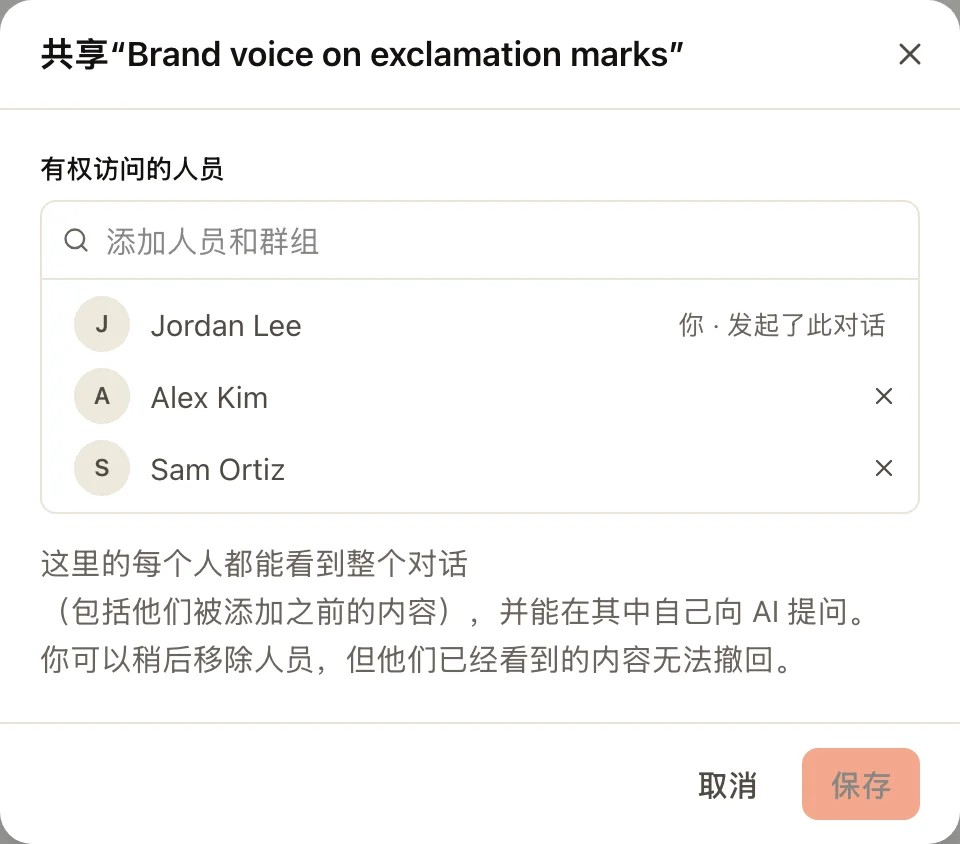

- 被共享的每个人都能看到整个对话，包括他们被加入之前说过的内容，也可以自己在里面问 AI。每个回答都以提问者的身份、按他能打开的内容运行。
- 在加入新的人之前，应用会说明哪些回答用到了其中某些人打不开的地方，并请你选择 **仍然共享**。
- 你添加的人会在自己的 Trina 历史记录和 **动态** 中看到它，可以继续对话，也可以 **从我的列表中隐藏**。他们的手机或浏览器会收到一条通知，说明是谁共享给他们的（**设置 › 通知 › 与我共享的对话** 可以关闭）。
- 你从电脑上传的文件会和对话保存在一起：能看到这个对话的人都可以打开它并向 Trina 询问，其他人不行。把某人移出，或把对话改回私人，他们就无法再看到这些文件；删除对话会一并删除文件。
- 只有发起对话的人可以更改谁能看到它。标题菜单中的 **在只有你能看到的对话中继续** 会为你开始一个私人副本。
- 团队项目中的对话改为与项目成员共享（见[项目](#项目)）；个人项目中的对话要先移出才能共享。

与已离开团队的人的私聊会显示“<姓名>已离开团队”，并且没有输入框，历史记录仍然可以查看。

## 团队聊天

左侧栏上的 **聊天**（在手机上是 **聊天** 标签页）是人与人交流的地方：**团队群聊**（团队全员一个，每个小组一个）、**群聊** 和 **私信**。顶部的 **提及与话题** 会汇集提到你的消息和你关注的话题。

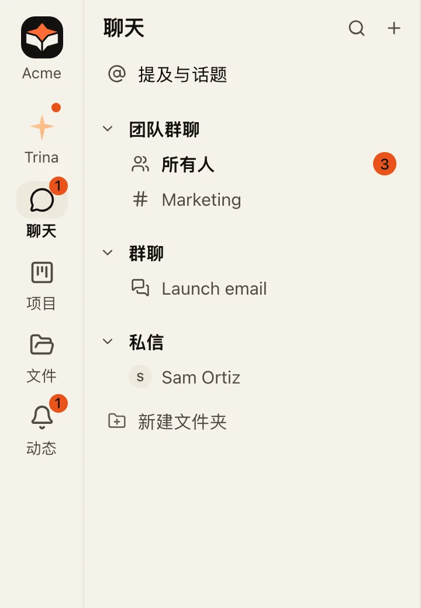

#### 在群聊旁边问 Trina

群聊顶部的 **✦** 按钮会在旁边打开一个和 Trina 的侧边对话。只有你能看到这个对话，AI 只用你有权打开的内容来回答。当某个回答值得分享时，回答下方的 **发送到群聊** 会把它作为你的消息发到群聊中（如果你问的是某一条消息，则是 **发送到话题**）。如果群聊里有些人打不开回答所用的文件，应用会先告诉你，等你同意后再发送。

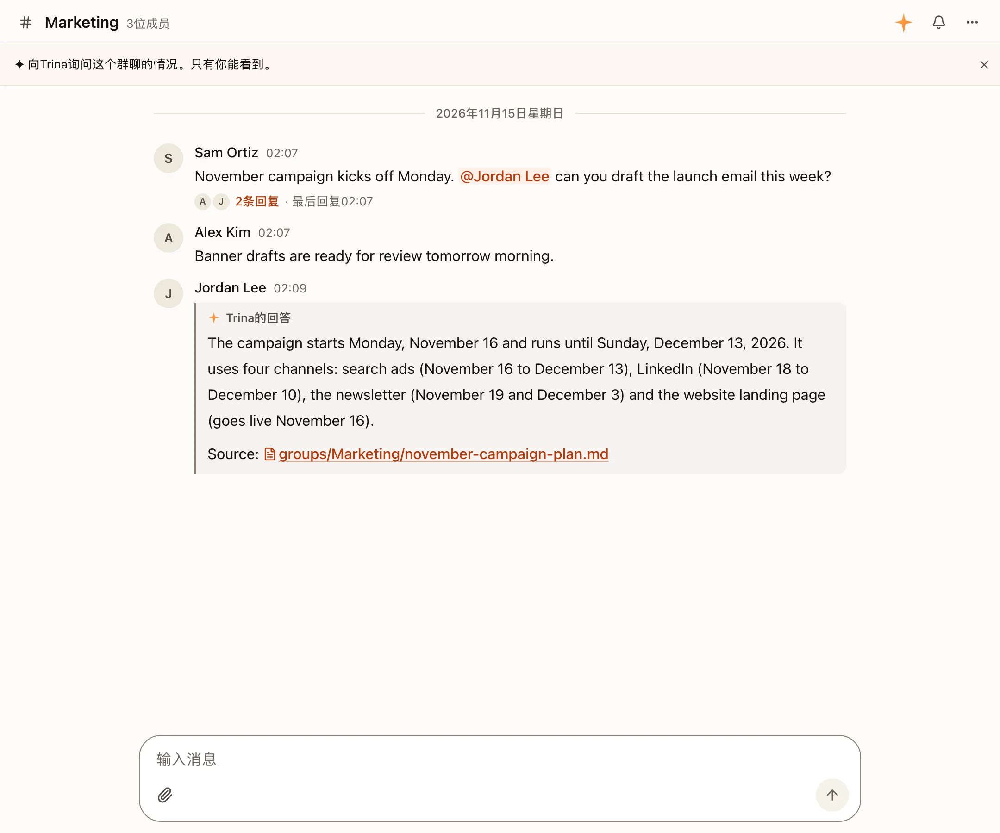

#### 在话题中回复

在一条消息上选择 **在话题中回复**，会把旁支讨论放在这条消息下面，让群聊保持清爽易读。群聊会显示一个话题有多少条回复；**同时发送到群聊** 会把回复也发到群聊中。

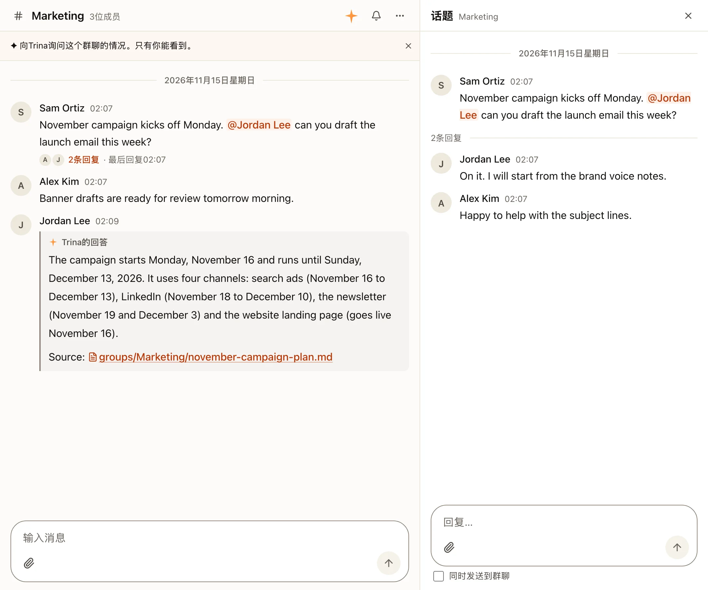

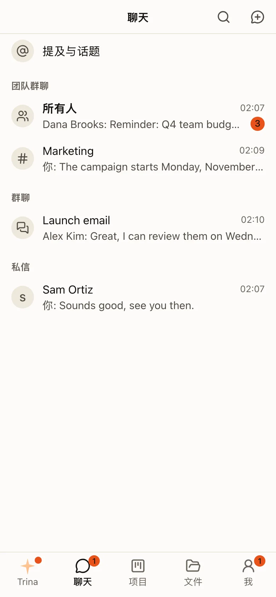

### 访客

团队之外的人，例如代理公司或客户，可以作为访客加入 **一个** 群聊或 **一个** 项目。在群聊中，点开顶部的名称查看成员，选择 **邀请成员**，再选 **邀请访客**；在项目中，在 **成员** 里选择 **添加成员**。写下链接是给谁的、是否让他们用 AI，然后 **创建链接**。链接只能用一次：请你自己发给对方。

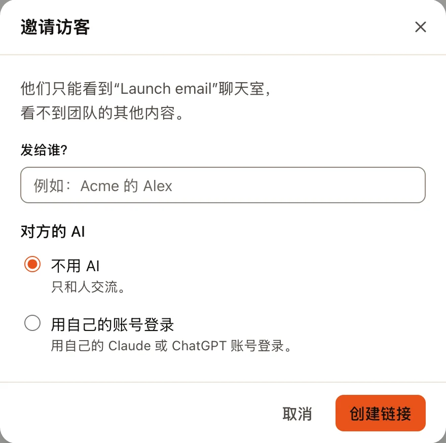

- 访客只能看到那一个地方：没有文件，看不到其他群聊、项目或团队区域。
- 他们的 AI 默认关闭，除非你选择 **用自己的账号登录**，或者管理员给他们一个带每月额度的 **团队 AI** 账号。
- 他们的名字旁边会显示 **访客** 标签，顶部会写着 **包括 1 位访客**。
- 管理员可以在 **管理 › 成员与邀请 › 访客** 中看到所有访客（[管理](admin.md#访客)）。

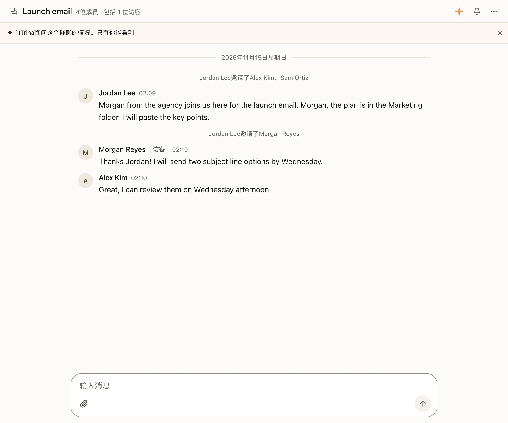

## 项目

项目把一项工作的对话、文件和指示放在一起，供你自己或你添加的人使用。适合总是回到同一批文件的工作：一次发布、一个客户、一个季度的报告。

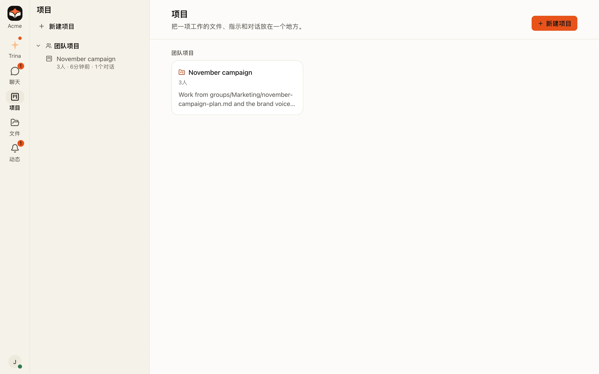

:::steps
#### 创建项目
打开左侧栏上的 **项目**（在手机上是 **项目** 标签页），选择 **新建项目**。给它起个名字。
新项目是 **仅自己**：在你添加其他人之前，只有你能看到它。

#### 编写指示
说明这项工作是什么，以及 AI 应该怎样帮忙。第一段会显示在项目标题下方。

#### 在项目中对话
从项目页面开始对话，或者用对话标题菜单中的 **移到项目** 把对话移进来。之后 AI 就能使用项目的文件和指示。

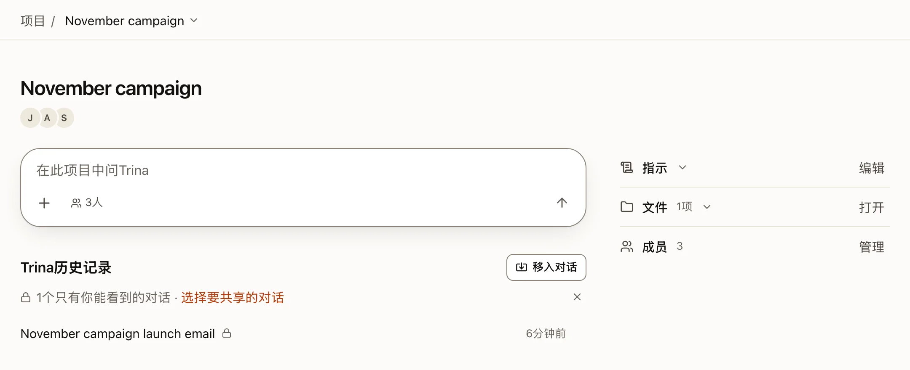
:::

- 你的项目在 **项目** 下，位于左侧栏和手机的 **项目** 标签页：**团队项目**（其他人也能看到）和 **我的项目**（只有你能看到）。点击项目名称会打开它的页面。从项目中打开的对话会回到这个项目；项目的对话也会出现在你 Trina 列表的 **Trina历史记录** 中。团队文件夹和它的回收站在 **文件** 下。
- 项目有成员。在项目页面上，**成员** 显示成员是谁，**添加成员** 可以把只属于你的项目分享出去。保存之前，它会告诉你：他们可以查看和编辑项目的文件和指示，你之前的对话仍然只属于你，而且项目无法再改回只有你自己。在有些团队中，只有所有者和管理员可以分享项目。
- 只有项目成员能看到其中的内容。所有者和管理员可以更改项目成员，但除非他们自己是成员，否则看不到项目的对话、文件和指示。
- 一个文件夹对应一个项目。文件夹成为项目后，只有管理员能移动、重命名或删除它。
- 团队项目菜单中的 **移到回收站** 会把项目连同它的文件一起放进回收站。成员仍然能看到它的卡片，上面标着 **在回收站中**：项目页面会说明是谁、在什么时候把它移进回收站的，以及管理员或它的创建者可以恢复它。在恢复之前，没有人能打开它的文件、对话或指示。管理员或它的创建者可以在项目页面上恢复它，也可以在 **文件 › 回收站** 中恢复，在那里它是以项目名称命名的一行。**永久删除** 只有管理员能用。
- 不完全由你自己编写的指示，会被视为外部内容。AI 读过这些指示后，在记住任何内容之前都会先问你。
- **团队项目中的对话与成员共享。** 项目输入框中 **+** 后面的小标签会说明谁能看到你要开始的对话（例如 **👥 3 人**）；点一下变成 **🔒 仅自己**，这个对话就只有你能看到。只有你能看到的对话带锁。移进项目的对话默认是私人的：项目页面上的 **1个只有你能看到的对话 · 选择要共享的对话**（或对话菜单中的 **共享给项目成员**）可以共享它们，**移入对话** 可以把其他对话移进来。共享对话中的每个问题都会显示发送者的头像和名字。每个回答都以提问者的身份、按他的权限运行；当 AI 要读取其中某些人打不开的内容时，会先问你。你从电脑上附加的文件（📎、粘贴或拖放）会保存在项目文件夹的 **对话附件** 子文件夹中（用团队的语言命名），项目的成员可以打开它，文件下方会有一行文字说明这一点；你需要对项目文件夹有写入权限（没有的话，输入框只提供团队文件），在发送前点 **✕** 会把文件移到回收站。

## 查找任何内容

按 ⌘K（Windows 上按 Ctrl+K），或者选择 **问Trina** 下方的 **搜索**，可以查找对话、聊天中的消息、项目、文件、技能、定时任务和 MCP 连接。[阅读关于搜索和设置的说明](settings-and-search.md)。

## 已删除的对话

删除对话会把它移到 **已删除的历史记录**，默认在 7 天内可以恢复。管理员可以设置为 1 到 365 天。

- 共享对话会进入创建者的 **已删除的历史记录**。当项目的创建者或管理员删除了别人的共享对话时，这个对话也会出现在他们自己的 **已删除的历史记录** 中，只要他们还能恢复它。
- 永久删除一个项目时，它的共享对话会移到各自创建者的 **已删除的历史记录** 中。这样的对话被恢复后，只属于它的创建者，不再属于任何项目。
