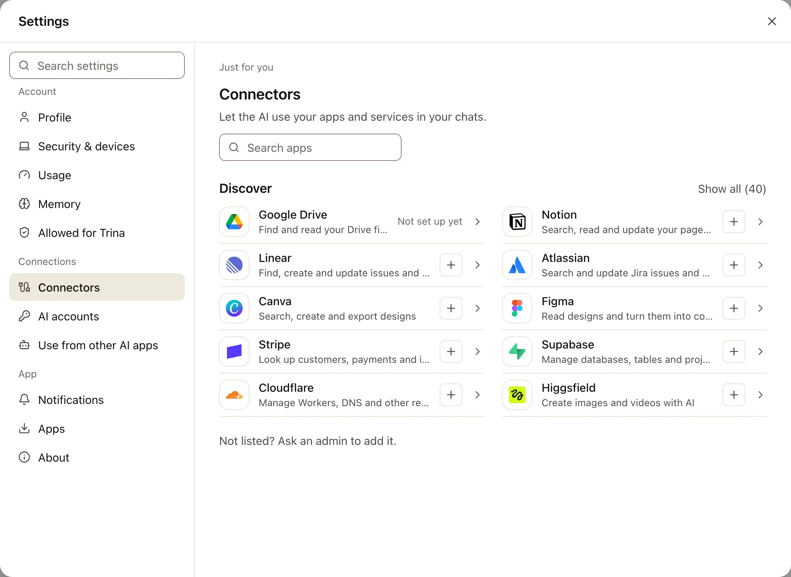
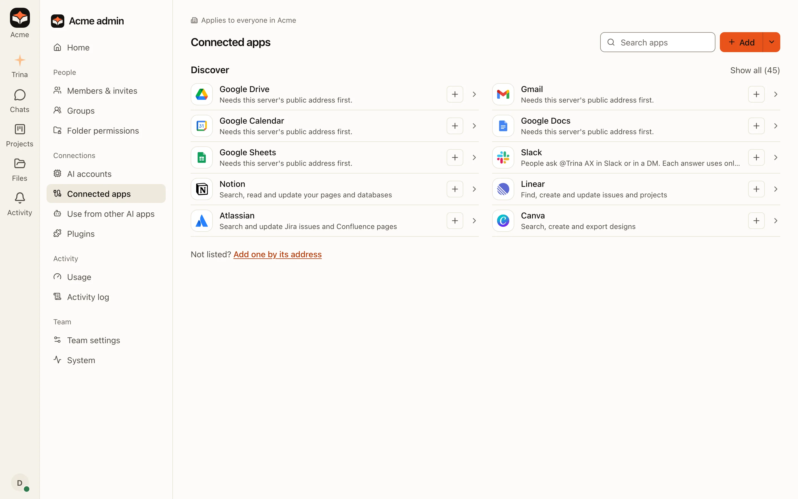

Trina AX 可以连接两类东西：

- **AI 账号**，负责回答你的问题：Claude 或 ChatGPT 账号，或者 Anthropic、OpenAI 或其他 AI 公司的 API 密钥。Trina AX
  不自带 AI：由你的团队连接自己的账号，费用由那家公司向你连接的账号收取。
- **应用**，AI 会替你使用它们：Google Drive、Gmail 和其他 Google 应用、Slack、Notion、Linear、GitHub，或者公司自己的系统。

本页告诉你该看哪篇指南。每篇指南的开头都列出了你需要的每个值，以及从哪里获取。

:::note
这些指南中的截图使用的是一家虚构的公司“Acme”和虚构的密钥。真实的密钥绝不会出现在页面或图片中。
:::

## 去哪里设置

| 你想做的事 | 由谁操作 | 在 Trina AX 中的位置 | 指南 |
|---|---|---|---|
| 让 AI 能回答问题 | 所有者或管理员 | **管理 › AI 账号** | [AI 账号](ai-accounts.md) |
| 用你自己的 Claude 或 ChatGPT 账号回答你自己的问题 | 你（在团队允许时） | **设置 › AI 账号** | [AI 账号](ai-accounts.md#你自己的账号) |
| 让 AI 读取你的 Google Drive、Gmail、日历、文档或表格 | 你 | **设置 › 连接器** | [Google 应用](google-apps.md) |
| 在 Google 的登录页面上显示公司名称 | 使用 Google Workspace 的公司的管理员 | **管理 › 已连接的应用** › 某个 Google 应用 | [使用公司自己的 Google 应用](google-own-app.md) |
| 在 Slack 中向 Trina AX 提问 | 管理员操作一次，然后每人操作一次 | **管理 › 已连接的应用 › Slack** | [Slack](slack.md) |
| 让 AI 使用 Notion、Linear、Atlassian、Figma、GitHub 等应用 | 你为自己设置，管理员为团队设置 | **设置 › 连接器**或**管理 › 已连接的应用** | [Notion、Linear 等应用](mcp.md) |
| 让 AI 使用公司自己的系统（API），或需要用你自己的登录应用的服务，例如 NAVER WORKS | 管理员 | **管理 › 已连接的应用** › **通过地址添加** | [公司自己的 API](api-connections.md) |
| 在 Claude 或 ChatGPT 中使用你在 Trina AX 中的文件 | 你 | **设置 › 在其他 AI 应用中使用** | [Team AX MCP 连接器](../../agents/mcp-connector.md)（英文） |

要打开**设置**，点左侧栏底部你的头像，再点**设置**（在手机上是**我**标签页）。所有者和管理员在同一个菜单中还能看到**管理**。

## 每个值，以及从哪里获取

你永远不会需要全部这些。找到你要连接的应用，这一行的其余部分会告诉你要准备什么。

| 要连接的 | 你在 Trina AX 中填写 | 从哪里获取 |
|---|---|---|
| Claude API 密钥 | **API 密钥**（一长串以 `sk-` 开头的代码） | [Claude Console › API keys](https://platform.claude.com/settings/keys) › **Create Key** |
| Claude 订阅 | 你批准后 **Claude 显示的代码**（中间有一个 `#`） | claude.ai，在**打开Claude进行批准**打开的窗口中 |
| OpenAI API 密钥 | **API 密钥**（以 `sk-` 开头） | [OpenAI platform › API keys](https://platform.openai.com/api-keys) › **Create new secret key** |
| ChatGPT 套餐 | 不用填：你是在 **OpenAI 那边**输入代码 | Trina AX 会显示地址和代码 |
| API 引擎（OpenRouter、Gemini……） | **API 地址**、**模型**、**API 密钥** | 那家 AI 公司的 API 页面（见 [API 引擎](ai-accounts.md#api-引擎)） |
| Google Drive、Gmail、日历、文档、表格 | 不用填：在 Google 上登录 | 你的 Google 账号 |
| 公司自己的 Google 应用 | Google Cloud 中的 **JSON 文件**（或**客户端 ID** 和**客户端密钥**） | Google Cloud › Google Auth Platform › **Clients** |
| Slack（托管的团队） | 不用填：**添加到 Slack** | 由 Slack 工作区管理员允许 |
| Slack（你自己的 Slack 应用） | **Bot User OAuth Token**（`xoxb-`）、**App-Level Token**（`xapp-`）、**Client ID**、**Client Secret** | api.slack.com › 你的应用 |
| Notion、Linear、Atlassian、Figma、Canva 以及“发现”中的其他应用 | 不用填：在应用自己的页面上登录 | 你在那个应用中的账号 |
| GitHub | **地址** `https://api.githubcopilot.com/mcp/` 和一个**密钥**（个人访问令牌） | [GitHub › Settings › Developer settings › Personal access tokens](https://github.com/settings/personal-access-tokens/new) |
| 其他提供密钥的应用 | **地址**和**密钥**（有时还有**请求头名称**） | 应用的帮助页面（“MCP server”“API keys”） |
| 公司自己的 API | **地址**、**密钥**、**使用说明** | 负责那个系统的人 |
| NAVER WORKS 等需要用你自己的应用登录的服务 | **Client ID**、**Client secret**、**登录地址**、**Token地址**、**权限范围** | 那个应用的开发者控制台 |

## 个人还是团队

| | 个人 | 团队 |
|---|---|---|
| 在哪里创建 | **设置 › 连接器**或**设置 › AI 账号** | **管理 › 已连接的应用**或**管理 › AI 账号** |
| 谁使用 | 只有你，在你自己的对话中 | 管理员选择的人：所有人、小组或个人 |
| 谁能看到密钥 | 谁都看不到，管理员也看不到 | 谁都看不到：管理员只能看到已保存了密钥，看不到密钥本身 |

密钥和登录信息加密保存在服务器上，之后不会再显示。要更改密钥，就替换它。

## 常见错误

| 发生了什么 | 原因 | 该怎么做 |
|---|---|---|
| “请输入密钥。”或“不是这种类型的API密钥。” | 复制密钥时多了空格、换行，或少了结尾 | 用提供方的复制按钮重新复制，不要手动选中文字 |
| Google 上出现 `redirect_uri_mismatch`，或登录时提示地址不对 | 提供方控制台中的返回地址和 Trina AX 显示的地址差了一个字母、`http` 或一个斜杠 | 在 Trina AX 对话框中用复制按钮复制地址，再重新粘贴到控制台 |
| “部分权限未勾选。” | 在 Google 的页面上取消勾选了某一项 | 重新连接，并保持所有选项都勾选 |
| 某个连接显示“需要登录” | 密钥被撤销、过期，或登录已失效 | 打开它并选择**重新登录**，或替换密钥 |
| 成员看到“没有列出？请管理员添加。” | 只有所有者和管理员可以通过地址添加应用 | 由管理员为团队添加，或作为每位成员各自连接的模板添加 |
| AI“无法”使用你连接的应用 | 这个连接是别人的，或者团队连接的使用者中没有你 | 在**设置 › 连接器**中，确认这个应用在**你的连接器**下 |
