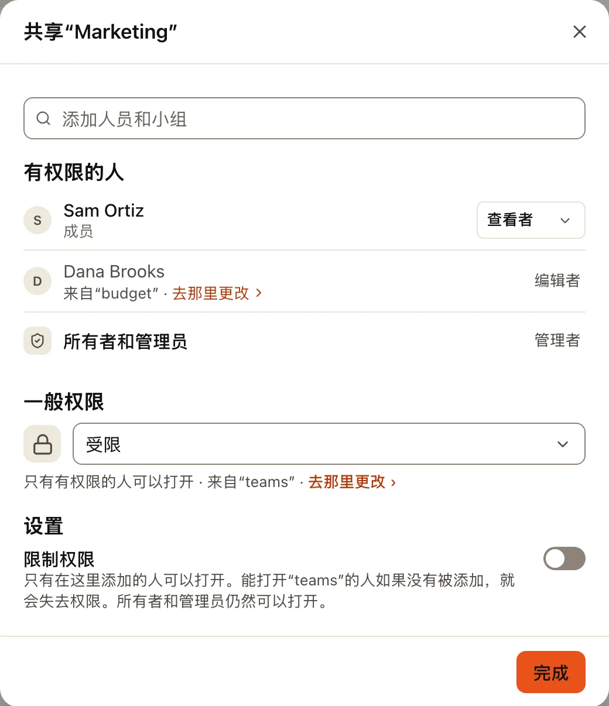
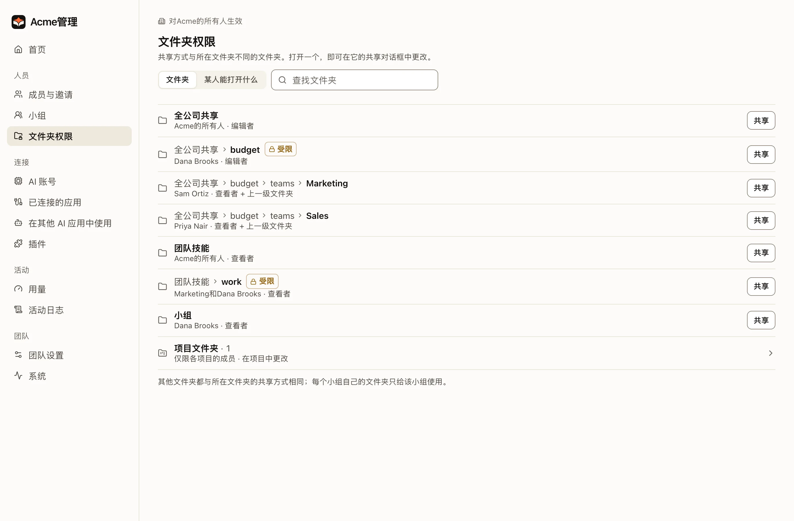
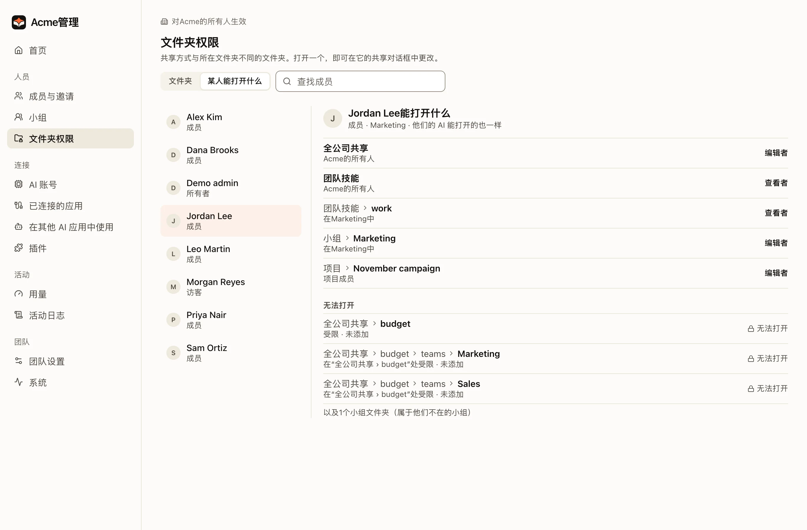
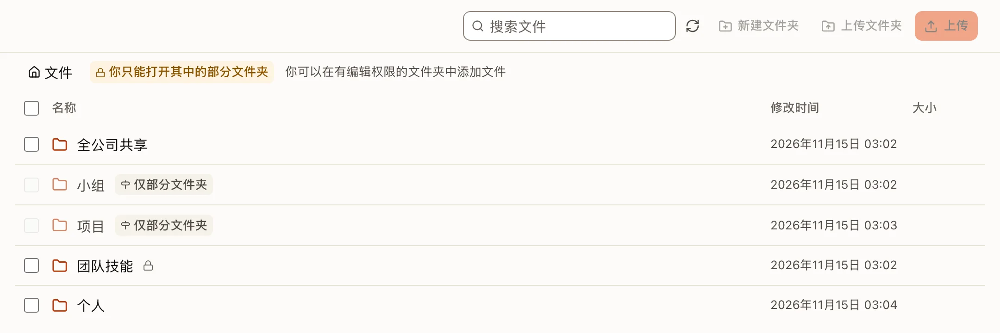
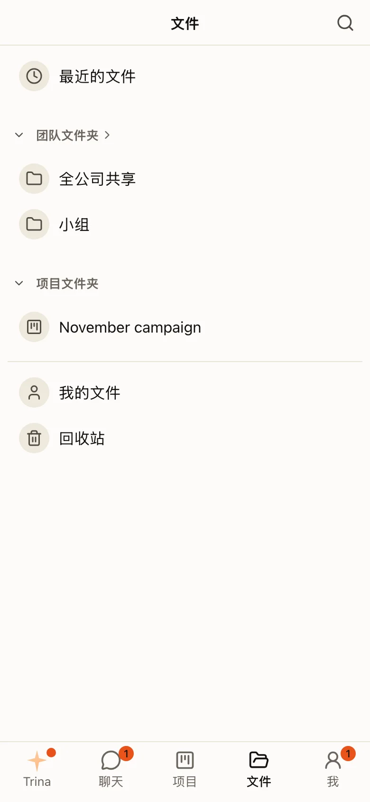

公司的资料都放在服务器上的一个团队文件夹里。文件夹规则决定谁能看到什么。AI 能看到的内容，永远不会超过提问的那个人。

## 团队文件夹

| 文件夹 | 谁能看到 | 用途 |
|---|---|---|
| `shared/` | 按规则决定，通常是所有人 | 全公司的文件 |
| `groups/<group>/` | 该小组，以及规则另外加入的人 | 小组的文件，例如销售或财务；小组自己的技能放在其中的 `skills/` 里 |
| `projects/<project>/` | 按规则决定 | 有自己文件夹和指示的工作 |
| `skills/` | 所有人可读；技能管理者可写 | 团队技能和团队规则 |
| `users/<id>/` | 只有本人 | 个人文件和个人技能 |

## 如何决定访问权限

服务器上由一个权限函数决定每一次访问。操作系统会阻止 AI 绕过它。

- 你无法打开的文件是**看不见的**，而不是显示“拒绝访问”。文件、AI 的回答、搜索、预览、版本历史、回收站和实时更新，都遵循同一条规则。
- 一个人的权限来自文件上方**最近一条点名此人的规则**。针对个人的规则优先于针对小组的规则。如果一个人属于多个小组，以权限最大的那个为准。
- 更改**立即**生效。AI 每次调用工具时都会重新读取权限。
- 收回权限，不会删除之前已经引用过某个文件的回答。

## 共享文件夹

所有者和管理员可以像在 Google Drive 里一样共享文件夹：**文件 › 文件夹的 ⋯ › 共享**，或 **管理 › 文件夹权限 › 共享**。两者打开的是同一个对话框。

:::steps
#### 添加人员和小组
输入名字。每个人或小组可以设为**查看者**或**编辑者**。**移除权限**也在同一个菜单里。

#### 检查一般权限
**受限**：只有列出的人能打开。也可以设为整个团队，作为**查看者**或**编辑者**。没有自己设置的文件夹，会显示它从上一层文件夹继承的权限，并提供**去那里更改**。

#### 保存前检查
对话框会列出谁将获得或失去权限。在你保存之前，什么都不会改变。授予更多权限之前会先询问你；如果某项限制会把上一层文件夹允许的人挡在外面，也会先询问你。
:::

权限是叠加的，就像在 Google Drive 中一样：一个文件夹给出的权限，会加在上层文件夹给出的权限之上。比上层更低的角色无法选择；这一行会说明更高的角色来自哪里（“编辑者，来自“全公司共享””）。

如果要让某个文件夹的权限低于上层文件夹，请打开**设置 › 限制权限**。之后，只有在那里添加的人员和小组才能打开它。**权限已移除**会列出能打开上层文件夹、但不能打开这个文件夹的人；点**添加**可以把其中一人作为查看者加回来。再次关闭限制时，任何低于上层文件夹的角色都会提升到上层的级别。

所有者和管理员始终可以打开团队文件夹，但他们不是成员的项目除外。他们显示为一行**管理者**。

:::note
在让权限变为叠加的那次更新之后，有些文件夹会按名字列出其中的人（标记为**在文件夹调整时添加**），文件夹权限页面也会显示一次性通知，列出这些人。按名字添加的人，即使之后离开了小组，也仍然保留访问权限。**管理 › 小组**和这个人的页面会在保存前提醒这一点，并提供**立即移除**。
:::

**管理 › 文件夹权限 › 文件夹**只列出与所在上层文件夹共享方式不同的文件夹，名称与文件中显示的相同；把人挡在外面的文件夹会标为**受限**。**共享**会打开该文件夹的共享对话框。项目文件夹只占一行：项目的成员要在项目中更改。

**某人能打开什么**针对某一个人（因此也就是他的 AI）显示每个文件夹是查看者还是编辑者以及原因，并列出他打不开的文件夹。

:::warning
`skills/` 里存放的是每位成员的 AI 都会遵循的说明。拥有那里的写入权限，就意味着成为技能管理者。在 AI 把内容保存到 `skills/` 之前，服务器会请一个人确认。小组的 `groups/<group>/skills/` 也是一样：该小组每位成员的 AI 都会遵循它，而任何可以写入该小组文件夹的成员都能更改它。
:::

## 共享文件

你可以把自己的文件只共享给选定的人，而不改变谁能打开它所在的文件夹：**文件 › 文件的 ⋯ › 共享**。添加人员或小组，然后点按**共享**。对方可以查看并下载这个文件，但看不到文件夹里的其他内容。你添加的每个人都会在**动态**里看到它。

- **团队所有人**是**添加人员或小组**里的第一个选项。点按**共享**之前，会有一行提示：团队所有人都将能打开这个文件，包括以后加入的人。访客始终不能。它算作一个文件最多可共享的 50 个人员和小组之一。
- 一次共享多个文件时（例如在**在这台电脑上查找工作文件**的最后一步），每个人在**动态**里只会收到一条通知，如“Mina 与你共享了 5 个文件”，点开就是这些文件的列表。按姓名添加的人还会收到手机通知。
- **有权访问的人**列出所有者，以及每个标为**可查看**的人员或小组。点按 **✕** 可移除某人的访问权限（会先确认）。 即使团队关闭了成员共享，文件所有者也始终可以移除他人。
- 被你移除的人打开文件链接时，会看到“Mina 已停止共享这个文件”，并可以再次请求访问。他们不会收到任何通知。
- 你也可以在聊天里让 Trina 来做：“把报价单共享给 Jun”，或“不再把报价单共享给 Jun”。答复下方的卡片会说明有什么变化：文件和它所在的位置、谁可以查看，以及一个按钮。共享之后，按钮是**管理访问权限**，点开就是这个对话框。停止共享之后，按钮是**撤销**，卡片会说明现在还有谁能打开这个文件以及原因（例如通过仍在共享的小组，或因为他们能打开它所在的文件夹）。共享文件之前，Trina 会先询问，除非你的消息里已写明文件和人。停止共享时，如果你的消息里写明了对方，也不会询问。如果对方本来就能打开这个文件，卡片会这样说明，对他们没有任何变化。
- Trina 无法共享某个文件时，卡片会说明原因，并把下一步作为唯一的按钮：别人拥有的文件是**请 Mina 共享**（她会在**动态**里收到请求并决定）；团队关闭了成员共享时是**请管理员处理**（团队所有者和管理员会收到你发出的消息，请求重新打开）。
- 团队文件也可以由所有能打开其文件夹的人打开。
- **复制链接**会复制这个文件自己的链接。有权访问的人可以直接打开；其他人会看到**你需要访问权限**，并可以附上备注**请求访问**。请求会出现在所有者的**动态**里，带有**共享**和**拒绝**按钮。对打不开文件的人，链接页面也不会显示文件名。
- 把文件移到能打开的人更少的位置时，会告诉你有多少人通过链接拥有这个文件。
- 问 Trina **“谁能打开这个文件？”**或**“为什么 Jun 打不开？”**。她会告诉你每个人是怎么获得访问权限的（按姓名共享、通过小组、通过文件夹）。你自己的文件会显示姓名；别人的文件则会显示你自己的访问权限，以及该问谁。
- Trina 在聊天室发帖后，如果那里有人打不开帖子中的文件，她会告诉你。**允许查看**只会把你的文件共享给那一行里点名的人。对别人的文件，带所有者名字的按钮（如**请 Mina 共享**）会在所有者的**动态**里发出请求（“Alice 请你把 Quote.pdf 共享给 Jun”），带有**共享**和**拒绝**按钮。对团队文件夹里的文件，成员会看到**请管理员处理**，团队所有者和管理员会收到你发出的消息。

所有者和管理员可以共享任何团队文件。在**管理 › 团队设置**里，关闭**成员可以共享自己的文件**后，成员就不能再共享（已有的共享仍然有效，其所有者仍可以停止这些共享）。团队所有者可以在同一处用**移除所有文件共享**一次性全部移除。

### 与你共享的文件

**文件 › 与我共享的文件**按时间从新到旧列出别人与你共享的文件，并显示是谁、什么时候共享的。你本来就能在文件夹里打开的文件，只有在有人按姓名添加了你时才会出现在这里。在这里打开文件即可查看或下载；点按 **‹ 与我共享的文件**回到列表。打开文件后，它在**动态**里的通知会标为已读。你失去访问权限的文件会从列表中消失（所有者移除了你、移到回收站，或已无法再编辑它）。

Trina 也可以使用这些文件。说“总结一下 Mina 与我共享的文件”，她会在与你共享的文件里查找，即使你自己的文件夹里有同名文件也一样。在共享文件的页面上，**问 Trina** 会打开一个新聊天，并把这个文件放在输入框里。Trina 可以查看共享文件，但不能修改。

### “这个文件”“那个讨论串”

当你说“总结一下这个”或“回复那个讨论串”而没有说出名称时，Trina 会查看你在应用里打开的内容：屏幕上的文件、聊天室、讨论串或聊天，优先看你正在输入的窗口。只有当你指着某样东西却没有说名称时才会这样做；如果可能指两样东西，她会先问你。以这种方式替你共享或发布的内容，仍会先给你看一张卡片，即使你选了 **始终允许** 也一样。不会保存任何有关你屏幕的内容：关闭的窗口会被忘记，保密的聊天也绝不会被提及。

## 使用文件

- **上传**：在文件页面上传文件或整个文件夹。
- **版本历史**：每次更改都会保留一个版本，你可以打开或恢复它。
- **回收站**：**文件 › 回收站**按名称和原来所在的位置，列出你可以恢复的内容（“price-sheet.xlsx · 全公司共享 › 销售”）。被删除过不止一次的文件只显示为一行，里面有它的各个副本：**恢复**会找回最新的那份，打开这一行则可以恢复其他任何副本。如果列表里有其他人删除的内容，**我删除的**只显示你删除的。超过团队的保留期限后（管理 › 团队设置，默认 30 天），条目会被永久删除；每一行都会写明删除时间。
- **格式**：AI 可以读取 PDF、Office 和 HWP/HWPX 文件中的文字，并把照片和扫描页当作图片来看（管理员可以关闭这一功能）。Linux 服务器不运行 OCR。
- **确认**：当 AI 要把受限内容写到更多人能看到的地方时，服务器会先询问。

## HTML 转 PDF

HTML 文件（例如 AI 写的报价单或报告）可以变成和页面看起来一样的 PDF：保留它的颜色和背景、合并的表格单元格、页面自己的 `@page` 规则中的页面大小和页边距（没有指定时为 A4），以及分页。

- **在预览中**：打开 `.html` 文件，在预览顶部点**另存为 PDF**。PDF 会以相同名称保存在页面旁边，通知中会附上它的链接。同一页面的第二个 PDF 会保存为 `name (2).pdf`，绝不会覆盖第一个。在你只能读取的文件夹中，PDF 会改为下载。在手机上，这个操作在 **⋯** 菜单里。
- **让 AI 来做**：“把 quote.html 转成 PDF”。AI 会直接打印这个页面，不会把它改写成 Markdown。
- **PDF 用到什么**：页面本身，以及它通过相对路径引用的、团队文件夹中的图片、样式表和字体。网址永远不会被加载：网络图片会显示为灰色方块，和预览中一样。请把图片保存到团队文件夹里，并用路径引用它。页面中的脚本不会运行，所以由脚本绘制的部分会缺失；请把这部分写成普通的 HTML。
- **限制**：最多 200 页、50 MB，每页大约一分钟。一台服务器同时只制作几个 PDF，其余的会排队等待。
- **在哪里可用**：服务器在其转换沙箱中用无界面的 Chromium 打印，不联网。Linux 服务器在安装了 Debian 的 `chromium` 软件包后才有它（开发环境会安装它，用开发环境制作的托管服务器镜像也会安装）。在 Linux 服务器上，每次打印都有自己的内存限制，与其他转换分开，服务器至少需要 3 GB 内存（6 GB 起可以同时打印两个）。没有浏览器或内存不足的服务器不会显示这个操作，AI 也会说明它无法打印 HTML。管理员可以用 `MYCEL_HTML_PDF_BROWSER` 指定浏览器（[环境变量](../../reference/environment.md)（英文））。

完整说明：[安全与权限](../../../security-and-permissions.md)（英文）和[权限模型（韩文）](../../../PERMISSIONS.md)。
