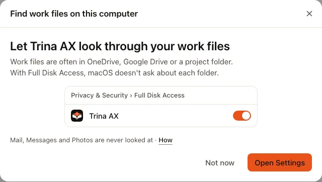

**Windows** 桌面应用和**从网站下载的 Mac 应用**可以找出你最近用过的文件，列出看起来是工作用的：表格、报告、方案、品牌资料等。你勾选想要的文件，只有这些会被添加。

它会查看这些位置：

- **文稿**、**桌面**和**下载**。
- 这台电脑上的**云盘文件夹**：OneDrive（以及 SharePoint）、Google Drive、Dropbox 和 Box。
- 个人文件夹中的**工作文件夹**：以公司或客户命名的文件夹，或名称中带有 *工作*、*项目*、*客户* 等词的文件夹。
- **聊天软件下载的文件**：KakaoTalk、Telegram、WhatsApp、Teams 等保存收到文件的文件夹。
- **最近打开的文件**，个人文件夹中的任何位置。在 Windows 上还包括其他磁盘和网络驱动器。

它只显示**最近**的文件（大约六个月内打开或修改过），并且看起来与你的公司有关或由团队的 AI 挑选，最多 50 个。其他文件可以用搜索找到。

哪些内容留在你的电脑上：

- 应用只读取文件的**名称、类型、大小和日期**，不会移动、重命名或修改文件。
- **只在云端**的文件（例如 OneDrive 的“仅联机”文件）在查看时不会被下载。列表中会标注 **在云端**；如果你添加它，它会在那时下载。
- **从不查看邮件、信息、照片、Safari 和其他应用的数据。** 应用读取的应用数据只有 macOS、Windows 和 Office 保存的最近文稿列表。
- 为了帮你挑选工作文件，**文件名**、所在文件夹的名称以及类型、大小和日期可能会发送给团队的 AI。看起来是个人文件的（工资单、税务资料、证件、简历、病历）会单独放在一边，名称不会发送。
- 文件**内容**在你按下**添加**之前一直留在电脑上。之后只读取并添加你勾选的文件。

## 开始

1. 在桌面应用中打开 **文件 › 我的文件**（窗口要足够宽，显示电脑版布局）。
2. 点击 **在这台电脑上查找工作文件**。

如果你刚加入团队，**主页**上的欢迎卡片里也有一个可选的一行：**从这台电脑带来工作文件**（仅在桌面应用中）。它打开同一个窗口，文件也放到同一个位置。文件放进去后这一行就显示为完成，它不会妨碍卡片的其他步骤。

所有者在 **开始使用 › 团队文件** 中也能看到同一个按钮。在那里，文件会和这一步的其他文件一样放进团队的主文件夹。

## 在 Mac 上：开启一次完全磁盘访问权限

工作文件常在文稿以外的地方，比如 OneDrive、Google Drive 或项目文件夹。没有**完全磁盘访问权限**时，macOS 会为这些文件夹一个接一个地询问你。所以在 Mac 上，应用会先显示这个画面：

1. 点击 **打开设置**。系统设置会打开 **隐私与安全性 › 完全磁盘访问权限**。
2. **Trina AX** 已经在列表中，开关是关闭的：应用打开这个画面时它就会出现在那里，所以不需要点 **+**。打开它的开关。macOS 会要求输入 Mac 的密码或使用触控 ID。
3. 回到应用。应用一获得权限，画面就会自动继续。

如果你已经打开了开关但画面仍在等待，说明 macOS 要在应用重新打开后才给予权限。画面会这样提示：点击 **重新打开 Trina AX**，然后再次点击 **在这台电脑上查找工作文件**。

以后想收回权限，在同一个位置关闭开关即可。

**以后再说** 会跳过这一步：应用只查看文稿、桌面和下载，macOS 会为每个文件夹询问你（见下文）。

## 应用先询问

在查看任何内容之前，应用会先在自己的窗口中询问（显示在应用上方）：列出要查看的每个位置，并说明会读取什么——只读取文件信息（名称、日期、大小、作者、来源），不读取内容；不会替你预先勾选；添加之前内容一直留在这台电脑上；为了帮你挑选，文件名可能会发送给团队的 AI。点击 **查找工作文件** 继续，或点击 **以后再说**（或按 Esc）停止。窗口出现片刻且你没有在打字时，按 Enter 也可以继续：窗口弹出前你在聊天中按下的 Enter 不会作为回答。

在 Windows 上，这是唯一的询问：应用会直接开始查看。如果 OneDrive 保存了你的文稿或桌面，列表会显示“文稿 (OneDrive)”。

## 没有完全磁盘访问权限时（Mac）：macOS 为每个文件夹询问

选择 **以后再说** 后，应用只查看文稿、桌面和下载。应用第一次读取其中一个时，macOS 会就该文件夹询问你：“Trina AX”想要访问你“文稿”文件夹中的文件。下面会显示应用的理由：*在这里查找工作文件。文件内容在你选择添加之前一直留在这台 Mac 上。* 询问一个接一个出现，每个文件夹一次。

- **允许**：应用会查看该文件夹。
- **不允许**：应用跳过该文件夹，列表中会注明。

macOS 会记住你的回答，所以每个文件夹只问一次。

## 挑选文件

- 每个文件都会说明**为什么**显示以及**在哪里**：“提到 Acme · 2 天前打开 · OneDrive – Acme › Plans”。
- **看起来是工作文件** 列出看起来与你公司有关的最近文件，以及 AI 挑选的文件，最相关的在前。
- **可能是个人文件** 默认折叠，不会发送给 AI。你仍然可以展开并勾选文件：它会进入“我的文件”，只有你能看到。
- **没有勾选任何文件。** 勾选你想要的文件，或使用 **全选**。每次最多添加 100 个文件、1 GB。
- **按文件名查找** 会搜索应用找到的所有文件，包括两个分组以外的文件。
- 超过 50 MB 的文件不会列出，请在文件页面上传。很大的文件夹只会查看一部分，列表会注明。

点击 **添加 n 个文件**。文件会进入 **我的文件 › 来自这台电脑**，文件夹按原来的位置命名（文稿 › 客户 › ……，OneDrive – Acme › ……）。

## 撤销

添加之后，在同一个窗口中，**撤销** 会把这次添加的文件移到回收站，这次创建的文件夹如果已经空了也会一并移走。其他内容不受影响：原本就在“我的文件”中的文件会保留，即使名称相同。按下撤销后，应用会写明在什么日期之前可以从 **回收站** 恢复。关闭该窗口后，请在文件页面用常规方式删除文件。你电脑上的文件始终不会改变。

## 如果跳过了某个文件夹（Mac，没有完全磁盘访问权限）

如果你回答了 **不允许**，列表会显示 **“Trina AX 无法查看下载 · 自己选择”**。如果三个文件夹都无法查看，应用会直接说明，而不是显示列表。

- **自己选择** 会在该文件夹打开 Mac 的文件夹窗口。在那里选择它，应用就可以查看。
- 或者开启完全磁盘访问权限（见上文），然后重新查看。
- 或者自己添加文件：**文件 › 上传文件夹**，然后选择文件夹。

选择 **不允许** 之后 macOS 不会再次询问，而且这样回答过的应用可能不会列在 **隐私与安全性 › 文件与文件夹** 中，所以不一定能在那里打开。

## 哪里没有这个功能

- **浏览器或手机上。** 网页无法查看你的文件夹。请使用文件页面上的 **上传文件夹**。
- **Mac App Store 版本。** macOS 只允许 App Store 应用读取你选择的文件夹，所以该版本保留文件页面上的 **上传文件夹**。
- **访客** 没有这个功能，Linux 应用也没有。
