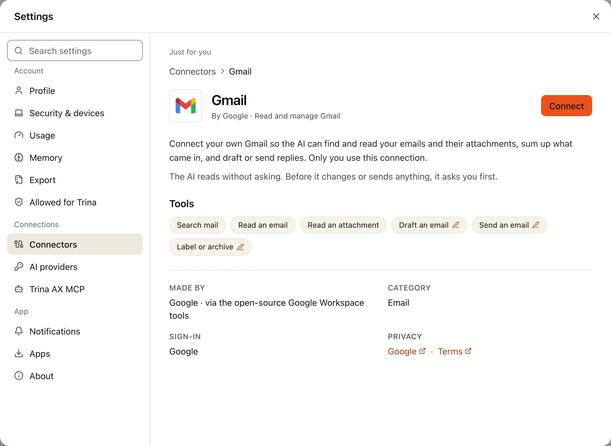
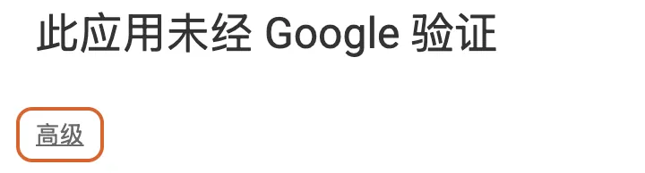
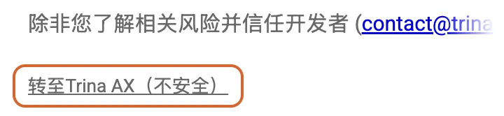
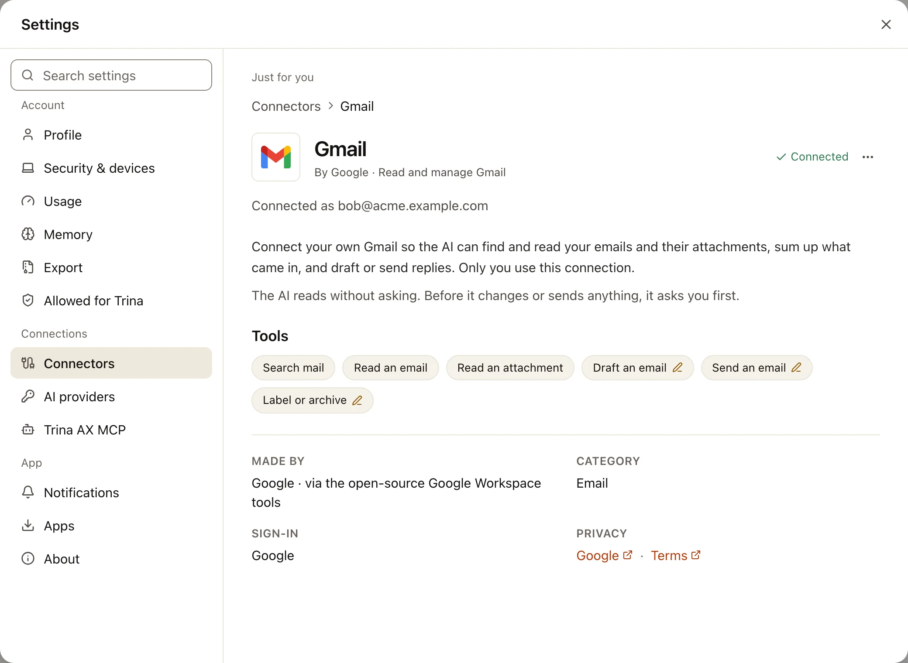
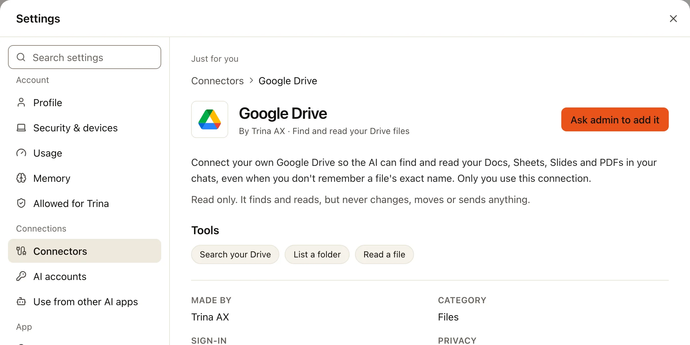
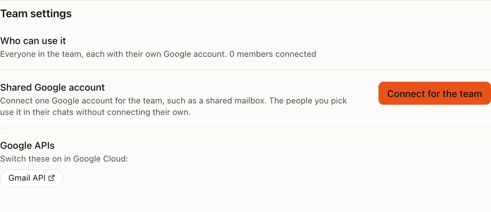
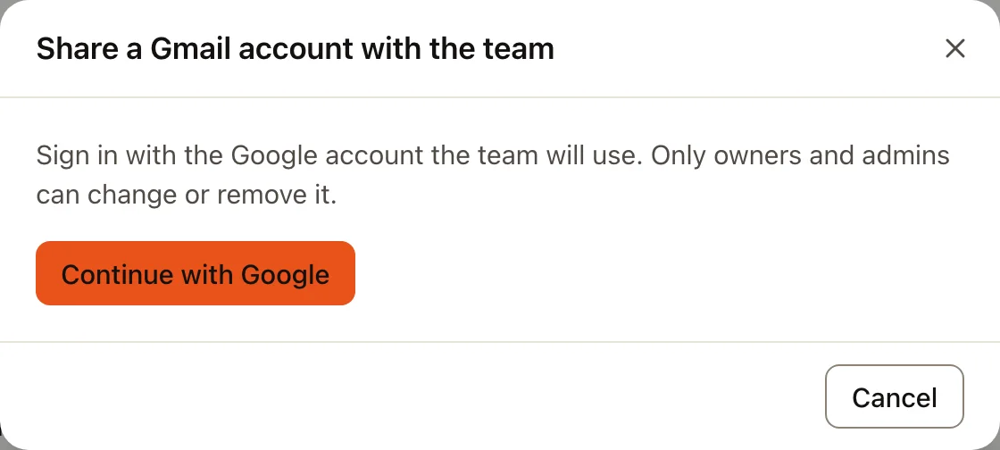
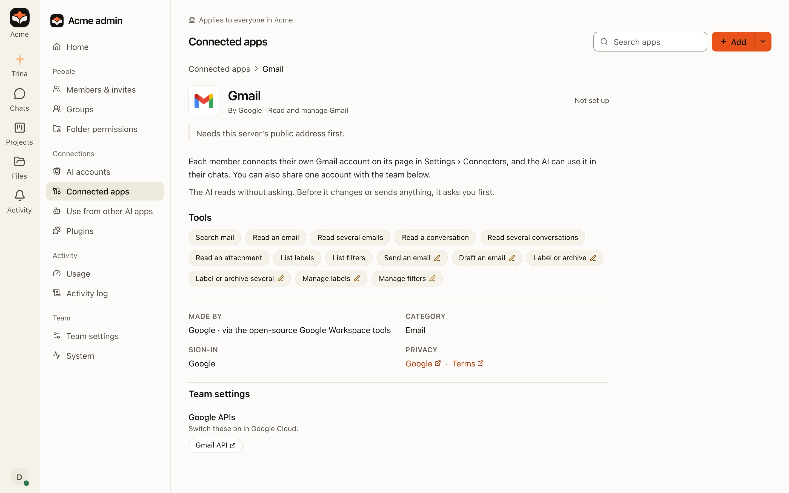

Google Drive、Gmail、Google 日历、Google 文档和 Google 表格是 Trina AX 内置的。每个人连接自己的 Google 账号，每个应用连接一次。
AI 只会在这个人自己的对话中使用它，权限也和这个人在 Google 中的权限一样。

不需要复制或粘贴任何内容：你是在 Google 上登录的。

## 连接 Google 应用（所有人）

:::tip
**你需要准备的**

- 你的 Google 账号（公司的 Google Workspace 账号或个人 Gmail 账号），并已在浏览器中登录。
:::

:::steps
#### 在连接器中打开应用
1. 点左侧栏底部你的头像，再点**设置**。
2. 在左侧的列表中，选择**连接器**。
3. 在**发现**下选择应用，例如 **Gmail**。（如果没看到，在**搜索应用**中输入它的名称。）

应用的页面会打开。它会说明 AI 在那里能做什么，并列出所有工具；会更改内容的工具带有铅笔标记。**连接**在右上角。



#### 选择“连接”
新窗口会打开（在桌面应用中，会在你的浏览器中打开）。在由 Trina 托管的团队中，它会先显示 Trina 的开始页面，写明你的团队，并说明
Trina AX 可以做什么：选择**前往 Google**。接着 Google 自己的登录页面会打开。如果你登录了不止一个 Google 账号，Google 会问你用哪一个：选择你想用的那个。

#### 通过 Google 的警告
在 Google 审核 Trina 的 Google 应用期间，Google 会在显示权限之前先显示 **Google 未验证此应用**。这是 Google 关于审核的提示，
不是你的账号有问题。只需点两下：

1. 选择文字下方的**高级**。

   

2. 选择展开的文字最下方的**转至Trina AX（不安全）**。

   

使用 Google Workspace 的公司可以改用公司自己的 Google 应用，让所有人都跳过这个警告：见下文[选择哪种 Google 登录](#选择哪种-google-登录)。

#### 保持所有选项都勾选
Google 会显示一个页面，写明 Trina AX，并逐行列出它可以做的事，每项权限一行，例如“阅读、撰写和发送电子邮件”。有些行带有选项框。请保持**所有**选项都勾选，然后选择**继续**（Continue）。
如果有选项没有勾选，登录会被拒绝：“部分权限未勾选。请重新连接，并保持所有选项都勾选。”

#### 确认账号
回到 Trina AX，检查显示的账号（“连接此账号？”），然后选择**连接此账号**。页面右上角会显示**已连接**，名称下方会显示**已连接为**你的地址。


:::

读取不需要确认。AI 在发送邮件、添加日程或编辑文档之前，会显示一张卡片，列出它要做的所有事，并等你同意。在卡片上，或者在应用的
**设置**（它的 **⋯** 菜单）中，你可以选择**始终允许**，而不是**先问我**。Google Drive 只读取：它从不更改、移动或发送任何内容。

### 如果你看到“请管理员添加”

这个应用在你的团队中还没有设置好。选择**请管理员添加**：所有者和管理员会收到通知，你可以连接时会收到回复。



## 团队共享的 Google 账号（管理员）

共享的邮箱或日历，例如 `sales@acme.com`，可以为需要它的人连接一次，就像 Gmail 中几个人一起打开的共享邮箱。他们无需连接自己的账号，即可在对话中使用。

:::steps
#### 在管理中打开 Google 应用
点左侧栏顶部你团队的标志，再点**管理 › 已连接的应用**，然后选择这个 Google 应用（例如 Gmail）。向下滚动到**团队设置**。**共享的 Google 账号**这一行的右侧有**为团队连接**。



#### 用共享账号登录
选择**为团队连接**。**与团队共享Gmail账号**对话框会打开。选择**使用 Google 继续**，在 Google 用共享账号登录，而不是你自己的账号。像上面一样保持所有选项都勾选，然后检查账号并选择**连接此账号**。



#### 选择谁使用它并保存
在**谁可以使用**下选择所有人、小组或个人，然后选择**保存**。在你保存之前，没有人会使用它；保存前关闭对话框会把它再次移除。这一行随后会显示账号、谁在使用它和由谁连接，以及一个 **⋯** 菜单：**更改人员**、**重新连接**和**移除**。
:::

Google Drive 在同一位置有**与团队共享**：**与团队共享 Google Drive** 会连接一个 Google 账号，并让你选择其中的文件夹；你选中的人可以在对话中使用它们。

在对话中也一样：所有者或管理员请 AI 连接 Google Drive 或 Gmail（或日历、文档、表格）时，卡片上还有**为团队连接**，打开的就是这个对话框。成员只看到连接自己的账号。已经能用共享账号或共享 Drive 的人，会被告知已经连接，无需再连接。

## 设置 Google 应用（自己运行服务器的管理员）

在由 Trina 托管的团队中，Google 登录已经准备好了：不需要设置。在公司自己运行的服务器上，需要管理员在 Google Cloud 中创建一次
Google 登录应用，再在**管理 › 已连接的应用**中添加它。

:::tip
**你需要准备的**

- 团队服务器的**公网 https 地址**（大家从 Google 登录后会回到这个地址）。在设置好之前，Google 应用会显示“需要先设置这台服务器的公网地址。”
  由运行服务器的人设置：见[配置](../../operate/configuration.md)（英文）。
- 一个 **Google Cloud 项目**、每个应用需要启用的 **API**，以及一个类型为 **Web 应用**（Web application）的**登录客户端**。
- 从 Google Cloud 获取：客户端的 **JSON 文件**（或它的**客户端 ID** 和**客户端密钥**）。
- 填到 Google Cloud 中：Trina AX 显示的**返回地址**，一个给 Google Drive，一个给另外四个应用。
:::



:::steps
#### 在 Google Cloud 中创建应用
按照公司应用页面上的[在 Google Cloud 中](google-own-app.md#在-google-cloud-中)操作：一个项目、几个 API、应用的名称和受众群体
（使用 Google Workspace 的公司选**内部**（Internal）；否则选**外部**（External）并添加测试用户）、权限，以及一个
**Web 应用**（Web application）客户端。

#### 添加返回地址
在客户端的**已获授权的重定向 URI**（Authorized redirect URIs）下，添加每个应用的**设置**对话框中显示的地址，用它的复制按钮复制：

```
https://<your team address>/api/integrations/google-drive/callback
https://<your team address>/api/integrations/google-apps/callback
```

#### 在 Trina AX 中上传文件
在**管理 › 已连接的应用**中打开 **Google Drive**，选择**设置**。上传你下载的 JSON 文件，或粘贴**客户端 ID** 和**客户端密钥**，
然后保存。接着逐个打开 Gmail、Google 日历、文档和表格，选择**设置**并打开**使用与 Google Drive 相同的 Google 应用**：不需要再上传别的。
:::

每个应用的页面会在 **Google API** 下列出需要为它启用的 API：

| 应用 | 需要启用的 Google API |
|---|---|
| Google Drive | Google Drive API |
| Gmail | Gmail API |
| Google 日历 | Google Calendar API |
| Google 文档 | Google Docs API、Google Drive API |
| Google 表格 | Google Sheets API、Google Drive API |

Gmail、日历、文档和表格应用运行在 Linux 服务器上。在 Mac 应用中，它们的页面会显示“团队服务器暂不支持”。

## 选择哪种 Google 登录

登录 Google 有两种方式。你的团队对全部五个 Google 应用使用其中一种。

| | Trina 的登录 | 公司自己的 Google 应用 |
|---|---|---|
| 谁可以连接 | 任何 Google 账号：公司的 Google Workspace 账号或个人 Gmail 账号 | 只有公司 Google Workspace 中的账号 |
| 设置 | 在由 Trina 托管的团队中不需要设置 | 由 IT 管理员设置一次，大约 15 分钟：[使用公司自己的 Google 应用](google-own-app.md) |
| Google 的页面 | 在 Google 审核 Trina 的应用期间显示 **Google 未验证此应用**：[点两下](#连接-google-应用所有人) | 显示公司的应用名称，没有警告 |
| 可以使用的人数 | 审核期间受 Google 限制 | 不限 |

先使用 Trina 的登录。如果公司使用 Google Workspace 并且不想看到警告，或者 Google 提示应用已达到人数上限，就改用公司自己的应用。
之后大家需要重新连接一次 Google。

## 常见问题

| 你看到的 | 该怎么做 |
|---|---|
| **部分权限未勾选。请重新连接，并保持所有选项都勾选。** | 重新连接，并让 Google 页面上的所有选项都保持勾选。 |
| **Google 要求你重新登录。** | 在应用的页面上选择**重新连接**。这通常发生在修改密码之后，或者公司管理员取消了访问权限。 |
| Google 页面上出现 **`redirect_uri_mismatch`**（自己运行的服务器） | Google Cloud 中的某个返回地址和 Trina AX 显示的不一样。请从**设置**对话框中重新复制。 |
| **“This app is blocked”** 或 **`admin_policy_enforced`** | 公司的 Google 管理员限制了哪些应用可以使用 Google 账号。请他们信任这个应用：见[在管理控制台信任应用](google-own-app.md#可选在管理控制台信任应用)。 |
| **Google 未验证此应用**（Google hasn't verified this app） | 使用 Trina 的登录时：选择**高级**，再选择**转至Trina AX（不安全）**（[截图](#连接-google-应用所有人)）。如果是管理员创建的、处于测试（Testing）状态的应用：只有当应用是你的管理员创建的时，才选择**高级**（Advanced）›**转至…**（Go to …）；或者请他们把它设为**内部**（Internal）。 |
| **已屏蔽访问权限**（Access blocked），或 Google 提示应用已达到用户数上限 | 审核期间，Trina 的登录已达到 Google 的上限。由管理员把团队改为[公司自己的 Google 应用](google-own-app.md)。 |

面向开发者和运维人员的完整说明：[Google 应用](../../../GOOGLE-APPS.md)（英文）和 [Google Drive](../../../GOOGLE-DRIVE.md)（英文）。
