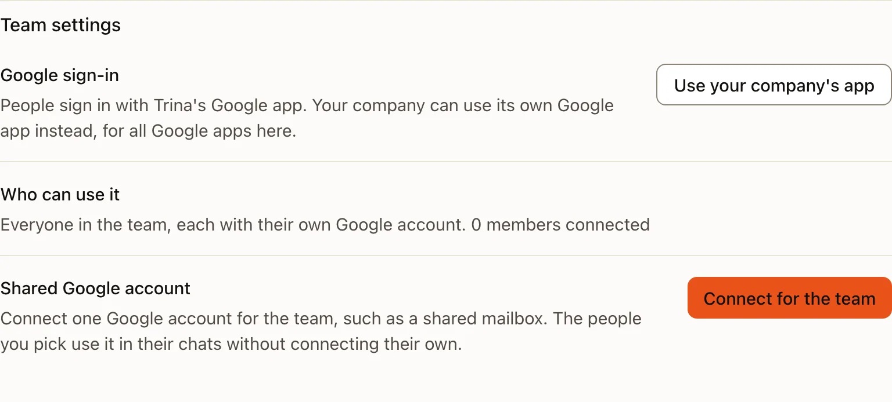
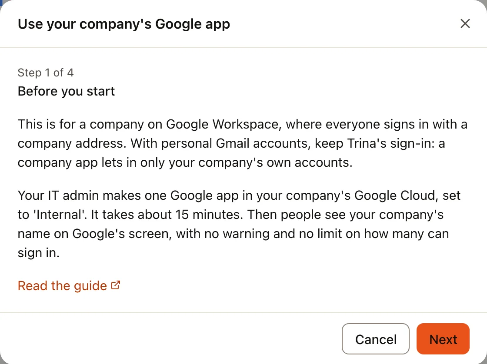
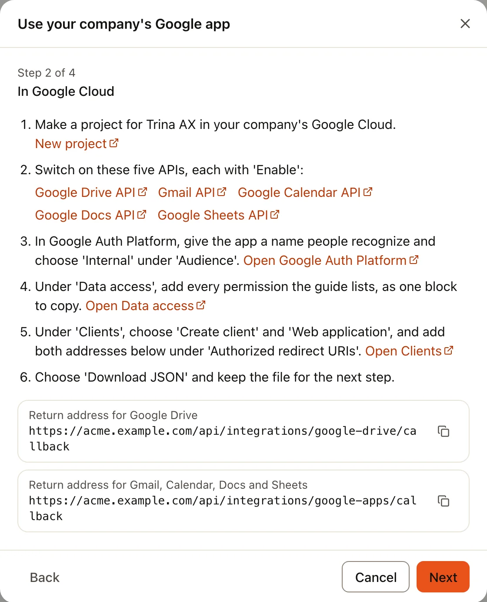
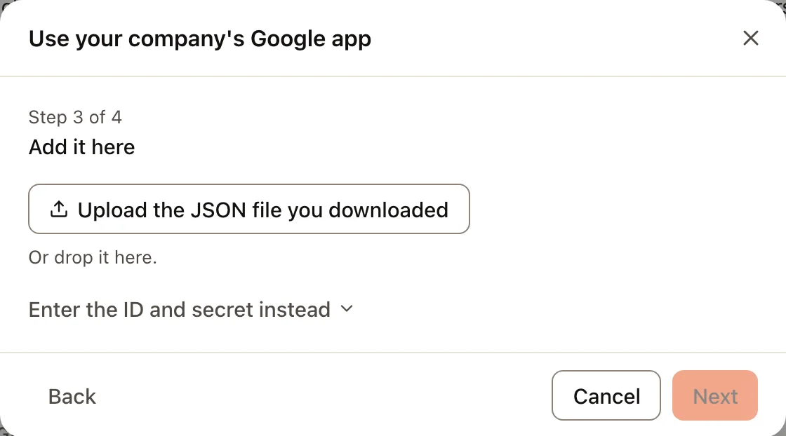
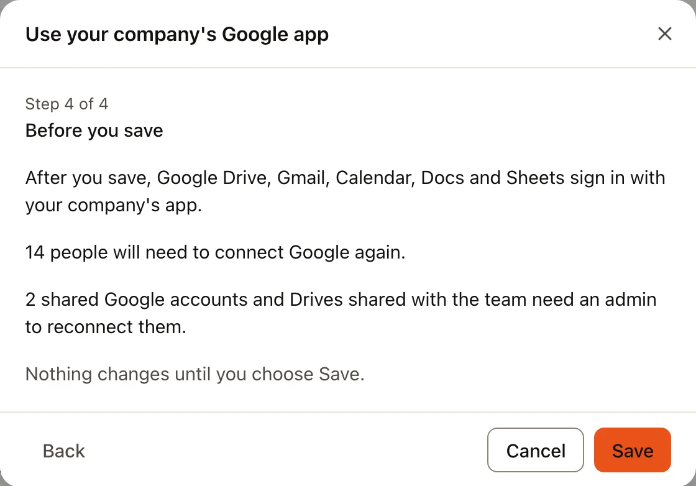
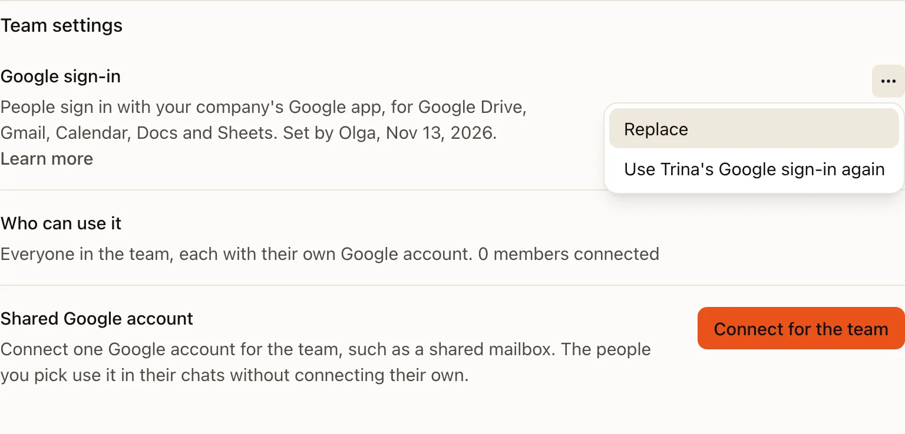
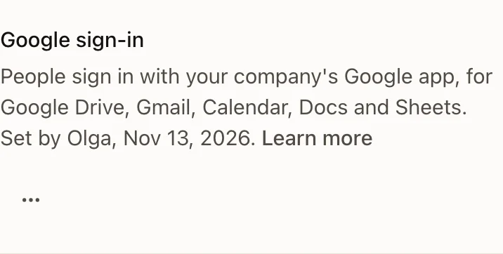
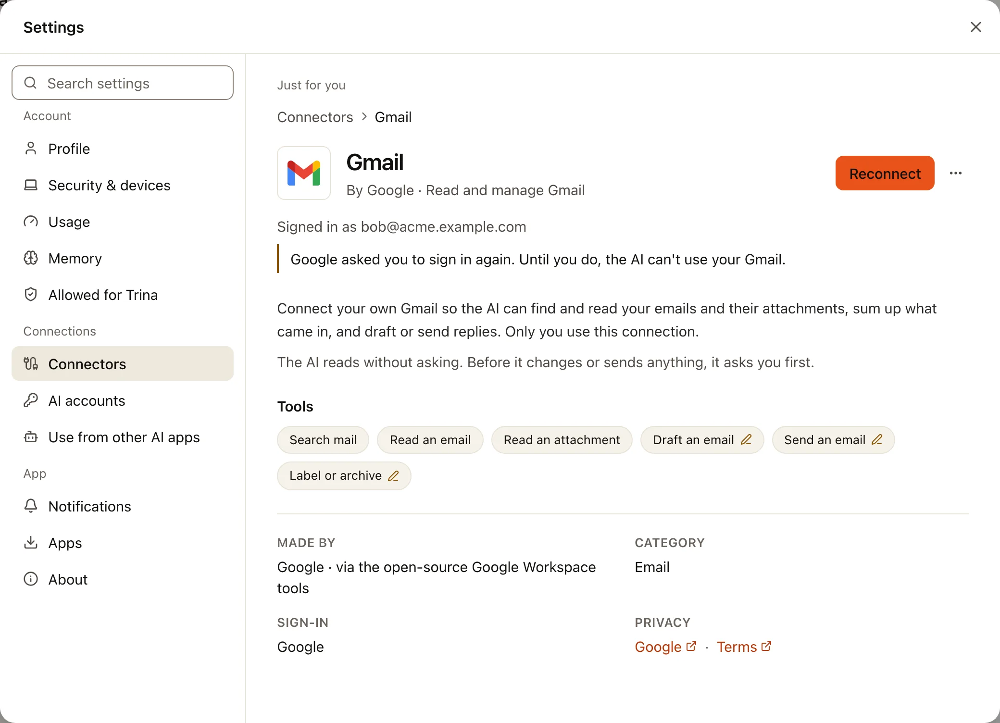

大家连接 Google Drive、Gmail、Google 日历、Google 文档或 Google 表格时，会通过 Trina 自己的 Google 应用在 Google
上登录。使用 Google Workspace 的公司可以改用**公司自己的 Google 应用**。由公司的 IT 管理员在 Google Cloud 中创建一次应用，
再在 Trina AX 中添加一次。从此以后，这五个 Google 应用都通过它登录，大家会在 Google 的页面上看到你公司的名称，
不会出现“未经验证的应用”警告，也不限制登录人数。

整个过程大约需要 15 分钟：大部分时间在 Google Cloud 中，最后在 Trina AX 中完成一个对话框。

:::tip
**你需要准备的**

| 内容 | 从哪里获取 | 填到哪里 |
|---|---|---|
| 两个**返回地址** | Trina AX 对话框的**在 Google Cloud 中**一步，每个都带有**复制**按钮 | Google Cloud › 客户端（Clients）› 你的客户端 › **已获授权的重定向 URI**（Authorized redirect URIs） |
| **权限**（范围）列表 | 本页的权限代码块，见[添加权限](#在-google-cloud-中) | Google Cloud › **数据访问**（Data access）› **手动添加范围**（Manually add scopes） |
| 客户端的 **JSON 文件**（或**客户端 ID** 和**客户端密钥**） | Google Cloud › **客户端**（Clients）› **下载 JSON**（Download JSON），在创建客户端后立即下载 | Trina AX 对话框的**在这里添加**一步 |
:::

:::note
本页截图使用的是一个虚构的团队“Acme”。这里没有展示 Google Cloud 自己的页面，因为它们经常变化：本页会引用 Google
的标签名称，并附上每个 Google Cloud 页面的链接。
:::

## 适用对象

- **使用 Google Workspace 的公司**（所有人都用公司邮箱登录，例如 `name@acme.com`）。本页就是为你准备的。你需要是
  Trina AX 中团队的所有者或管理员，并且能在公司的 Google Cloud 中创建项目。
- **使用个人 Gmail 账号的人。** 请继续使用 Trina 的登录：“内部”应用只允许公司自己的账号登录。

对成员来说，其他都不变：页面一样，**连接**按钮也一样。切换之后，他们只需重新连接一次 Google。

:::tip
没有 Google Workspace 的小团队可以改为创建一个处于**测试**（Testing）状态的**外部**（External）应用。只有你列为测试用户的人
才能登录（最多 100 人），而且 Google 会要求他们每 7 天重新登录一次。对大多数团队来说，Trina 自己的登录更简单。
:::

## 在 Google Cloud 中

用公司的账号登录 [Google Cloud](https://console.cloud.google.com/)。

:::steps
#### 创建项目
打开[新建项目](https://console.cloud.google.com/projectcreate)。起一个你认得出的名称，例如“acme-trina”，在**组织**
（Organization）下保留你的公司，然后选择**创建**（Create）。进行后面的步骤之前，请确认页面顶部选中的是这个新项目。

#### 启用五个 API
打开下面每个页面，选择**启用**（Enable）：

- [Google Drive API](https://console.cloud.google.com/apis/library/drive.googleapis.com)
- [Gmail API](https://console.cloud.google.com/apis/library/gmail.googleapis.com)
- [Google Calendar API](https://console.cloud.google.com/apis/library/calendar-json.googleapis.com)
- [Google Docs API](https://console.cloud.google.com/apis/library/docs.googleapis.com)
- [Google Sheets API](https://console.cloud.google.com/apis/library/sheets.googleapis.com)

五个都要启用，即使团队现在只用到其中一部分 Google 应用。

#### 给应用命名并设为“内部”
打开 [Google Auth Platform](https://console.cloud.google.com/auth/overview)。第一次打开时，它会显示**开始**（Get started）：

1. **应用信息**（App Information）：填写大家认得出的**应用名称**（App name），例如“Acme Trina”，以及**用户支持电子邮件**
   （User support email）。
2. **受众群体**（Audience）：选择**内部**（Internal）。只有公司的账号可以使用这个应用，Google 也不需要审核它。
3. **联系信息**（Contact Information）：填写 Google 可能会就这个项目联系你的邮箱地址。
4. **完成**（Finish）：同意 Google 的政策，然后选择**创建**（Create）。

之后可以在[品牌塑造](https://console.cloud.google.com/auth/branding)（Branding）和
[受众群体](https://console.cloud.google.com/auth/audience)（Audience）中修改这些内容。

#### 添加权限
打开[数据访问](https://console.cloud.google.com/auth/scopes)（Data access），选择**添加或移除范围**（Add or remove scopes）。
在**手动添加范围**（Manually add scopes）下，粘贴下面整段内容，选择**添加到表格**（Add to table），再选择**更新**（Update），
最后选择**保存**（Save）。

```
openid
https://www.googleapis.com/auth/userinfo.email
https://www.googleapis.com/auth/userinfo.profile
https://www.googleapis.com/auth/drive.readonly
https://www.googleapis.com/auth/drive.file
https://www.googleapis.com/auth/gmail.readonly
https://www.googleapis.com/auth/gmail.send
https://www.googleapis.com/auth/gmail.compose
https://www.googleapis.com/auth/gmail.modify
https://www.googleapis.com/auth/gmail.labels
https://www.googleapis.com/auth/gmail.settings.basic
https://www.googleapis.com/auth/calendar
https://www.googleapis.com/auth/calendar.readonly
https://www.googleapis.com/auth/calendar.events
https://www.googleapis.com/auth/documents
https://www.googleapis.com/auth/documents.readonly
https://www.googleapis.com/auth/spreadsheets
https://www.googleapis.com/auth/spreadsheets.readonly
```

这些正是 Trina AX 为五个应用一起申请的权限。一个都不能少：缺少其中任何一个，登录都会被拒绝。

#### 创建登录用的客户端
打开[客户端](https://console.cloud.google.com/auth/clients)（Clients），选择**创建客户端**（Create client）。

1. **应用类型**（Application type）：**Web 应用**（Web application）。
2. **名称**（Name）：随意，例如“Trina AX”。
3. 在**已获授权的重定向 URI**（Authorized redirect URIs）下，选择两次**添加 URI**（Add URI），粘贴两个返回地址。请从
   Trina AX 中复制它们（下一部分的对话框会显示这两个地址，每个都带有**复制**按钮）。它们看起来像这样，只是换成你团队的地址：

   ```
   https://<your team address>/api/integrations/google-drive/callback
   https://<your team address>/api/integrations/google-apps/callback
   ```

4. 选择**创建**（Create）。在**已创建 OAuth 客户端**（OAuth client created）中，选择**下载 JSON**（Download JSON）并保存好文件。
   Google 只在这时显示密钥；如果弄丢了，请为这个客户端新建一个密钥。
:::

## 在 Trina AX 中

:::steps
#### 打开一个 Google 页面
在**管理 › 已连接的应用**中，选择任意一个 Google 应用，例如 **Gmail**。五个页面的最后都是**团队设置**，其中第一行是
**Google 登录**：“大家通过 Trina 的 Google 应用登录。你的公司也可以改用自己的 Google 应用，用于这里的所有 Google 应用。”



#### 点击“使用公司自己的应用”
对话框**使用公司自己的 Google 应用**会打开。第一步**开始之前**说明了适用对象，并附有本页的链接。



#### 在 Google Cloud 中
第二步列出了上面的 Google Cloud 步骤，每一步都带有对应页面的链接，还显示了你团队的两个返回地址，每个都带有**复制**按钮。
请从这里复制它们，粘贴到**已获授权的重定向 URI** 中，确保完全一致。



#### 在这里添加
拖放你从 Google 下载的文件，或选择它。如果你更想手动输入，**改为输入 ID 和密钥**会打开**客户端 ID** 和**客户端密钥**
两个输入框。如果文件中没有同时列出两个返回地址，就会被拒绝，并有一行提示告诉你需要在 Google Cloud 中添加哪一个。



#### 检查并保存
最后一步**保存之前**会用你团队的数字说明会有哪些变化：有多少人需要重新连接 Google，以及与团队共享的 Google 账号和 Drive
需要管理员重新连接。选择**保存**之前不会有任何更改。**取消**会让一切保持原样。


:::

**保存**之后，这一行会显示“大家通过你公司的 Google 应用登录 Google Drive、Gmail、日历、文档和表格。”，以及由谁在什么时候设置。
它的 ⋯ 菜单中有**替换**（用来添加新文件，例如换了新密钥之后）和**重新使用 Trina 的 Google 登录**。只需设置一次：五个
Google 页面上的这一行都是一样的。



在手机上，⋯ 会留在这一行名称的旁边，就像手机的设置那样。



## 成员会看到什么

切换之后，所有通过 Trina 的应用建立的 Google 连接都会停止工作，因为 Google 会把一次登录绑定到发起它的应用上。

- **每个人**会在**设置 › 连接器**中自己的 Google 应用上看到熟悉的**重新连接**，只需操作一次。之后 Google 会显示你公司的
  应用名称，没有警告。
- **共享 Google 账号和与团队共享的 Drive** 会在其 Google 页面的**团队设置**下显示**重新连接**。由管理员重新连接；在此之前，
  AI 无法使用它们。



## 可选：在管理控制台信任应用

如果公司限制了哪些应用可以使用 Google 账号，需要由 Google Workspace 超级管理员把这个应用标记为可信。在
[管理控制台](https://admin.google.com/)（Admin console）中，打开**安全性 › 访问权限和数据控制 › API 控件**（Security › Access and
data control › API controls），然后选择**管理第三方应用访问权限**（Manage Third-Party App Access）› **配置新应用**（Configure new
app）。搜索客户端 ID（在下载的文件中），选中它，并设为**可信**（Trusted）。如果不这样做，大家连接时可能会看到
`admin_policy_enforced`。

## Trina AX 保存什么

- 应用的 ID 和密钥保存在**团队服务器上的一个私有文件**中，只有服务器能读取。它们不会再显示出来：页面上不会，日志中不会，
  活动日志中也不会。
- 对于托管的团队，**由 Trina 托管服务运行这台服务器**，所以它运行在该文件所在的地方。仅凭密钥什么也打不开：每个人仍然要在
  Google 上登录并在那里同意。
- 每个人自己的 Google 登录和以前一样，加密保存在服务器上。

## 改回 Trina 的登录

在任意 Google 页面的**团队设置 › Google 登录**中，打开 ⋯ 并选择**重新使用 Trina 的 Google 登录**。它会先显示与**保存之前**
相同的数字。确认之后，五个 Google 应用都会重新通过 Trina 的应用登录，大家需要重新连接一次 Google，公司应用的文件也会从服务器中
移除。之后你可以在 Google Cloud 中删除这个客户端。

如果团队地址发生变化，Google 登录这一行会提示你。请在 Google Cloud 中为客户端添加两个新的返回地址，重新下载它的文件，然后在
Trina AX 中打开 ⋯ › **替换**：对话框会在**在 Google Cloud 中**这一步打开，显示可复制的新地址。在此之前，任何人都无法连接 Google。

## 常见问题

| 你看到的 | 该怎么做 |
|---|---|
| Google 页面上出现 **`redirect_uri_mismatch`** | Google Cloud 中缺少某个返回地址，或者有一个字母不同。打开[客户端](https://console.cloud.google.com/auth/clients)（Clients），选择你的客户端，从对话框的**在 Google Cloud 中**一步重新粘贴两个地址。保存后可能需要几分钟才会生效。 |
| **“部分权限未勾选。请重新连接，并保持所有选项都勾选。”** | 这个人在 Google 的页面上取消勾选了某一项，或者**数据访问**中缺少某个权限。请检查上面的整段权限是否都列在那里，然后重新连接，并勾选所有选项。 |
| **`admin_policy_enforced`** | 公司的管理控制台阻止了这个应用。请把它标记为可信（见[上文](#可选在管理控制台信任应用)）。 |
| **公司外部的账号**被拒绝（Google 提示该应用只能在其组织内使用） | 这正是**内部**的含义。请使用公司的账号。共享 Google 账号也必须是公司账号。 |

面向开发者和运维人员的完整说明：[Google 应用](../../../GOOGLE-APPS.md)（英文）和 [Google Drive](../../../GOOGLE-DRIVE.md)（英文）。
