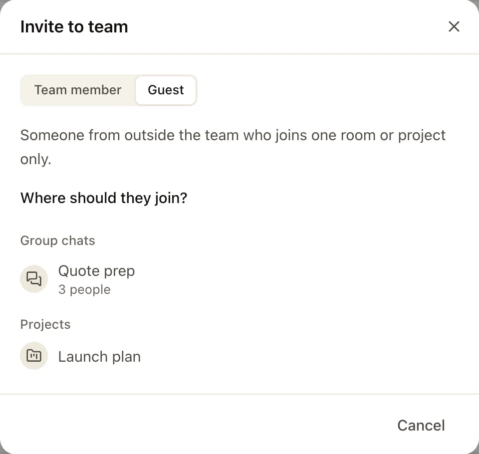

**访客**是来自团队外部的人，例如客户、合作伙伴或自由职业者。访客只加入一个群聊或一个项目，看不到团队的其他任何内容：没有其他对话、没有团队文件、没有其他项目，也没有团队技能。访客不占用套餐席位。

| | 团队成员 | 访客 |
|---|---|---|
| **能去哪里** | 小组和文件夹权限允许的一切 | 一个群聊或一个项目 |
| **团队文件** | 可以打开的文件夹 | 只有所在项目的文件（群聊里没有） |
| **AI** | 按团队的 AI 设置 | 不用 AI，除非为其选择了 AI |
| **席位** | 占用一个 | 不占用 |

访客的名字旁边有 **访客** 标签；有访客的群聊或项目会在顶部注明（“包括 1 位访客”）。

## 谁可以邀请访客

- **邀请到群聊：** 这个群聊里的任何人。
- **邀请到项目：** 创建项目的人，或者所有者、管理员。

不必先打开群聊或项目：**新聊天** 的第一行就是 **邀请访客**；所有者和管理员还可以在 **邀请团队成员** 和 **管理 › 成员与邀请 › 邀请成员** 中选择 **访客**。见下文 [不打开群聊或项目也能邀请](#不打开群聊或项目也能邀请) 和 [从管理页面邀请](#从管理页面邀请)。

访客不会出现在 **团队群聊** 中（全员群聊和每个小组的群聊）。访客可以发私信，但只能发给自己那个群聊或项目里的人。

## 邀请访客

:::steps
#### 打开添加列表
在群聊中，选择顶部的 **⋯**，然后选择 **添加到群聊**（也可以点击顶部的群聊名称，再选择 **添加到群聊**）。在项目中，在项目页面的 **成员** 旁边选择 **管理**。第一行就是 **邀请访客**。

#### 写上对方的名字，选择对方的 AI
在 **发给谁？** 下输入对方的名字。在 **对方的 AI** 下，默认选中 **不用 AI**。其他选项见下文 [访客的 AI](#访客的-ai)。

#### 复制链接，自己发给对方
**创建链接** 会为这一个人生成一个链接。Trina 不会发送邮件：选择 **复制链接**，自己通过邮件或聊天发给对方。链接只能用一次，有效期 7 天；对话框会显示它失效的日期和时间。

:::

链接被使用或过期之前，也会显示在 **管理 › 成员与邀请** 的 **邀请链接** 下面，标有 **访客**，并带有对方的名字。

链接只在创建它的人仍有权邀请时有效。如果创建者退出了群聊、失去了项目、被移出，或者（对 **团队 AI**）不再是管理员，链接就会失效，并从 **管理 › 成员与邀请** 的 **邀请链接** 中消失。其他有权邀请的人可以重新创建一个链接。

### 不打开群聊或项目也能邀请

- **新聊天**（对话列表上方的 **+**）：第一行就是 **邀请访客**。
- **邀请团队成员**（所有者和管理员：团队标志下方的团队菜单、搜索，或手机上的 **我**）：在对话框顶部选择 **访客**（默认选中的是 **团队成员**）。
- **邀请你的团队**（入门步骤和主页上的团队目标）：在消息下方选择 **邀请访客**。

这几处都会列出访客可以加入的那一个地方：你所在的群聊，以及你能更改成员的项目（你创建的项目；所有者和管理员：任何团队项目）。选好一个，再填写和上面相同的对话框。如果还没有这样的群聊或项目，对话框会直接说明；如果套餐里的访客已满，也会直接说明。

**我的项目** 中你自己的项目也会列出来，并标着 **仅自己**。选中后，它会像项目页面上的 **添加成员** 一样被共享，对话框会在 **创建链接** 之前用一句话说明：

- **创建链接** 会把它变成团队项目。在访客加入之前，它仍然只有你能看到，也仍然在 **我的项目** 里。
- 访客加入后，它会移到 **团队项目**，成员是你和访客两个人。
- 访客可以打开和编辑其中的文件，但看不到你的聊天，无论是之前的还是之后新开的。
- 和 **添加成员** 一样，这一步无法改回仅自己。

如果你的团队只允许所有者和管理员共享项目，成员自己的项目不会列出来。

### 从管理页面邀请

所有者和管理员不必先打开群聊或项目，也可以邀请访客。在 **管理 › 成员与邀请** 中选择 **邀请成员**，再选对话框顶部的
**访客**（默认选中的是 **团队成员**）。选出访客要加入的那一个地方：你所在的群聊、一个团队项目，或者你自己的项目（按上文的方式共享）。然后填写和上面相同的对话框：
对方的名字、对方的 AI、**创建链接** 和 **复制链接**。如果套餐里的访客已满，对话框会直接说明，而不列出可选的地方。

## 访客看到什么

链接打开的页面会写明是谁邀请了他们，以及他们将加入的那一个群聊或项目。他们设置用户名和密码后即可加入。如果你选了 **用自己的账号登录**，页面还会告诉他们需要连接自己的 Claude 或 ChatGPT 账号。如果链接已经不能用，页面会说明原因：已过期、已被使用、已被关闭、创建链接的人已无法再邀请，或者群聊或项目已不存在。

登录后，Trina 会直接打开他们的群聊或项目。左侧栏只显示他们能用的内容：没有 **文件**，没有团队的项目和群聊；AI 关闭时也没有 **Trina**。他们的 **设置** 里只有自己的内容，例如个人资料和通知。

在项目中，项目成员可以看到访客在这里的对话。能使用 AI 的访客会在项目页面上看到这一点。

## 只能在一个地方

访客只能在一个群聊或一个项目中，不能更多。Trina 不允许把访客加入第二个地方。在添加列表中，已经在别处的访客会注明所在位置，无法勾选。

如果对方需要不止一个地方，所有者或管理员可以选择 **设为团队成员**（见下文）。

如果访客离开、被移出，或者所在的群聊或项目被关闭，对方就无法再登录，和被移除时一样。把有访客的项目移到回收站时，确认前会先告诉你。如果对方的项目从回收站恢复，对方会自动可以再次登录，除非所有者或管理员在此期间手动启用或停用过对方。重命名群聊或项目对访客没有影响。

## 访客的 AI

| 选项 | 含义 | 谁可以选 |
|---|---|---|
| **不用 AI**（默认） | 只和人交流。 | 任何邀请人 |
| **团队 AI** | 使用团队的一个 AI 账号，每月 token 上限由你设定。 | 所有者和管理员 |
| **用自己的账号登录** | 在 **设置 › AI 提供商** 中连接自己的 Claude 或 ChatGPT 账号来使用。用的是他们自己的套餐，团队无需付费。 | 任何邀请人 |

### 团队 AI 的每月上限

上限是 **token** 数量：AI 读写的量。可以选 **100万 token**、**500万 token** 或 **1000万 token**（默认 500万），也可以选
**其他** 自己输入。旁边会显示大约能回答多少次，例如“500万 token · 约 62 次回答”。上限每月 1 日重置。

回答次数是估算：Trina 用上限除以你的团队最近 90 天里每次回答平均用的 token，并向下取整。团队的回答少于 20 次时，按每次回答
80,000 token 估算，并会注明。读文件或使用工具的回答比简短的回答用更多 token。

在上限改为 token 之前就设了团队 AI 的访客，会保留美元上限（例如“每月最多 US$20.00”），直到你更改。之后 **更改 AI** 会要求填写
token 数量。

在 **管理 › 成员和邀请** 中，使用团队 AI 的访客那一行会显示上限和本月剩余，例如“每月最多 500万 token · 剩余 320万”，或 **AI
额度已用完**。

用完每月额度的访客会看到上限是多少 token，以及额度重新开始的日期。如果访客使用的团队 AI 账号被删除，访客会看到 AI 现在无法回答，**管理 › 成员和邀请** 中对方的那一行会写明账号已被删除：选择 **更改 AI** 另选一个。

:::note
如果你的团队在办公室 Mac 上运行 Trina AX，而且安装时没有用管理员密码，访客在那里不能使用 AI，只能选 **不用 AI**。使用管理员安装程序（.pkg）安装 Trina AX 后，其他选项才可以使用。
:::

## 套餐和上限

访客不占用席位。每个套餐可以同时有一定数量的访客：

| 套餐 | 访客 |
|---|---|
| 免费试用 | 10 |
| Starter | 10 |
| Team | 30 |
| Business | 100 |
| 自己的服务器（自托管） | 不限 |

**管理 › 成员和邀请** 会在 **访客** 旁边显示你有多少访客，例如“访客 3/10 位”。访客人数达到套餐上限时，邀请对话框会在你填写之前就告诉你。移除不再需要的访客可以空出名额。

如果套餐改成访客上限比现有访客少的套餐，不会移除任何人：每位访客照常使用。人数会变成橙色并附一句说明，在你移除访客或更改套餐之前无法再邀请。

## 管理访客（所有者和管理员）

**管理 › 成员与邀请** 中有 **访客** 列表。要只看访客，在顶部的角色列表中选择 **访客**。每一行显示访客所在的位置和他们的 AI。

访客的 **⋯** 菜单中有：

- **更改 AI**：重新选择不用 AI、团队 AI 或用自己的账号登录。
- **设为团队成员**：对方成为团队成员，占用一个席位。对方留在现在的位置，你也可以把对方加入更多群聊和项目。对方的访客 AI 和每月额度随之结束：对方的 AI 之后和其他成员一样，按团队设置使用。已移除的访客设为团队成员后可以再次登录。
- **移除访客**：对方的账号停用，无法再登录。对方的消息和文件留在团队里。已离开或已移除的访客收在 **显示已退出或已移除的访客** 后面。

已移除访客的 **⋯** 菜单中，只要对方的群聊或项目还在，就有 **重新启用**，另外还有 **设为团队成员** 和 **删除**。没有可以让对方回去的地方时，对方那一行会写明原因（对方已离开，或者群聊或项目已不存在）：请重新邀请，或把对方设为团队成员。

项目在回收站里的访客仍留在访客列表中，标有 **在回收站**。点对方那一行上的 **恢复项目** 即可恢复项目；只要套餐还有访客名额，对方也会一起回来。
