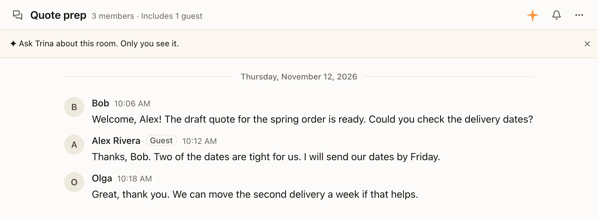
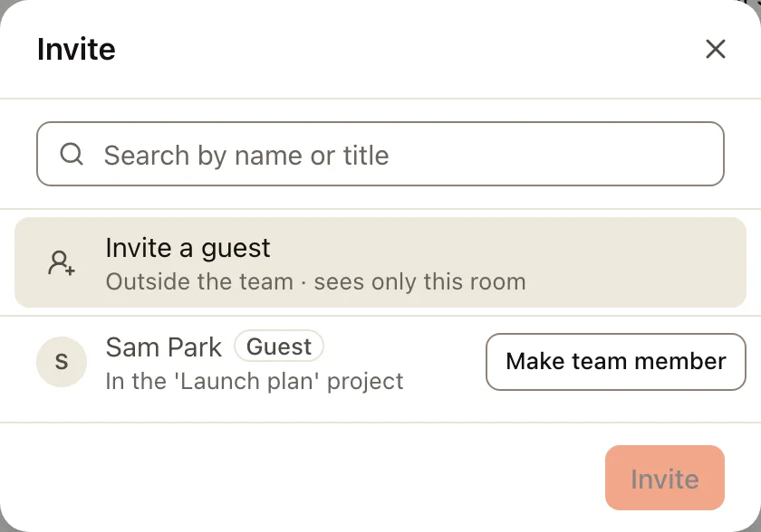
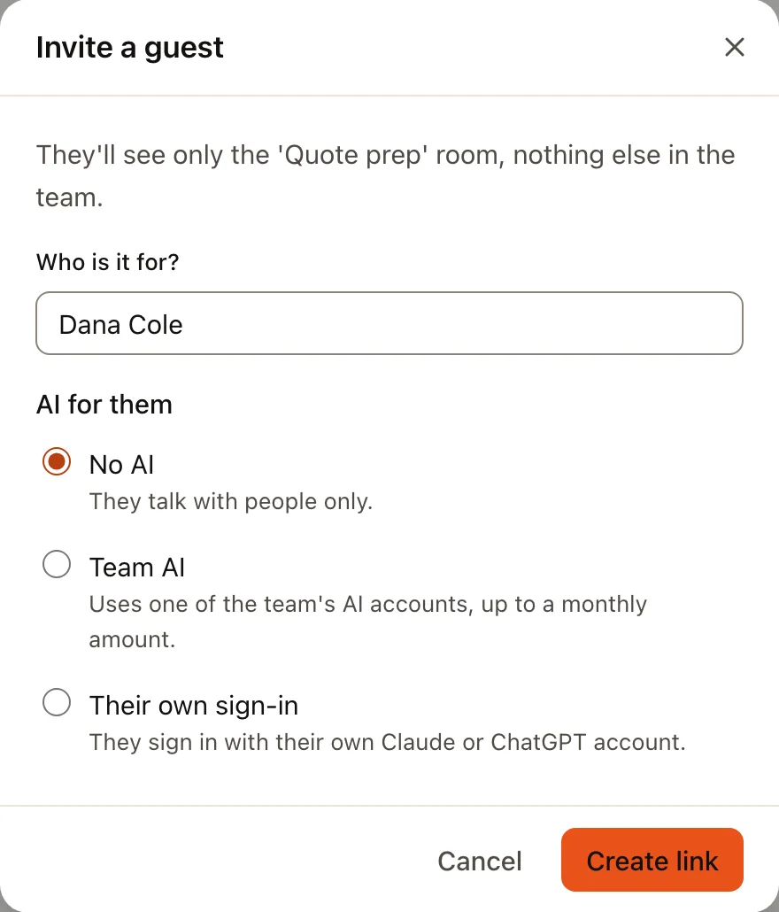
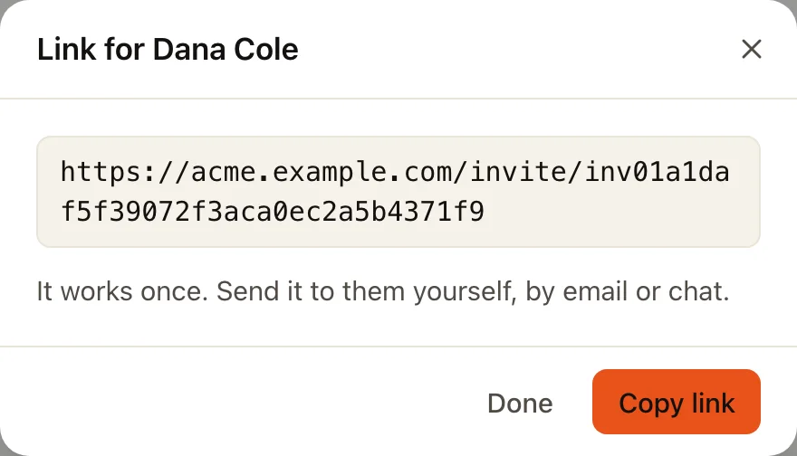
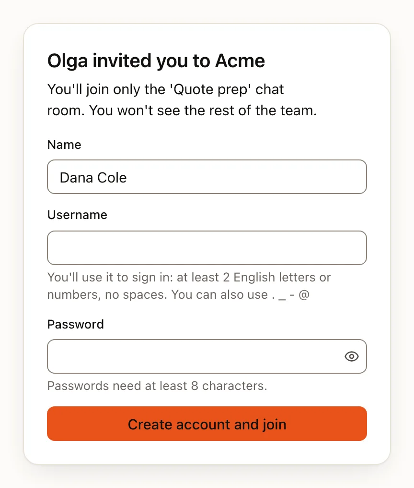
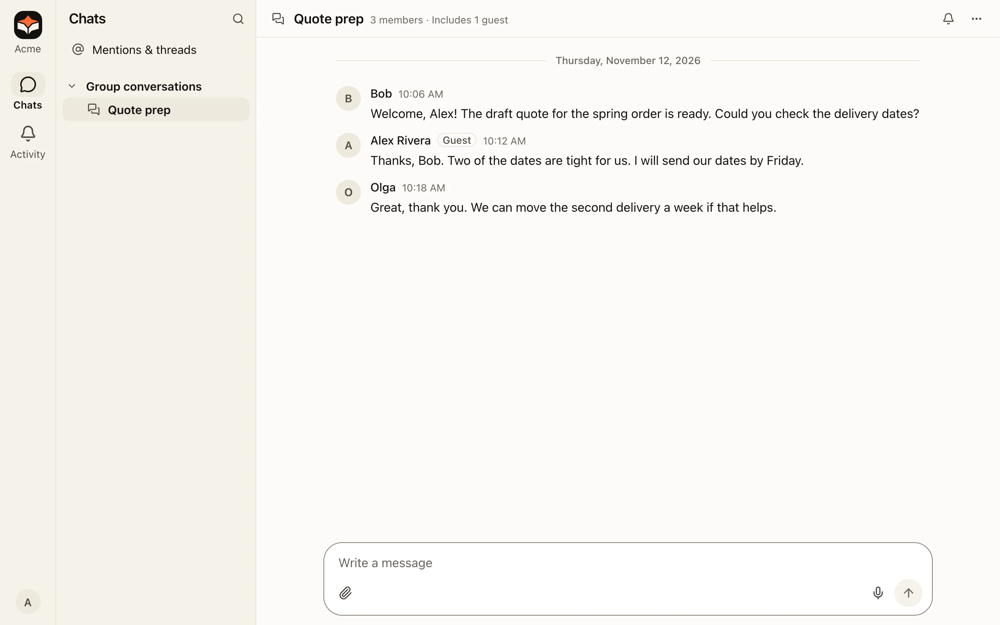
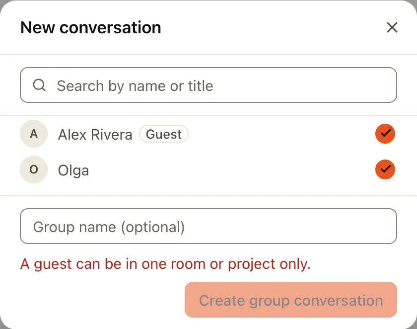
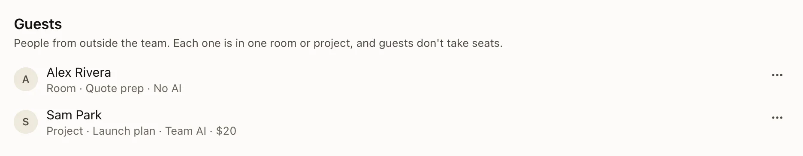

**访客**是来自团队外部的人，例如客户、合作伙伴或自由职业者。访客只加入一个群聊或一个项目，看不到团队的其他任何内容：没有其他对话、没有团队文件、没有其他项目，也没有团队技能。访客不占用套餐席位。

| | 团队成员 | 访客 |
|---|---|---|
| **能去哪里** | 小组和文件夹权限允许的一切 | 一个群聊或一个项目 |
| **团队文件** | 可以打开的文件夹 | 只有所在项目的文件（群聊里没有） |
| **AI** | 按团队的 AI 设置 | 不用 AI，除非为其选择了 AI |
| **席位** | 占用一个 | 不占用 |

访客的名字旁边有 **访客** 标签；有访客的对话或项目会在顶部注明（“包括 1 位访客”）。

## 谁可以邀请访客

- **邀请到群聊：** 这个群聊里的任何人。
- **邀请到项目：** 创建项目的人，或者所有者、管理员。

访客不会出现在 **团队群聊** 中（全员群聊和每个小组的群聊）。访客可以发私信，但只能发给自己那个对话或项目里的人。

## 邀请访客

:::steps
#### 打开添加列表
在群聊中，点击顶部的群聊名称，然后选择 **邀请成员**。在项目中，在项目页面的 **成员** 旁边选择 **管理**。第一行就是 **邀请访客**。

#### 写上对方的名字，选择对方的 AI
在 **发给谁？** 下输入对方的名字。在 **对方的 AI** 下，默认选中 **不用 AI**。其他选项见下文 [访客的 AI](#访客的-ai)。

#### 复制链接，自己发给对方
**创建链接** 会为这一个人生成一个链接。Trina 不会发送邮件：选择 **复制链接**，自己通过邮件或聊天发给对方。链接只能用一次，有效期 7 天；对话框会显示它失效的日期和时间。

:::

链接被使用之前，也会显示在 **管理 › 成员与邀请** 的 **访客** 下面，并带有对方的名字。

## 访客看到什么

链接打开的页面会写明是谁邀请了他们，以及他们将加入的那一个对话或项目。他们设置用户名和密码后即可加入。如果链接已经不能用，页面会说明原因：已过期、已被使用、已被关闭、创建链接的人已无法再邀请，或者对话或项目已不存在。

登录后，Trina 会直接打开他们的对话或项目。左侧栏只显示他们能用的内容：没有 **文件**，没有团队的项目和群聊；AI 关闭时也没有 **Trina**。他们的 **设置** 里只有自己的内容，例如个人资料和通知。

在项目中，项目成员可以看到访客在这里的对话。项目页面会告诉访客这一点。

## 只能在一个地方

访客只能在一个群聊或一个项目中，不能更多。Trina 不允许把访客加入第二个地方。在添加列表中，已经在别处的访客会注明所在位置，无法勾选。

如果对方需要不止一个地方，所有者或管理员可以选择 **设为团队成员**（见下文）。

如果访客离开、被移出，或者所在的对话或项目被关闭，对方就无法再登录，和被移除时一样。如果对方的项目从回收站恢复，对方会自动可以再次登录，除非所有者或管理员在此期间手动启用或停用过对方。重命名对话或项目对访客没有影响。

## 访客的 AI

| 选项 | 含义 | 谁可以选 |
|---|---|---|
| **不用 AI**（默认） | 只和人交流。 | 任何邀请人 |
| **团队 AI** | 使用团队的一个 AI 账号，每月金额（美元）上限由你设定。 | 所有者和管理员 |
| **用自己的账号登录** | 在 **设置 › AI 账号** 中连接自己的 Claude 或 ChatGPT 账号来使用。 | 任何邀请人 |

访客不能使用免费试用的 AI 额度。用完每月额度的访客会看到额度重新开始的日期。如果访客使用的团队 AI 账号被删除，访客会看到 AI 现在无法回答，**管理 › 成员和邀请** 中对方的那一行会写明账号已被删除：选择 **更改 AI** 另选一个。

:::note
如果你的团队在办公室 Mac 上运行 Trina AX，而且安装时没有用管理员密码，访客在那里不能使用 AI，只能选 **不用 AI**。使用管理员安装程序（.pkg）安装 Trina AX 后，其他选项才可以使用。
:::

## 套餐和上限

访客不占用席位。每个套餐可以同时有一定数量的访客：

| 套餐 | 访客 |
|---|---|
| Free | 3 |
| Starter | 10 |
| Team | 30 |
| Business | 100 |
| 自己的服务器（自托管） | 不限 |

**管理 › 成员和邀请** 会在 **访客** 旁边显示你有多少访客，例如“访客 3/10 位”。访客人数达到套餐上限时，邀请对话框会在你填写之前就告诉你。移除不再需要的访客可以空出名额。

如果套餐改成访客上限比现有访客少的套餐，不会移除任何人：每位访客照常使用。人数会变成橙色并附一句说明，在你移除访客或更改套餐之前无法再邀请。

## 管理访客（所有者和管理员）

**管理 › 成员与邀请** 中有 **访客** 列表。要只看访客，在顶部的角色列表中选择 **访客**。每一行显示访客所在的位置和他们的 AI。

访客的 **⋯** 菜单中有：

- **更改 AI**：重新选择不用 AI、团队 AI 或用自己的账号登录。
- **设为团队成员**：对方成为普通成员，占用一个席位。对方留在现在的位置，你也可以把对方加入更多对话和项目。对方的访客 AI 和每月额度随之结束：对方的 AI 之后和其他成员一样，按团队设置使用。已移除的访客设为团队成员后可以再次登录。
- **移除访客**：对方的账号停用，无法再登录。对方的消息和文件留在团队里。已移除的访客收在 **显示已移除的访客** 后面。

已移除访客的 **⋯** 菜单中，只要对方的对话或项目还在，就有 **重新启用**，另外还有 **设为团队成员** 和 **删除**。没有可以让对方回去的地方时，对方那一行会写明原因（对方已离开、项目在回收站里，或者对话或项目已不存在）：请重新邀请，或把对方设为团队成员。
