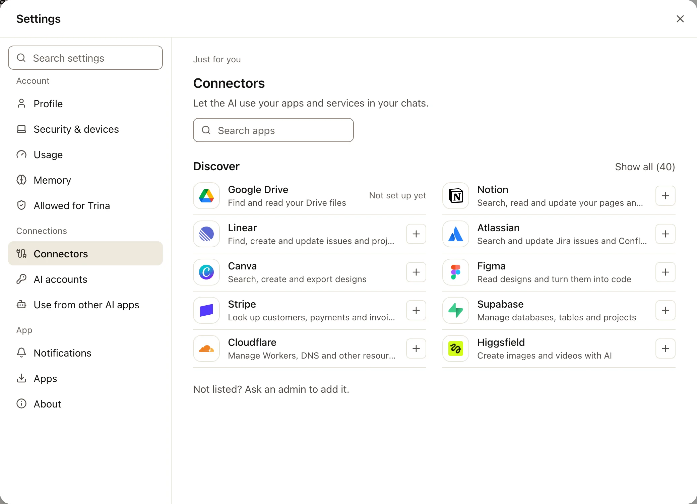
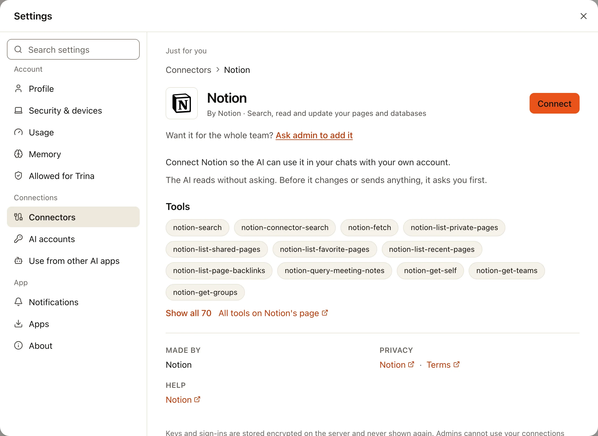
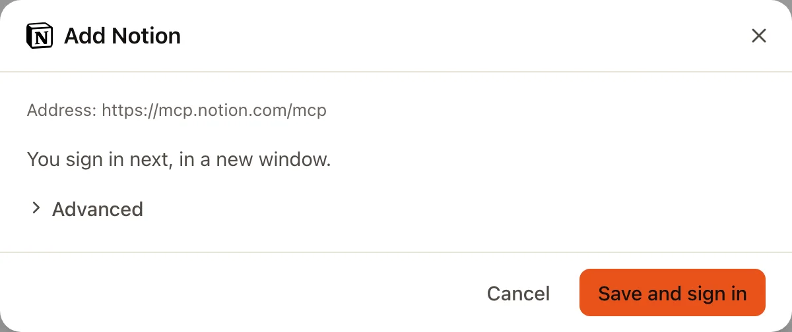
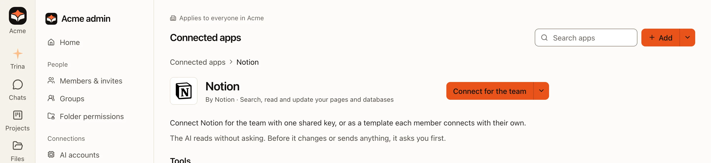
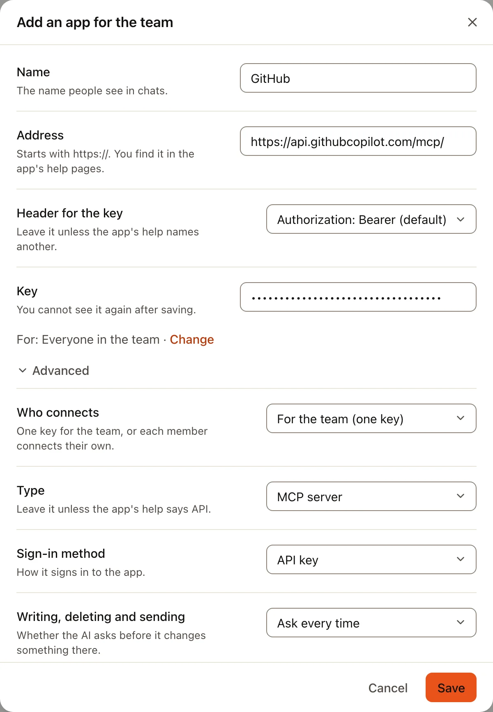
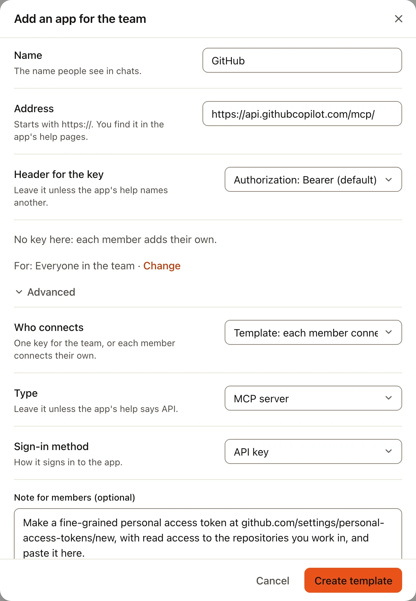

AI 可以替你使用 Trina AX 以外的应用：搜索你的 Notion 页面、打开一个 Linear 议题、读取一个 Jira 工单。每个应用只需连接一次。
大多数应用不需要复制任何东西：你在应用自己的页面上登录即可。少数应用（例如 GitHub）则会给你一个密钥。

:::note
在 0.4.0 之前，这个页面叫作**外部服务**（External services）。这些连接使用的是 MCP，一种应用向 AI 提供工具的通用方式；
使用时你不需要了解更多。
:::

## 你的应用用哪种方式连接

| 应用 | 你需要什么 | 指南 |
|---|---|---|
| Notion、Linear、Atlassian（Jira、Confluence）、Figma、Canva、Stripe、Supabase、Cloudflare、Higgsfield，以及**发现**中的其他应用 | 你在那个应用中的账号。不需要复制任何东西 | [登录“发现”中的应用](#登录发现中的应用) |
| GitHub | 一个个人访问令牌 | [GitHub](#github) |
| 其他公布了“MCP server”地址的应用 | 地址，以及应用要求时的密钥 | [通过地址添加应用](#通过地址添加应用) |
| 公司自己的系统（API） | 地址、密钥和使用说明 | [公司自己的 API](api-connections.md) |
| Google Drive、Gmail、日历、文档、表格 | 你的 Google 账号 | [Google 应用](google-apps.md) |
| Slack | 成员什么都不用做；管理员添加一次 | [Slack](slack.md) |

## 为你自己还是为团队

| | 为你自己 | 为团队 |
|---|---|---|
| 在哪里 | **设置 › 连接器** | **管理 › 已连接的应用**（所有者和管理员） |
| AI 用谁的账号 | 你的 | 登录的那个账号，或保存的那个密钥 |
| 谁使用 | 只有你，在你自己的对话中 | 管理员选择的所有人、小组或个人 |
| 谁能看到 | 只有你，管理员看不到 | 管理员 |

团队连接**只登录一次，作为一个账号**：所有使用它的人在那个应用中都以这个账号的身份操作。如果每个人应该以自己的身份操作（自己的
Notion 页面、自己的 GitHub 权限），请改为创建[模板](#模板每位成员使用自己的密钥)，或让每个人自己连接。

## 登录“发现”中的应用

:::tip
**你需要准备的**

- 你在那个应用（Notion、Linear……）中的账号，并已在浏览器中登录。
- 不需要复制或粘贴任何东西：Trina AX 会自动填好应用的官方地址。
:::

:::steps
#### 打开连接器
点左侧栏底部你的头像，再点**设置 › 连接器**（在手机上是**我**标签页）。**发现**列出了你可以连接的应用。**显示全部**会列出所有应用；
**搜索应用**可以按名称查找。

#### 打开应用并选择“连接”
应用的页面会说明 AI 在那里能做什么，并列出它的工具。选择**连接**（或列表中的 **+**）。成员还会看到**请管理员添加**，用来请求为整个团队添加。

#### 保存并登录
对话框会显示应用的官方地址。**高级**保持不变，选择**保存并登录**。

#### 在应用的页面上允许访问
一个新窗口会打开应用自己的页面（Notion、Linear……）。如有提示请登录，选择工作区，然后选择 **Allow**（按钮也可能叫 **Continue**
或 **Accept**）。窗口会关闭，Trina AX 显示**已登录。**应用会移到**你的连接器**中，并显示**已连接**。
:::

为团队连接时，管理员在**管理 › 已连接的应用**中做同样的操作：打开应用并选择**为团队连接**。旁边的箭头还提供
**作为模板：每位成员各自连接**。然后选择谁可以使用它。

登录必须在电脑上完成，在浏览器或桌面应用中。连接好之后，在手机上也能用。

## GitHub

GitHub 不允许其他应用自己完成登录，所以要用个人访问令牌连接。只有所有者和管理员可以通过地址添加应用；成员请找管理员，管理员可以创建
[模板](#模板每位成员使用自己的密钥)，让每个人使用自己的令牌。

:::tip
**你需要准备的**

- **地址**：`https://api.githubcopilot.com/mcp/`（GitHub 的 MCP 服务器）。
- **密钥**：GitHub 的个人访问令牌，以 `github_pat_` 开头。
:::

:::steps
#### 在 GitHub 创建令牌
打开 [GitHub › Settings › Developer settings › Personal access tokens › Fine-grained tokens](https://github.com/settings/personal-access-tokens/new)，
选择 **Generate new token**。填写名称（“Trina AX”）、到期日期、它可以打开的仓库（选 **Only select repositories** 最安全），以及
AI 需要的权限，例如把 **Contents**、**Issues** 和 **Pull requests** 设为 **Read-only**；如果允许 AI 修改，就设为 **Read and write**。
选择 **Generate token** 并复制它：GitHub 只显示一次。详情见 [GitHub 的指南](https://docs.github.com/en/authentication/keeping-your-account-and-data-secure/managing-your-personal-access-tokens)（英文）。

#### 在 Trina AX 中添加
在**管理 › 已连接的应用**中，选择**通过地址添加**（在“发现”下）或**添加**。填写：

- **名称**：`GitHub`
- **地址**：`https://api.githubcopilot.com/mcp/`
- 打开**高级**，把**登录方式**设为 **API密钥**。
- **密钥使用的请求头**：保留 **Authorization: Bearer（默认）**。
- **密钥**：粘贴令牌。

#### 保存
选择**保存**。Trina AX 会向 GitHub 核对令牌，并列出它提供的工具。这一行会显示**已连接**。
:::

## 通过地址添加应用

任何公布了“MCP server”地址的应用都可以添加，即使它不在“发现”中。所有者和管理员在**管理 › 已连接的应用** › **通过地址添加**中添加。
成员会看到“没有列出？请管理员添加。”

:::tip
**你需要准备的**

- **地址**：在应用的帮助页面中，通常是名为“MCP”“MCP server”或“Connect to AI tools”的页面。它以 `https://` 开头，
  通常以 `/mcp` 结尾。
- 应用的登录方式：在它自己的页面上登录（**登录（OAuth）**）、用密钥（**API密钥**），或不需要登录（**无**）。
- 如果用密钥：**密钥**，在应用的设置中（“API keys”“Tokens”“Developer”）获取；如果应用的帮助写了请求头名称，例如
  `X-API-Key`，还需要**请求头名称**。
:::

对话框中的各项：

| 项目 | 填什么 |
|---|---|
| **名称** | 大家在对话中看到的名称，例如“GitHub”。 |
| **地址** | 应用的 MCP 地址。以 `https://` 开头。 |
| **由谁连接**（高级） | **团队共用一个**，或**每位成员各自**。 |
| **类型**（高级） | **MCP服务器**。只有普通的 Web API 才选 **API**：见[公司自己的 API](api-connections.md)。 |
| **登录方式**（高级） | 按应用的帮助选择**登录（OAuth）**、**API密钥**或**无**。 |
| **密钥使用的请求头** | 保留 **Authorization: Bearer（默认）**，除非应用的帮助写了别的请求头。那时选择**其他请求头**，并准确填写**请求头名称**。 |
| **密钥** | 完整粘贴密钥。保存后就看不到了。 |
| **用我自己的应用登录**（高级） | 只用于要求你创建自己的登录应用的应用，例如 Google 的 MCP 服务器。见[用你自己的应用登录](api-connections.md#用你自己的应用登录)。 |
| **写入、删除和发送**（高级） | AI 是否先询问（见下文）。 |

:::warning
请把密钥填在**密钥**中，绝不要放在地址里（`…?key=…`）。使用团队连接的人能看到它的地址，AI 也会读取地址。
:::

## 更改需要同意

读取会立即执行。其他操作都算写入，按照连接的**写入、删除和发送**设置处理：

| 设置 | 会怎样 |
|---|---|
| **每次都询问**（默认） | Trina AX 会显示一张卡片，列出要发送的所有内容。在有人同意之前，什么都不会发出。 |
| **禁止写入** | 只能查询；写入会被拒绝。 |
| **无需询问直接运行** | 写入会直接执行，不再询问。只有管理员可以选择，而且只用于团队连接。 |

管理连接的人还可以在它的页面上单独关闭某些工具。应用返回的内容会被当作外部数据，绝不会被当作指令。在定时任务中没有人可以同意，
所以写入会被拒绝，除非是任务卡片上允许的、设为**无需询问直接运行**的团队连接。

## 模板：每位成员使用自己的密钥

很多应用会让密钥拥有其主人的权限，并把每次调用都记在那个人名下。对这类应用，管理员可以添加一个**模板**：应用只登记一次，
每位成员用自己的密钥或登录来连接。

:::steps
#### 添加模板
在**管理 › 已连接的应用**中，选择**通过地址添加**（或者在应用的页面上，选择**为团队连接**旁边的箭头 › **作为模板：每位成员各自连接**）。
在**高级**下，把**由谁连接**设为**每位成员各自**。填写地址、登录方式以及适用于谁。这里没有密钥输入框，地址中也不能有
`?…` 部分：放在那里的密钥会到达每位成员。用**给成员的说明（可选）**告诉大家去哪里获取密钥。

#### 成员连接
适用的成员会在**动态**中收到通知，并在**设置 › 连接器**的**你的连接器**下看到它，带有**团队**标签和**连接**按钮。他们输入自己的密钥
或登录。它会成为他们自己的连接，只在他们自己的对话中使用。
:::

| | 团队连接（一个密钥） | 模板 |
|---|---|---|
| 密钥 | 一个，由管理员添加 | 每位成员自己的 |
| AI 使用谁的权限 | 密钥主人的，对所有人都一样 | 每位成员自己的 |
| 管理员能看到什么 | 这个连接 | 谁在什么时候连接了，以及谁的密钥失效了；永远看不到密钥 |

在“管理 › 已连接的应用”中模板的那一行，**模板 · N人已连接**会打开适用的人员列表：**已连接**、**未连接**或**密钥已失效**。需要模板的
定时任务在没有你自己的密钥时不会运行：结果会说明需要你自己的……密钥，并链接到**连接**。

成员只能更改自己的密钥或登录，以及写入设置，并且可以随时断开。如果管理员更改了模板的地址或登录方式，所有成员的密钥都会被删除，需要重新连接；
改名称或说明则不影响大家的连接。删除模板，或把某人从模板中移除，会删除他们的连接。

## 请成员连接

管理员还可以给某位成员发送一个已填好应用的请求：**管理 › 已连接的应用** › **添加**旁边的箭头 › **请成员连接**。成员会收到通知，
用自己的密钥连接，或拒绝。管理员永远看不到密钥。

## 在对话中连接

你也可以在对话中说：“连接 Linear。”AI 会填好应用的官方地址并显示一张卡片。你只需在卡片中登录或粘贴密钥。密钥永远不会到达 AI。

## 常见问题

| 你看到的 | 该怎么做 |
|---|---|
| **需要登录** | 登录已结束，或密钥在应用那边被撤销。打开连接并选择**重新登录**或**更换密钥**。 |
| **登录尚未完成。** | 登录窗口被关闭了，或被其他窗口挡住了。选择**打开登录窗口**，或取消后重试。 |
| **在该服务中未获允许访问。** | 你在应用的页面上选择了 Cancel 或 Deny。请重新登录并允许。 |
| **无法检查连接。**，原因中有“401”或“unauthorized” | 密钥错误、已过期，或复制时带了空格。请用应用的复制按钮重新复制。如果用的不是 Bearer 请求头，请逐个字母检查**请求头名称**。 |
| **该服务没有列出任何工具。** | 这个地址不是 MCP 地址（常常是粘贴了应用的首页）。请使用应用 MCP 帮助页面中的地址。 |
| 成员找不到某个应用 | 成员只能从**发现**连接应用。请管理员通过地址添加它，或作为模板添加。 |

## 反方向

你自己的 Claude（Claude Code、Claude Desktop 或 claude.ai）可以连接**到** Trina AX，并以你的权限使用你的文件。
[了解 Team AX MCP 连接器](../../agents/mcp-connector.md)（英文）。

面向开发者的完整说明：[集成](../../../INTEGRATIONS.md)（英文）。
