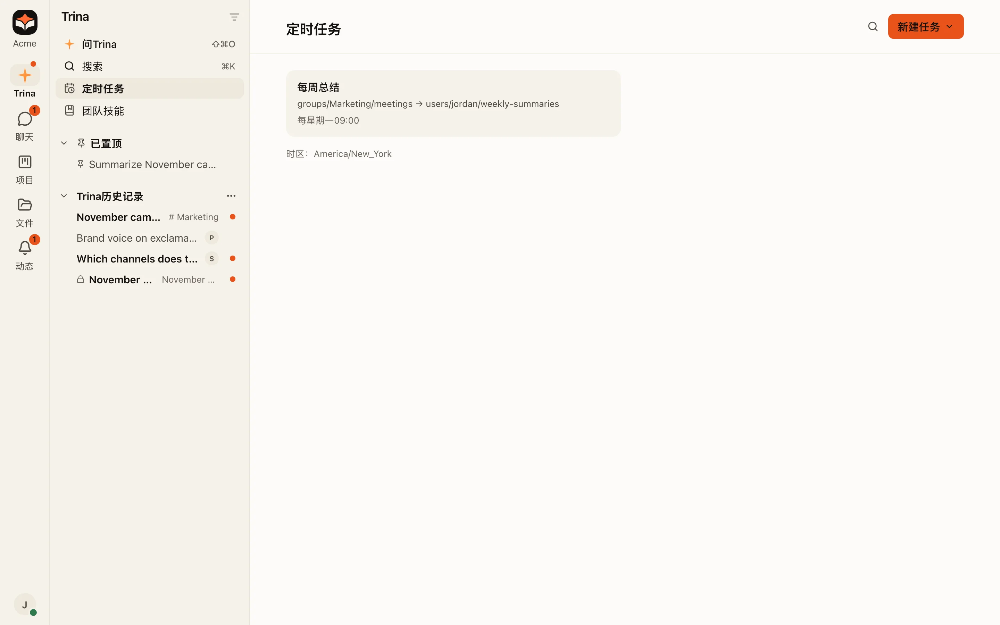
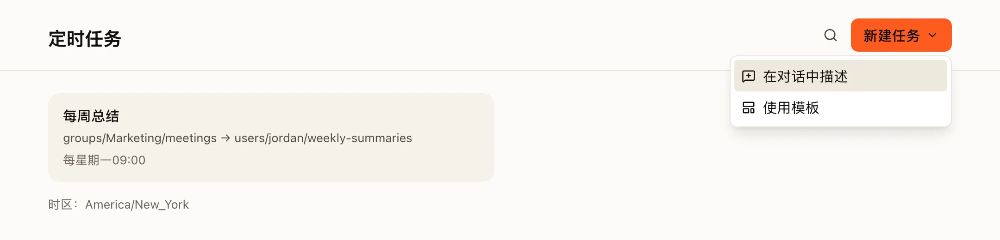
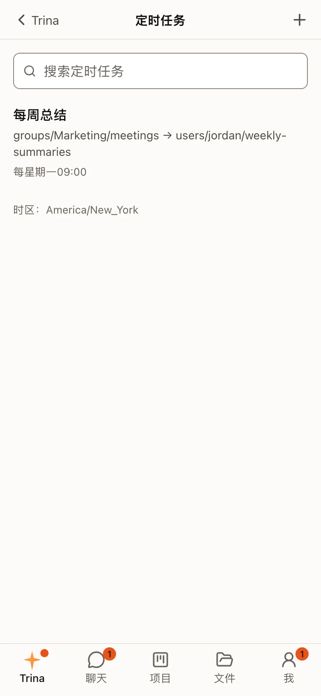

定时任务会一次又一次地运行同一个请求：每个工作日早上、每周一、每月一号。它以创建者的身份运行。

:::note
从 0.4.0 开始，定时任务有了自己的 **定时任务** 页面：它是 Trina 列表顶部附近的一行（在手机上，在 **Trina** 标签的 **☰** 菜单中）；在 ⌘K 中选择 **新建定时任务** 也能打开它。在此之前，它们在 **设置 › 计划（Schedules）** 中。
:::

## 创建任务

选择 **新建任务**。有两种方式：

- **在对话中描述。** 例如：“每周一 9:00，总结 shared/sales 中上周的笔记。”AI 会创建时间表并显示出来。
- **使用模板。** 选一个模板，填好它的文件夹和时间，然后保存。

## 一次运行可以做什么

| 主题 | 在定时运行中 |
|---|---|
| **权限** | 任务创建者的文件夹权限和技能。 |
| **时间** | 团队的时区。 |
| **问题** | 没有人在场回答，所以任何需要人确认的操作都不会运行，任务卡片允许的内容除外（见下文）。 |
| **网页** | 每次运行最多访问 8 个不需要人确认的新网址。 |
| **大文件下载** | 超过 1 GB 的文件会被跳过，而不是询问。 |

## 不经询问就保存和发送

运行时没有人能回答确认，所以任务卡片会在创建、编辑或重新检查任务时询问一次：

- **保存文件夹。**“新文件保存到：shared/Weekly reports（现在有 30 人可以看到）。可能保存到那里的内容：我的文件夹、#Sales群聊”。运行会不经询问把 **新** 文件放到那里及其子文件夹中，每次运行最多 20 个。它们永远不会修改或替换那里不是它们创建的文件，也永远不会碰技能或说明文件。如果一次运行读取了卡片上没有列出、能看到的人更少的内容（另一个文件夹、另一个群聊），它会改为保存到你自己的文件夹，并说明原因。
- **你自己的连接。**“可能发送到：我的 Notion · ‘Daily notes’”。运行只会发送给卡片上列出的接收方。

如果保存文件夹被移动、重命名或删除，它的权限发生变化，或者你不能再写入那里，任务会显示 **请重新检查保存文件夹** 和 **重新检查**，你会收到一条通知。在你重新检查之前，运行会保存到你自己的文件夹。有人加入或离开小组不会改变任何东西。

在 **编辑** 中，**保存文件夹** 字段可以选择另一个文件夹，或者把它移除（×），可能保存到那里的内容中的每一项也都可以移除（×）。

## 管理任务

打开一个任务，可以看到它的时间表、指令、下次运行和上次运行。

- **立即运行** 会马上运行它。
- 开关可以暂停和恢复它。
- 名称上的菜单有 **编辑** 和 **删除**。

已完成的一次性任务，或者无法再运行的任务，会说明为什么不能开启。

## 在手机上

任务排成一个列表，上面有搜索框，顶部的 **+** 用来新建任务。

