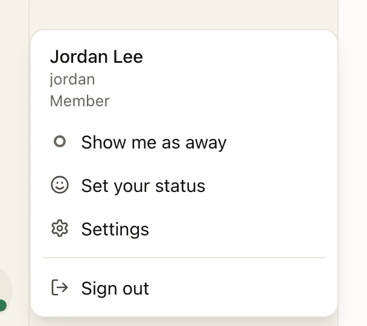
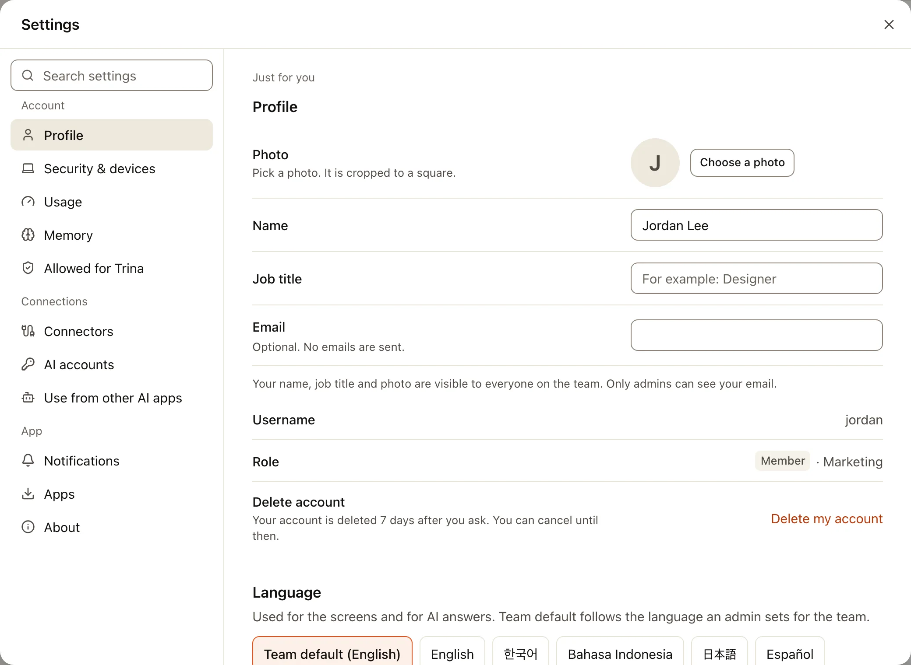
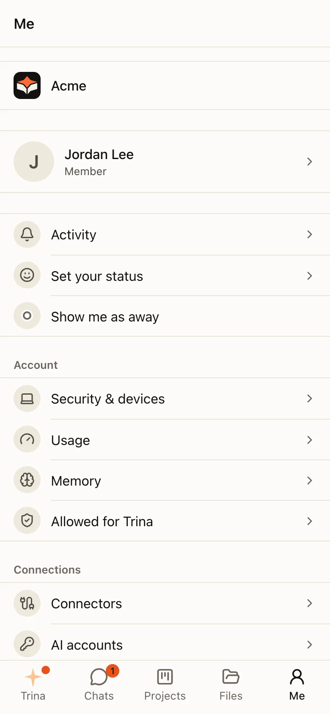
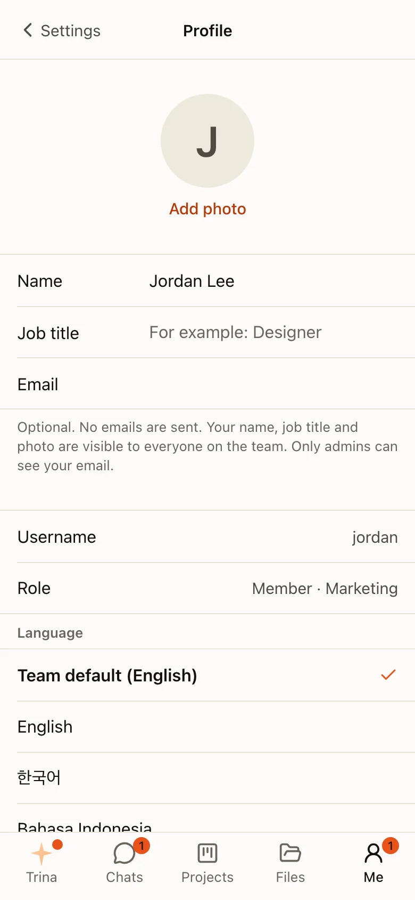
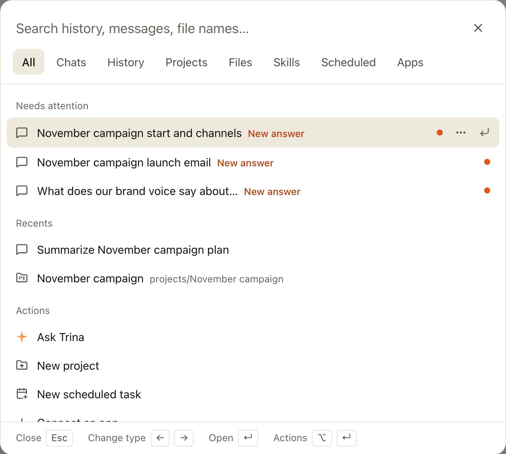
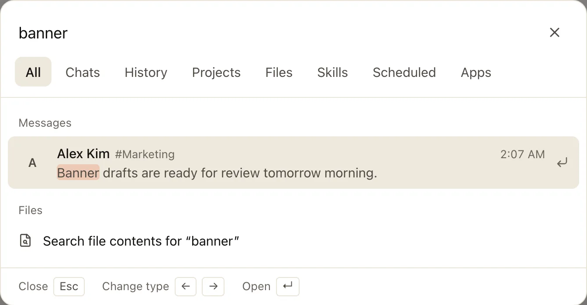

和你自己账号有关的一切都只需点一下：左侧栏底部你的头像。

## 账号菜单

点击左侧栏底部你的头像。在手机上，打开 **我** 标签页。

| 项目 | 作用 |
|---|---|
| **显示为离开** | 其他人会看到你处于离开状态，直到你改回来 |
| **设置状态** | 一条带表情的简短状态，显示在你的名字旁边 |
| **设置** | 打开设置窗口，停在你的个人资料 |
| **退出登录** | 结束本次会话 |

你的用量在 **设置 › 用量** 中；你删除的对话在 **已删除的历史记录** 中，位于 Trina 列表里 **Trina历史记录** 旁边的 **⋯** 菜单里（在手机上，在 **Trina** 标签页 **☰** 菜单的最下面）。

### 切换团队

在桌面应用中，点击左侧栏顶部你团队的标志，然后选择 **切换团队**：它会列出你的所有团队，和应用的 **团队** 菜单（⌘1–9）一样。在手机应用中，它在 **我** 标签页里你的团队下方。在网页浏览器中，每个团队都有自己的网址，所以无需切换。

## 设置窗口

设置会以窗口的形式打开，覆盖在你当前的页面上。像 `/settings/usage` 这样的链接会直接打开对应的部分。
这里的所有内容都只对你自己有效；适用于整个团队的内容在“管理”中。

| 分组 | 部分 |
|---|---|
| **账号** | 个人资料、安全与设备、浏览器、用量、记忆 |
| **连接** | 连接器、AI 账号（当团队允许成员添加自己的账号时）、在其他 AI 应用中使用 |
| **应用** | 通知、应用、关于 |

**连接器** 存放你和其他服务的连接：Google Drive、Gmail 和其他 Google 应用、Slack，以及列出的其他服务。打开其中一个可以连接它、查看 AI 可以用它做什么，或者断开连接；名称上方的 **连接器**（在手机上是 **‹ 连接器**）会回到列表。像 `/connectors` 这样的旧链接也会打开它。参见 [MCP 连接](mcp.md)。

:::steps
#### 找到一个部分
在左侧选择一个部分，或者在 **搜索设置** 中输入。

#### 更改你需要的内容
个人资料、语言、主题（浅色、深色或跟随系统，在个人资料中）、你的默认引擎、通知等等。

#### 关闭
按 **Esc** 或选择 **✕**。你会回到原来的位置。
:::

**浏览器** 中有 **允许所有网站**。打开后，在你的对话和群聊中，当你让 AI 打开公开网站时，它不会再询问。定时任务仍然会询问。带有又长又难读的字符串或很长查询参数的地址仍然会询问，但这只能拦下明显的令牌：文档、网页或群聊消息中隐藏的指令，可能让 AI 把它能读到的任何内容发送到任何网站。你也可以在地址卡片上打开它（“允许所有网站（可在设置中关闭）”）。在桌面应用中，同一个开关也覆盖应用自带的浏览器，它会在自己的窗口中再确认一次。只有在你的团队允许时，这个部分才会出现。

在手机上，设置会占满整个屏幕。先显示部分列表，**←** 会回到列表。

## 用 ⌘K 搜索

按 **⌘K**（Windows 上按 Ctrl+K），或者选择 **问Trina** 下方的 **搜索**。

- **标签页** 可以缩小搜索范围：全部、聊天、历史记录、项目、文件、技能、定时任务和应用。
- **什么都不输入时**，它会显示需要你处理的内容、你最近的对话和项目，以及 **新对话** 等快捷操作。
- **按名称查找聊天和人员**，结果排在 **全部** 标签页的最前面：输入名字的一部分，或者韩文名字的首辅音（“ㄱㅈ”能找到“견적”）。选中一个聊天会打开它。选中一个人会打开你和他的一对一聊天；如果还没有，会打开新建聊天列表并勾选好他，只有按下按钮后聊天才会开始。
- **聊天中的消息**（团队群聊、全员群聊、一对一聊天和多人聊天）会在 **全部** 标签页中显示，排在你的对话之后：显示是谁写的、在哪里、什么时候，以及你输入内容前后的文字。只会找到你现在打开那个聊天时能看到的内容。选中一条会在那条消息处打开聊天（回复会打开它所在的话题）；**跳到最新** 会带你回到最新的消息。输入一个词的一部分也可以：“견적”能找到“견적서를”。
- **聊天中发送的文件** 可以在 **全部** 和 **文件** 标签页中按名称找到，排在团队文件之后：显示文件、发送者、在哪里和什么时候。只会找到你能看到的消息中的文件。选中一个会在发送它的那条消息处打开聊天。
- **每个词都算数**，顺序不限：“견적서 보내”能在消息、对话和文件名中找到“견적서를 보내드렸어요”。
- **按键：** ↑ 和 ↓ 移动，Enter 打开，← 和 → 切换标签页，Esc 关闭。

