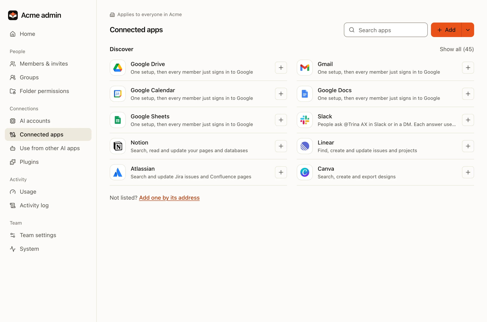
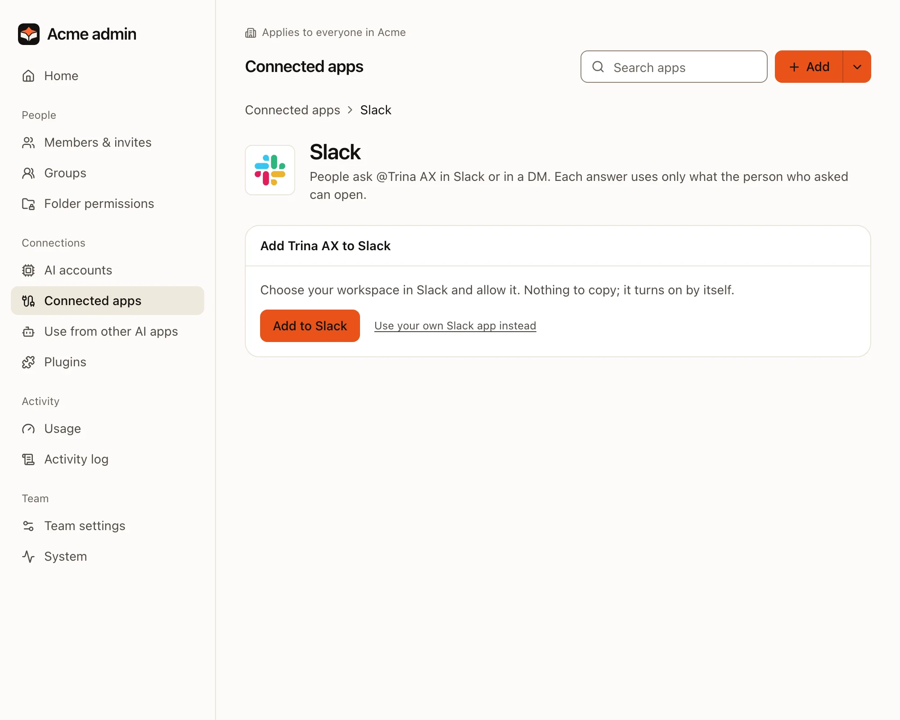
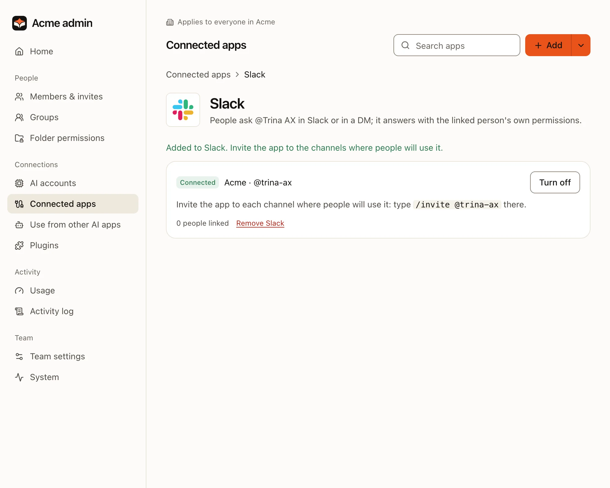
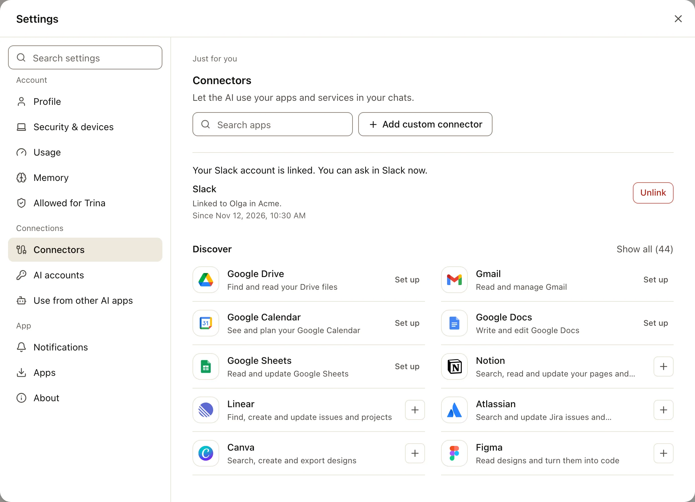
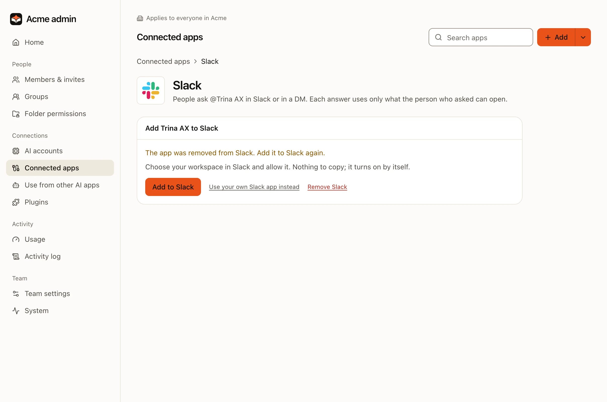

连接 Slack 后，大家不用离开 Slack 就能向 Trina AX 提问：在频道中提及 **@Trina AX**，或给它发私信。每个问题都以提问者的身份
运行，使用这个人自己的文件夹权限、AI 引擎和限额，完整的回答也会作为一次对话保存在 Trina AX 中。

只需两个简短的步骤。团队的所有者或管理员把应用添加到 Slack 一次，每个人再关联一次自己的 Slack 账号。

:::note
本页截图使用的是一个虚构的团队和工作区“Acme”。
:::

## 把 Trina AX 添加到 Slack（所有者或管理员）

:::steps
#### 在“管理 › 已连接的应用”中打开 Slack
在**管理**中，选择**已连接的应用**。Slack 是其中的一项服务：添加之前在**发现**下，添加之后在**已连接**下。团队的所有者和
管理员可以看到它。



选择 **Slack**。它的页面会显示**将 Trina AX 添加到 Slack**。



#### 点击“添加到 Slack”
**添加到 Slack**会打开 Slack 自己的页面。在手机上也可以操作。

#### 选择工作区并允许
Slack 的页面右上角会显示工作区名称，并列出 Trina AX 在那里能看到和能做的事。请先确认工作区：Slack 会打开你上次使用的工作区，
那可能不是你想要的。如有需要，在那个角落切换工作区，然后选择**允许**（Allow）。

#### 回到 Trina AX 中的 Slack 页面
页面会显示“已添加到 Slack。请把应用邀请到大家会使用它的频道。”这一行会显示你的工作区和应用，先是几秒钟的**正在连接**，然后是
**已连接**。不需要复制或粘贴任何内容。


:::

只有 Slack 工作区的管理员或所有者才能添加应用。其他人操作后回来会看到“需要 Slack 工作区管理员来添加。请让管理员操作。”，
应用也会再次从工作区中移除。

### 把应用邀请到频道

Slack 只会把应用所在频道的消息告诉 Trina AX。在每个大家会提问的频道中，输入：

```
/invite @trina-ax
```

私信不需要邀请。

## 关联账号并提问（所有人）

每个人把自己的 Slack 账号关联到自己的 Trina AX 账号，只需一次。任何人都不能替别人关联。

:::steps
#### 在 Slack 中提问
在邀请了它的频道中提及 **@Trina AX**，或给它发私信。例如：“@Trina AX 总结一下 shared/sales 里上周的笔记”。

#### 第一次时连接你的账号
第一次时，Trina AX 只回复你一个人：“要在这里向 Trina AX 提问，请先连接你的 Trina AX 账号。这个链接只能用一次，10分钟内有效，
并且只对你有效。”选择**连接 Trina AX 账号**。Trina AX 会打开（如有提示请登录），并显示两个账号。如果你的 Slack 账号和
Trina AX 账号的邮箱相同，**关联**就会把它们关联起来。如果不同，页面会说明原因，并改为提供**使用 Slack 登录以关联**。

#### 或者从 Trina AX 中关联
**设置 › 连接器**中有一行 **Slack**：“使用你在……的 Slack 账号登录以完成关联。”**关联**会带你去 Slack 再回来，之后这一行会
显示它所关联的账号。



#### 再问一次
回到 Slack，把你的问题再问一次。从现在起，Trina AX 会马上回答。
:::

### 回答出现在哪里

| 在哪里提问 | 你会得到什么 |
|---|---|
| **频道** | 先显示“正在处理…”，然后是只有你能看到的回答，并带有**发布到频道**。点击它，回答就会发布到话题中，并附上“……的提问”和你的名字。 |
| **私信** | 回答会出现在你这条消息的话题中。 |

- **在同一个话题中继续。** 在那个话题中再次提及应用，或在私信的话题中回复：会继续同一个对话。新话题会开始一个新对话。
- **完整的回答也在 Trina AX 中。** 较长的回答在 Slack 中会被缩短，并附上查看其余内容的链接。“正在处理…”还会写明它以哪个账号的
  身份回答，这样你就能确认那是你的。
- **发布之前。** 如果回答用到了团队中不是所有人都能看到的地方，例如某个小组的文件夹或你自己的文件夹，**发布到频道**会先请你确认，
  并提供**仍然发布**和**取消**。在与其他组织共享的频道中，回答永远不会被发布。

## 如果没有“添加到 Slack”

**添加到 Slack**只出现在由 Trina 托管服务为你提供服务器的地方：托管的团队，或者你自己安装、并已在托管服务中登记的服务器。
在其他地方，**管理 › 已连接的应用**中的 Slack 页面会改为显示**连接 Slack 应用**：分四步，用我们的清单（manifest）创建团队自己的
Slack 应用，并粘贴它的密钥。请按照[设置团队自己的应用](../../../SLACK.md#setting-up-the-teams-own-app-the-owner)（英文）操作。
只有团队的所有者可以做这一步，因为需要粘贴应用的密钥；管理员会看到“只有团队所有者可以在这里连接 Slack。”

如果团队自己的 Slack 应用已经设置好，你也会看到这四个步骤。要切换的话，所有者先把它移除（**更换令牌**，然后**移除 Slack**），
再点击**添加到 Slack**。管理员可以关闭和开启团队自己的应用，但只有所有者可以更改或移除它。如果在“管理 › 已连接的应用”中
根本看不到 Slack，说明你不是团队的所有者或管理员：请找他们。

## 移除或重新连接

**管理 › 已连接的应用**中的 Slack 页面始终会说明当前状态，列表中它的那一行会显示**开**、**关**或需要你处理的事。如果应用在
Slack 中被移除，这一行会显示**重新连接**，页面会再次提供**添加到 Slack**，如果你不想再用，也可以选择**移除 Slack**。



| 发生了什么 | 该怎么做 |
|---|---|
| **有人在 Slack 中移除了应用** | Slack 页面会显示“应用已从 Slack 中移除。请重新添加到 Slack。”再次点击**添加到 Slack**。每个人的关联都会保留：只要添加到同一个工作区，就没有人需要重新关联。如果你不想再用，请改为点击**移除 Slack**：Slack 会回到**发现**下，所有人的账号关联都会被删除。 |
| **想暂时关闭** | 点击**关闭**。Trina AX 会停止在 Slack 中回答；关联保留。点击**开启**即可恢复。 |
| **想彻底移除** | 点击**移除 Slack**并确认。应用会从你的 Slack 工作区中移除，所有人的账号关联都会被删除。如果以后再次添加，每个人都需要重新关联。 |

任何人都可以随时在**设置 › 连接器**的 Slack 这一行中，对自己的 Slack 账号点击**解除关联**。

## 常见问题

### 谁可以把 Trina AX 添加到 Slack？

团队的所有者或管理员在 Trina AX 中点击**添加到 Slack**，在 Slack 中还需要工作区的管理员或所有者允许。管理员还可以关闭和开启它、
重新添加以及移除它。设置团队自己的 Slack 应用（粘贴它的密钥）只能由团队的所有者完成。成员永远看不到“管理”；他们在
**设置 › 连接器**中关联自己的 Slack 账号。

### 每个人都需要登录吗？

是的，一次。在一个人关联自己的 Slack 账号之前，Trina AX 只会给他发送连接用的链接。Trina AX 账号被停用或删除的人会立即被解除关联。

### Trina AX 在 Slack 中能看到什么？

只有在邀请了它的频道中提及 @Trina AX 的消息，以及发给它的私信。它不会读取频道历史、话题中较早的消息或文件：AI 只会收到你问题的
文字。为了关联账号并说明是谁提的问，它会读取工作区中成员的名字和邮箱地址。在频道中，回答在提问者发布之前只对提问者本人可见。

### 回答使用谁的权限？

提问者的：他的文件夹权限、AI 引擎和限额。和任何对话一样，这个回答会计入他的用量。

### 可以连接多个工作区吗？

不可以，每个团队只能连接一个工作区。已经连接到另一个团队的工作区会被拒绝：“此 Slack 工作区已连接到另一个团队。请在那里移除，
或在 Slack 中移除应用，然后重试。”共享频道中其他组织的人以及机器人都不会得到回答。

完整说明：[Slack 连接器](../../../SLACK.md)（英文）。
