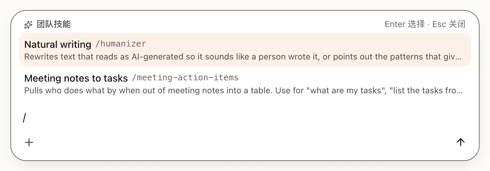
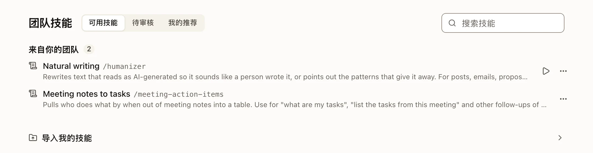

技能是写在 `SKILL.md` 文件里的一套可重复使用的做法。它告诉 AI 你的团队是怎么完成某项任务的。它不会训练模型，也绝不会给出额外的访问权限。

## 使用技能

- 在对话中输入 `/` 并选择一个技能，或者在消息里写 `/skill-name`。
- 当技能符合请求时，AI 也可以自己找到并加载它。
- **团队技能**是 Trina 列表顶部附近的一行（在手机上，位于 **Trina** 标签页的 **☰** 菜单里），列出你可以使用的技能。





## 推荐技能

产品自带四个现成的技能，使用团队的语言（韩语或英语；其他语言使用英文版本）。它们不会自动加入：只有当有人按下写着该技能名称的按钮时，才会加入。

| 文件夹 | 技能 | 如何加入 |
|---|---|---|
| `skills/general/` | Company profile（公司简介）、Promo cards（宣传卡片）、Promo video（宣传视频） | 所有者在设置步骤**选择团队要使用的技能**中选择，或由所有者或管理员之后在**可用技能**中添加 |
| `skills/work/` | Natural writing（自然写作） | 同上 |

- **在设置步骤中**，每个技能有一行说明和**示例**。如果已保存公司简介，Company profile、Promo cards 和 Promo video 会默认勾选（它们是根据公司简介制作的）；Natural writing 默认不勾选。按钮会写明要加入什么，例如 **添加Company profile·Promo cards·Promo video**。
- **在可用技能中**，所有者和管理员会在列表下方看到一行折叠的内容：**Trina AX准备的技能 · 还有2个**，里面是团队还没有的技能。展开它，勾选你想要的（一开始什么都没勾选），然后按 **添加到团队**。搜索时这一行会隐藏，团队拥有全部技能后它就会消失。之后版本新增的技能只会让数字增加：不会有通知。
- **示例**展示该技能为一家虚构公司 Example Coffee 做出的成果，以及这个技能的来源。

如果设置步骤结束时团队已有其中某个技能，最后一个页面会建议用它做出第一个成果（优先使用 Promo cards）：按下后会打开该技能的表单，在你按下**运行**之前什么都不会执行。

它们是你团队自己的文件：技能管理者可以编辑、移动或删除它们。再次添加只会补上缺少的部分；你编辑过的技能绝不会被替换，名称已被另一个团队技能使用的技能会被跳过。你删除的技能，只有当有人再次按名称添加它时才会回来。

**Natural writing** 会改写读起来像 AI 写的文字，让它听起来像人写的，同时不改变任何事实。韩语版由公司编写，熟悉韩语的各种文体（博客、Shorts 标题、Instagram、提案、通知）；英语版改编自开源的 “humanizer” 技能（MIT 许可证，其声明在技能内部）。

只有来源明确的技能才会随产品提供。早期版本还会添加用于会议任务、文档简报、市场营销、日常工作和韩国人事文件的技能；已经拥有这些技能的团队会把它们保留为自己的文件。

## 技能存放的位置

| 位置 | 谁能看到 |
|---|---|
| `skills/<name>/SKILL.md` | 所有能读取 `skills/` 的人（通常是整个团队） |
| `skills/<folder>/<name>/SKILL.md` | 只有能读取该文件夹的人，例如 `skills/finance/` |
| `groups/<group>/skills/<name>/SKILL.md` | 只有该小组的成员。不在小组里的所有者或管理员也看不到。 |
| `projects/<project>/skills/<name>/SKILL.md` | 只在该项目的对话中，供能读取该项目文件夹的人使用。 |
| `users/<you>/skills/<name>/SKILL.md` | 只有你。所有者和管理员也看不到。 |

当两个技能同名时，离你最近的那个生效，并且只对你生效：先是你的个人技能，然后是你所在小组的，再是团队的，最后是项目的。项目技能只会增加新的名称。如果你所在的两个小组都有同名技能，两者都会连同各自的文件夹一起列出，`/name` 使用小组名称排在前面的那个小组的技能。

## 小组技能

每个小组在自己的文件夹里都有自己的技能：`groups/<group>/skills/`，就在小组文件的旁边。只有小组成员能看到和使用它们：在**团队技能**中（每个小组一个分区，标题是小组名称）、在 `/` 菜单中（标有小组名称），以及在 AI 所知道的内容中。所有者和管理员如果不在该小组里，就不会获得该小组的技能。

- 小组的任何成员都可以添加或修改小组的技能，就像修改小组的其他文件一样。AI 在把技能保存到那里之前会用卡片询问你，和团队技能一样，每次修改都会以小组的名称记录下来。
- 成员可以向自己的小组推荐技能（**推荐为技能**，然后选择小组的文件夹）；由小组成员进行审核。
- 重命名小组时会保留它的文件夹；**团队技能**中的分区会立即显示新名称。删除小组会把它的技能从成员的列表中移除。

小组技能由小组成员编写，而不是由团队的技能管理者编写：一名成员保存在那里的内容，每位成员的 AI 都会遵循。

## 项目技能

`projects/<project>/` 中的团队项目可以在它的 `skills/` 文件夹里有自己的技能，每个技能一个文件夹，里面放一个 `SKILL.md`。AI 只在该项目的对话中使用它们（你的对话、共享的对话以及项目中的定时任务），绝不会在群聊或你的其他对话中使用。**团队技能**为每个项目显示一个分区，**<project> 项目技能**，`/` 菜单会在项目内为它们加上标记。

- 能写入该项目文件夹的人都可以添加或修改它们；AI 会先用卡片询问，卡片上写着项目名称，每次修改都会以项目的名称记录下来。
- 项目技能只会增加新的名称。如果某个名称已被团队、小组或你使用，页面上会标记为 **同名：整个团队**，AI 的卡片会建议换一个名称，而不是保存一个永远不会运行的技能。
- 要在团队、小组、项目和你自己的技能之间移动技能，请使用技能菜单中的**移动**：它会显示每个层级中谁会获得、谁会失去这个技能，并在更多人获得之前显示全文。你也可以在项目对话中让 AI 来做；它只会把技能移到让更少人获得的位置，并且会先显示一张列出所有文件的卡片。

## 编写技能

:::steps
#### 创建文件夹
在文件中创建 `skills/<name>/`。名称使用 `a`–`z`、`0`–`9` 和连字符，并且与文件夹名称一致。

#### 编写 SKILL.md
先写一个头部，然后写做法。
```markdown
---
name: meeting-summary
description: Summarize permitted meeting notes into decisions, actions and open questions.
---

# Inputs
Ask for the source paths before reading.

# Procedure and output
Return decisions, an action table and open questions. Cite the source paths.
```

#### 检查能否加载
当技能无法加载时，**团队技能**会显示清楚的原因。修正头部后再试一次。
:::

[阅读完整的 SKILL.md 格式说明](../../agents/skills-format.md)（英文）。

## 从 Claude Code 或 Codex 导入你的技能

所有者和管理员可以通过**可用技能**列表下方的**导入我的技能**，或通过一个提案链接，把自己已经在用的技能带到团队中。设置步骤只提供现成的技能。在手机上，页面会提示这需要在电脑上完成。

| 来源 | 选择或拖入 | 读取的内容 |
|---|---|---|
| Claude Code | `~/.claude`（或某个项目的 `.claude`） | `skills/`、`commands/*.md`、`CLAUDE.md` |
| Codex | `~/.codex`，以及用于当前个人技能的 `~/.agents` | `skills/`（绝不包括 `.system`）、`prompts/*.md`、`AGENTS.md`、`config.toml` 中的远程服务器 |

或者，当 Claude Code 或 Codex 连接到团队后（[MCP 连接器](../../agents/mcp-connector.md)（英文）），在其中粘贴一行内容，它就会发送一个提案。

- 这些文件夹里的其他内容都不会被打开。包含密钥或令牌的技能绝不会离开你的电脑；只会列出它的名称。
- 服务器会再次检查每个技能，并推荐整个团队都能使用的技能。如果检查超过 30 秒，列表会在什么都没勾选的状态下显示，由你自己选择。在你按下添加的按钮之前，什么都不会进入团队。
- 规则文件会变成一条团队规则。远程 MCP 服务器会变成不带密钥的连接模板：每位成员用自己的密钥连接。
- 与团队技能同名的技能，会在你确认后，在一个只能读取这两个技能并保存团队技能的对话中合并。
- **改为分享给你的某个小组。** 在提案页面上，**共享给**可以选择整个团队（默认）或你的某个小组；Claude Code 和 Codex 也可以指定小组。发给小组的提案只会添加技能（没有团队规则，也没有连接），并且绝不会修改团队技能：与小组某个技能同名的技能会合并进去或放在旁边，与团队技能同名的技能会成为小组自己的副本。小组成员会在**团队技能 › 审核**下看到它（只有发给该小组的内容），其中任何人都可以把它添加到小组。

## 谁可以修改技能

**技能管理者**可以修改团队技能：所有者、管理员，以及管理员添加的人员或小组。实际上，这就是对 `skills/` 或其中某个文件夹的写入权限。

所有者和管理员会在**团队技能**标题下看到是谁：“可编辑：所有者和管理员、Sales：3人、Alex [更改]”。这个列表就是文件夹权限中对 `skills/` 的设置，因此也包括通过小组、所有人规则或整个团队文件夹的规则而能够编辑的人。其中有自己写入规则（针对某个人、某个小组或所有人）的文件夹会在最后计数（“2个文件夹有自己的写入规则”）。**更改**会打开一个窗口：

- 它会列出所有者和管理员（始终列出），以及每个在 `skills/` 上有自己写入规则的人员和小组；如果规则设在子文件夹上，例如 `skills/finance/`，还会显示该文件夹。**移除**会在确认后取消这条规则；如果另一条规则仍然允许此人编辑（小组的、所有人的，或此人自己在 `skills/` 上的规则），它会说明这一点。
- **添加人员或小组**可以按名称查找。阅读警告后，按**开启**：他们就可以编辑整个 `skills/`。
- 如果只想移交一个文件夹，请按照**要移交单个文件夹，请使用文件夹权限**，在那里给该文件夹设置写入权限。

成员和其他技能管理者看不到这一行。

- 成员可以向团队**推荐**个人技能。由目标文件夹的技能管理者进行审核。
- 对 `skills/` 的每次修改都会被记录，所有者和管理员会收到一条带有版本历史链接的通知。
- 小组的技能由小组成员修改（见[小组技能](#小组技能)）；他们的修改也会以同样的方式记录和通知。

## 成员导入自己的技能

成员可以使用**可用技能**列表下方的**导入我的技能**（在电脑上），或者在第一次得到好结果后，回答下方的一行提示，它会询问是否也要把自己在用的技能或文件带到团队中。两者都会打开同一个面板：

- 成员选择或拖入自己的 `.claude`、`.codex` 或 `.agents` 文件夹，读取方式与上面相同。包含密钥的技能绝不会离开他们的电脑。
- 一开始什么都没勾选。他们最多勾选 10 个技能，作为推荐发送；同一时间最多可以有 20 条推荐在等待。规则文件和 MCP 服务器不会被发送。
- 服务器会再次检查每个技能（密钥、脚本、大小、名称、他们电脑上的路径），并把它保存在团队文件之外。不会由 AI 来评判。
- 如果他们可以写入团队文件夹，面板还会链接到该文件夹，用于放文件。在手机上，这一行只提供该文件夹；如果他们无法写入任何文件夹，则什么都不显示。

每次发送，所有者和管理员都会在**动态**中收到一条通知（“Mina想把2个技能带到团队”），点开后进入**审核**，按人员分组。只有所有者和管理员能看到并批准这样的技能：它会以 `skills/<folder name>/` 连同其文件一起保存，成员会收到通知，列表中的技能会显示“由Mina建议”。批准绝不会改变邀请所打开的技能，也不会改变 7 天目标中指定的技能。这一行可以用 ✕ 永久关闭。

## 入门技能

代码仓库中有六个使用虚构输入的入门技能：周报、销售跟进、品牌简报、费用审核、新员工指南和会议纪要。[查看示例](../../../../examples/README.md)（英文）。
