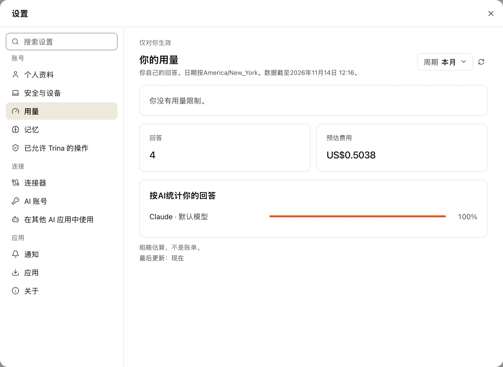
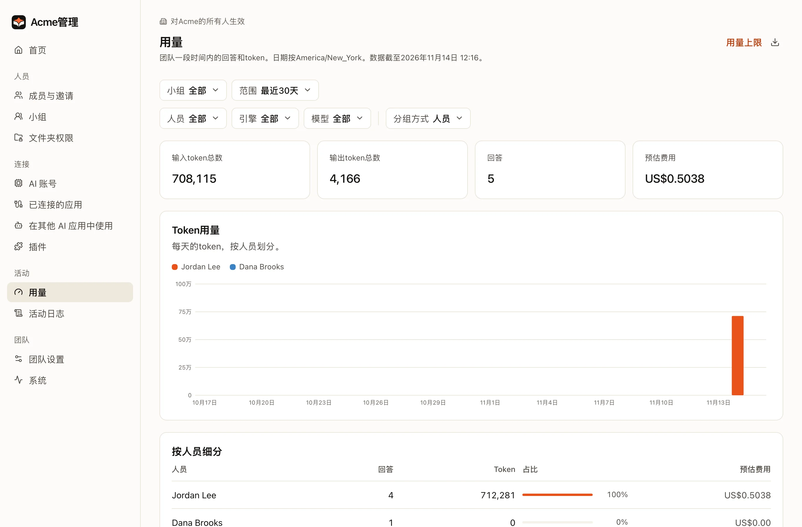

Trina AX 会统计每一次回答：谁提的问题、用了哪个引擎和模型、多少 token，以及预估费用。

:::note
费用是按同等 API 价格估算的，不是账单。订阅连接每次请求计为 0，但它们的 token 仍会计入。
:::

## 你自己的用量

打开 **设置 › 用量**（左侧栏底部你的头像 › **设置**；在手机上是 **我** 标签）。它会显示你的回答数和预估费用、回答来自哪个 AI，以及适用于你的每项限制已经用了多少。你只能看到自己的数字。

:::note
个人用量是 0.4.0 新增的。在此之前，只有管理员能在 **管理 › 用量** 中看到用量。
:::

## 团队的用量

管理员打开 **管理 › 用量**。它的布局和 Claude Console 的用量页面类似。

- 顶部的 **筛选**，每个都是一个小按钮，显示当前选中的内容：
  - **小组**（仅当团队有小组时）和 **范围**：今天、最近 7 天或 30 天、本月，或自定义范围。
  - **人员**、**引擎**、**模型** 和 **AI连接**，用来只看其中一项。**清除筛选** 会重新显示全部内容。
  - **分组方式**：按人员、小组、引擎、模型、日期、AI 连接或技能。
- **卡片** 显示总计：输入 token、输出 token、回答数和预估费用。
- **Token用量**：以堆叠柱状图显示每天的 token 数，每个分组方式的值一种颜色（最大的五个，其余归为“其他”）。把鼠标指向某一天，或者聚焦图表后用方向键，就能看到那天的数字。
- **细分**：每个分组方式的值一行，显示回答数、token 数、所占比例和预估费用。
- **下载** 按钮会把细分保存为 CSV。

个人技能永远不会按名称统计，所以没有管理员能看到某人私下保留的内容。小组技能和团队技能一样统计。

## 设置限制

默认没有任何限制。管理员在 **管理 › 团队设置** 的 **用量限制** 中添加。

| 限制对象 | 周期 |
|---|---|
| 一个人 | 每天或每月 |
| 一个小组 | 每天或每月 |
| 整个团队 | 每天或每月 |

达到限制后，受限制的人在周期重置之前无法开始新的回答。他们的用量页面会说明何时重置。
