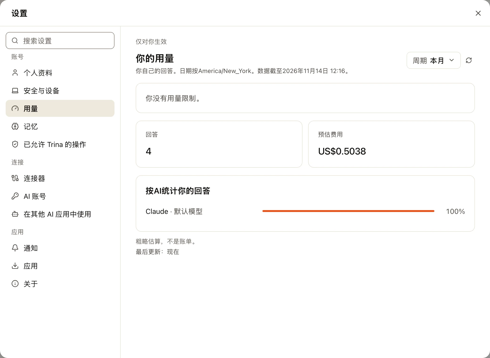
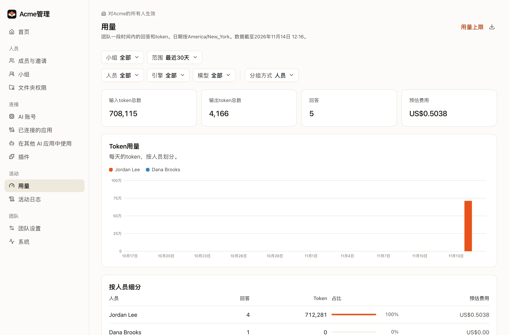
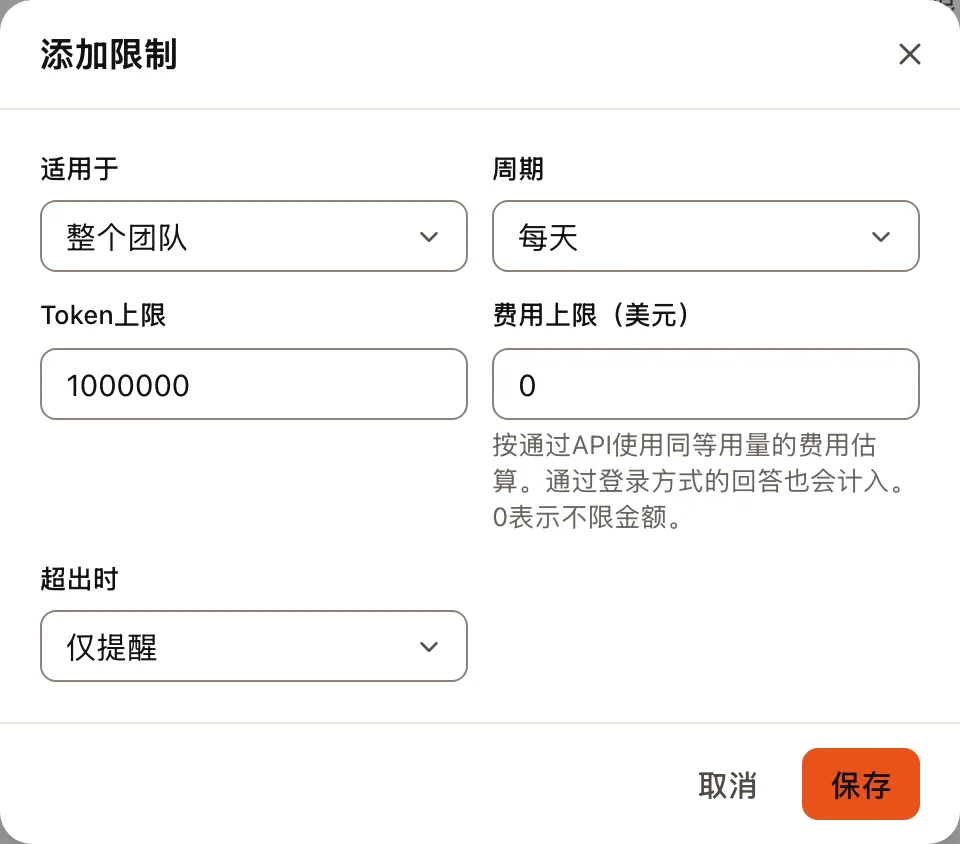

Trina AX 会统计每一次回答：谁提的问题、用了哪个引擎和模型、多少 token，以及预估费用。

:::note
费用是按同等 API 价格估算的，不是账单。订阅连接每次请求计为 0，但它们的 token 仍会计入。
:::

## 你自己的用量

打开 **设置 › 用量**（左侧栏底部你的头像 › **设置**；在手机上是 **我** 标签）。它会显示你的回答数和预估费用、回答来自哪个 AI，以及适用于你的每项限制已经用了多少。你只能看到自己的数字。

:::note
个人用量是 0.4.0 新增的。在此之前，只有管理员能在 **管理 › 用量** 中看到用量。
:::

## 团队的用量

管理员打开 **管理 › 用量**。它的布局和 Claude Console 的用量页面类似。

- 顶部的 **筛选**，每个都是一个小按钮，显示当前选中的内容：
  - **小组**（仅当团队有小组时）和 **范围**：今天、最近 7 天或 30 天、本月，或自定义范围。
  - **人员**、**引擎**、**模型** 和 **AI连接**，用来只看其中一项。**清除筛选** 会重新显示全部内容。
  - **分组方式**：按人员、小组、引擎、模型、日期、AI 连接或技能。
- **卡片** 显示总计：输入 token、输出 token、回答数和预估费用。
- **Token用量**：以堆叠柱状图显示每天的 token 数，每个分组方式的值一种颜色（最大的五个，其余归为“其他”）。把鼠标指向某一天，或者聚焦图表后用方向键，就能看到那天的数字。
- **细分**：每个分组方式的值一行，显示回答数、token 数、所占比例和预估费用。
- **下载** 按钮会把细分保存为 CSV。

个人技能永远不会按名称统计，所以没有管理员能看到某人私下保留的内容。小组技能和团队技能一样统计。

## 设置限制

默认没有任何限制。限制按 **token** 计算：token 是文字的小片段，每个大约相当于四分之三个英文单词。AI 读到的所有内容（你的问题、它打开的文件）和它写出的内容都会计入，所以读取长文件的回答比简短的回复多用很多 token。
就像手机的每月流量套餐一样，限制规定了一天或一个月最多能用多少。

添加限制（所有者和管理员）：

1. 打开 **管理 › 团队设置**，滚动到 **用量限制**。
2. 点 **添加限制**。会打开一个窗口。
3. **适用于**：**整个团队**、一个小组或一个人。**周期**：**每天** 或 **每月**。
4. **Token上限**：多少个 token，例如 1000000 表示一百万。**费用上限（美元）** 可以不填：它是同样的用量通过 API 大约会花多少钱；
   0 表示不限制金额。
5. **超出时**：**仅提醒** 会让回答继续并发送通知；**阻止** 会停止新的回答，直到下一个周期开始。
6. 点 **保存**。

这个限制现在是 **用量限制** 下的一行。每个人、每个小组或整个团队，每个周期只能有一个限制。

只给一个人设置时，从 **管理 › 成员与邀请** 更快：打开这个人的 **…** 菜单，选择 **用量限制…**。对话框已经对应这个人，
如果他已有限制，会直接打开并显示已用多少。选择 **每天** 或 **每月** 可以查看或设置各自的限制，**删除限制** 可以去掉一个。
有限制的人会在名字下方显示一行，用完后显示 **已超出限制**。在手机上，打开这个人后点 **用量限制**。

| 限制对象 | 周期 |
|---|---|
| 一个人 | 每天或每月 |
| 一个小组 | 每天或每月 |
| 整个团队 | 每天或每月 |

达到限制时会发生什么，取决于 **超出时** 的设置：

- **阻止**：用到 80% 和 100% 时，所有者和管理员各会收到一次通知（限制是针对某个人的，这个人也会收到）。到 100% 时，受限制的人
  在周期重置之前无法开始新的回答：每天的限制在午夜重置，每月的限制在每月 1 号重置，都按团队的时区计算。他们的用量页面会说明何时重置。
- **仅提醒**：回答会继续。用完时，所有者和管理员（限制是针对某个人的，还有这个人）会收到一次通知。
